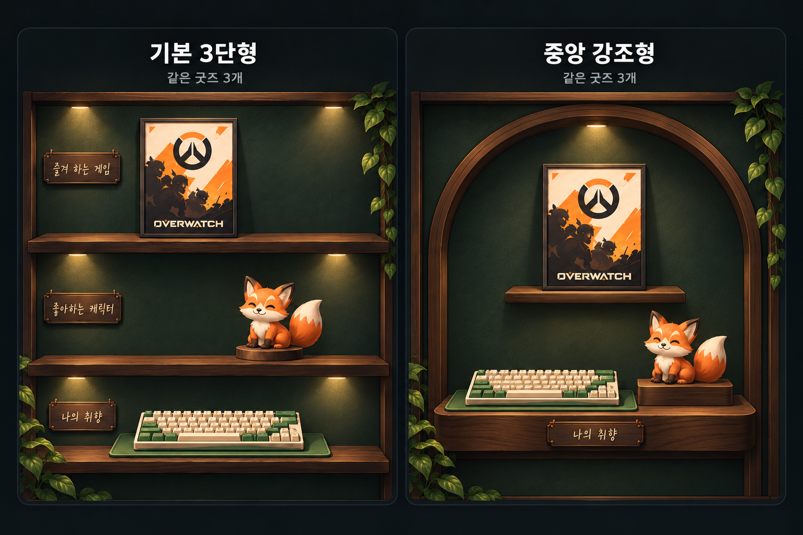
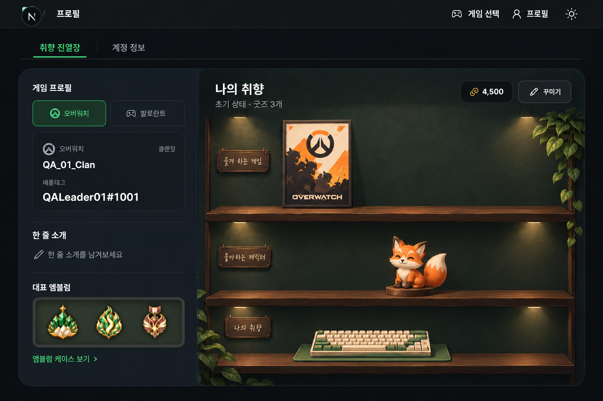
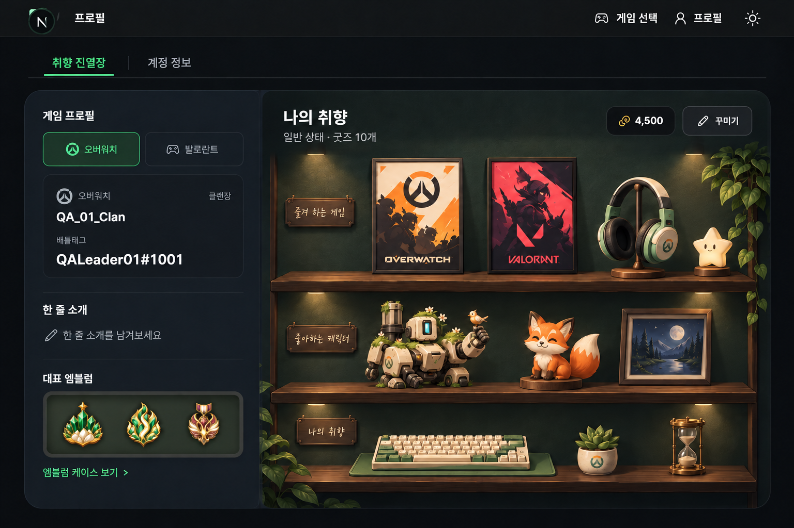
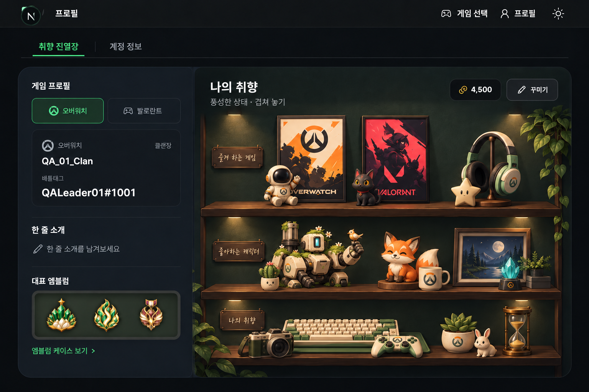

# 프로필 취향 진열장 기획

작성일: 2026-10-24 · 상태: 기본 편집·저장 QA 적용 / 유료 판매·운영 전환 전

## 2026-10-25 호버 보관함·자동 저장 확정

- 화면 제목은 ‘진열장’. 소개 문구와 편집/저장 버튼, 하단 상시 설정 패널을 제거한다.
- 진열장 바로 아래 보관함 손잡이에 마우스를 올리면 내용이 위로 겹쳐 열리고, 벗어나면 즉시 닫힌다. 페이지 높이는 유지한다. 터치는 손잡이 탭으로 연다.
- 보관함에서 굿즈·장식·조명·벽지·선반을 분류/검색하고 보관 중·전시 중으로 필터링한다. 벽지와 보유 선반은 선택 즉시 적용한다.
- 굿즈를 놓거나 보관함에 반환하는 순간 자동 저장한다. 저장 중에도 조작할 수 있으며 순서대로 최신 구성을 저장한다. 실패한 변경은 유지하고 명시적인 재시도로 복구한다.
- 여러 구성 생성·복사·대표 지정·삭제는 보관함의 ‘진열장 관리’로 이동한다. 좌측 소개와 제목/보관함의 배경색을 통일하고 맞닿는 모서리 라운드를 제거한다.
- 이 결정은 아래 수동 저장·상시 편집 패널 설명에 우선한다. [동작·검증](../design/profile-showcase-2026-10-25/hover-inventory.md).

## 2026-10-25 편집·상품 확장 결정

- 이름 입력/표시를 없애고 ‘진열장 1, 2…’로 구분한다. 하단 보관함 드로워에서 마우스·터치로 꺼내기/회수하기를 지원하며 클릭·기존 조절 입력도 유지한다.
- 기본 2종 외에 엇갈림형·계단형을 상점의 선반 모양 상품으로 제공한다. 모양은 한 번 보유하면 여러 구성에서 사용하고, 굿즈는 기존 보유 수량 제한을 지킨다.
- 배경에 고정된 이파리를 제거하고 보유·배치한 이파리와 조명만 표시한다. 선반 미보유 저장은 서버에서 거절한다.
- 상점은 QA 무료 체험 수령을 유지하며 코인 가격/결제는 후속이다. [동작·에셋·실제 캡처·검증](../design/profile-showcase-2026-10-25/drawer-and-shelves.md). 이 결정이 아래 초기 기획의 이름 입력·기본형 2종만 제공한다는 설명보다 우선한다.

## 2026-10-24 구현 반영

- 프로필과 로그인 방문 화면을 취향 진열장으로 전환했다. 무료 2종, 배경 3종, 좌우 이동·선반 선택·9단계 겹침, 굿즈 목록 선택, 명패·이파리·조명을 지원한다.
- **사용자 확정: 굿즈 1개 구매는 보유 1개이며, 전체 진열장에 놓인 수량 합계가 보유 수량을 넘을 수 없다.** 다른 진열장으로 옮기려면 먼저 보관한다. 복사는 여분 수량만 사용하며 기존 전시를 빼앗지 않는다.
- 여러 구성 생성·이름 변경·복사·삭제·대표 지정·공개 전환을 지원한다. QA 기술 제한은 최대 12개 구성, 구성당 60개 배치, 상품별 추가 수량 60개다. 유료 슬롯 정책을 뜻하지 않는다.
- QA 시작용 액자·여우·키보드를 각 1개 제공하고 중앙 강조형에 배치한다. 상점의 9종 체험 상품을 무료로 한 개씩 추가할 수 있다. 정식 초기 지급·가격 정책은 미정이며 유료 결제는 연결하지 않았다.
- 이번 편집은 `꾸미기 → 저장하고 닫기` 방식이다. 탭·소개 수정 중 초안을 보존하며 저장 중 추가 변경을 잠근다. 실패 시 초안을 유지하고 재시도·충돌 시 최신 내용 재조회가 가능하다. 자동 저장은 후속이다.
- 기존 가구·코인·배치는 변경하지 않았다. `/profile/miniroom`에서 기존 보관함과 편집을 이용한다. 기존 상품의 변환·보상은 후속이다.
- 구현·검증 상세: [진행 기록](../TODO_Phase2.md#2026-10-24-취향-진열장-qa). 아래는 원 기획이며 이 반영 항목이 우선한다.

관련: [프로필·꾸미기 명세](pages/14-Profile-Customization.md) · [결정 D-PROFILE-05](decisions.md)

## 1. 목적과 확정 범위

프로필 오른쪽의 3D 미니룸을 **2D 취향 진열장**으로 대체한다. 왼쪽의 게임 프로필·한줄 소개·대표 엠블럼이 플레이어의 정체성과 활동을 보여준다면, 오른쪽은 좋아하는 게임·캐릭터·소품을 모아 개인 취향을 표현하는 공간이다. 업적과 엠블럼을 반복 나열하는 전시판으로 만들지 않는다.

| 구분 | 확정한 방향 |
| --- | --- |
| 기본 제공 | **기본 3단형과 중앙 강조형을 모두 무료 제공**한다. |
| 꾸미기 | 굿즈 배치와 앞뒤 겹치기를 지원한다. |
| 선반 장식 | 이파리·조명·주제 명패 등도 배치하고 상점에서 구매할 수 있게 한다. |
| 상품 확장 | 새로운 굿즈·장식·진열장 종류를 지속적으로 공급할 수 있는 구조를 갖춘다. |
| 여러 진열장 | 서로 다른 구성을 이름 붙여 여러 개 저장하고 전환한다. |
| 품질·비용 | 소수 굿즈로도 완성된 구도, 가벼운 화면 표현, 쉬운 콘텐츠 업데이트를 우선한다. |

이하 내용은 원 기획의 방향과 **설계안**이다. 구현 범위는 위 반영 항목을 기준으로 확인한다. 기존 미니룸 명세의 가구 충돌 제한은 새 진열장의 겹치기 규칙으로 가져오지 않는다.

## 2. 기본 진열장 두 종류

두 종류를 같은 외곽 영역에 표시하고, 사용자가 소장품과 취향에 맞춰 고른다. 물건 수에 따라 템플릿을 자동 교체하지 않는다.

| 항목 | 기본 3단형 | 중앙 강조형 |
| --- | --- | --- |
| 구성 | 가로로 긴 선반 세 줄 | 중앙 배경판과 길이가 짧은 선반·단차 |
| 강점 | 행별 주제를 나누고 여러 물건을 넓게 배치 | 적은 물건을 가까이 모아 대표 소장품을 강조 |
| 적합한 구성 | 게임별·색상별 컬렉션, 약 10개 비교 시안 | 굿즈 3개로 시작하는 구성, 대표작 중심 전시 |
| 확장 방식 | 선반 너비와 앞뒤 겹치기 활용 | 중심 주변의 소품·장식과 앞뒤 겹치기 활용 |
| 기본 제공 | 무료 | 무료 |

기본 배경·선반 그림자·기본 조명 표현만으로도 빈 공간이 의도된 여백처럼 보이게 한다. 시안의 아치, 원목, 짙은 초록 배경은 시각 방향의 예이며 최종 재질과 색상은 별도 확정한다. 기본 외형에 포함된 표현과 구매 가능한 추가 장식을 구분해, 추가 구매 없이도 초기 구도가 완성되게 한다.

향후 4단형·비대칭형·칸막이형 등을 추가할 수 있다. 이는 출시 확정 목록이 아니다. 단순히 물건을 가장 많이 담는 진열장만 유리해지지 않도록 종류별 구도와 분위기에 차이를 둔다. 늘어난 컬렉션은 여러 진열장 저장으로도 수용한다.

### 비교 시안

이미지는 콘셉트 시안이다. 실제 동작 화면·최종 상품 이미지·확정된 편집 UI가 아니다. 비교에 사용한 굿즈 3개는 무료 지급 수량이나 배치 한도를 뜻하지 않는다.

## 3. 굿즈 배치와 겹치기

딱 정해진 칸에 하나씩 넣기보다 **선반 위에서 좌우 위치를 조정하고 앞뒤로 겹쳐 놓는 방식**을 사용한다.

- 액자는 선반 뒤쪽에, 작은 피규어는 그 앞에 둘 수 있다. 큰 물건이 모든 선반 공간을 독점하지 않게 한다.
- 선택한 선반의 바닥선에 굿즈 밑면을 맞추고, 선반 너비 안에서 좌우 이동한다. 임의의 공중 배치는 기본 동작으로 제공하지 않는다.
- 앞쪽·뒤쪽 배치 가이드와 앞으로/뒤로 보내기 조작으로 겹침 순서를 조절한다. 정확한 단계 수는 상세 설계에서 정한다.
- 다른 물건에 가려진 굿즈는 선반별 배치 목록에서 선택·이동·보관할 수 있다.
- 실제 보이는 그림의 크기와 받침 위치를 기준으로 배치한다. 투명 여백 때문에 선반에서 뜨거나 경계를 벗어나 보이지 않게 한다.
- 초기에는 상품별 규격 크기를 사용한다. 작은·중간·큰 상품 규격을 준비하고 자유 확대·축소는 후속 검토로 둔다.
- 보관은 전시에서 빼는 동작이다. 소유권을 삭제하거나 재구매를 요구하지 않는다.

모바일에서도 목록 선택과 위치·앞뒤 조절로 편집할 수 있어야 한다. 드래그만으로 조작을 제한하지 않으며 키보드 선택·이동·취소도 상세 설계에 포함한다. 기존 미니룸의 길게 눌러 집기와 별도 꾸미기 진입 중 어떤 방식으로 연결할지는 아직 확정하지 않았다.

## 4. 선반 자체를 꾸미는 요소

2026-10-25 확정·QA 반영: 조명은 기본 외형에서 분리한 보유/배치 상품이다. 기구와 빛을 함께 이동·보관하며 상단 프레임 또는 선반 아래에 설치한다. 보유 1개당 전체 진열장에서 한 곳만 사용한다. 기존 고정 조명은 제거했으며, 상점은 현재 QA 무료 체험 정책을 따른다([구현·검증](../design/profile-showcase-2026-10-25/lighting.md)).

굿즈와 별도로 장식 상품을 공급한다. 자유로운 배치를 지원하되, 장식 종류마다 자연스럽게 붙는 영역을 정의한다.

| 장식 종류 | 예시 | 배치 영역 설계안 |
| --- | --- | --- |
| 선반 위 소품 | 화분, 책, 받침대, 작은 시계 | 선반 바닥선, 굿즈와 겹치기 가능 |
| 걸치는 장식 | 늘어진 이파리, 리본, 가랜드, 천 | 선반 가장자리·앞면·측면 |
| 조명 | 상단 램프, 선반 아래 간접 조명 | 진열장 상단·선반 밑면의 호환 위치 |
| 주제 명패 | 행의 주제를 적는 나무판·금속판 | 선반 앞면, 가로 위치 조절 |
| 배경 장식 | 포스터, 패턴, 배너 | 진열장 뒤판의 허용 영역 |

명패는 디자인을 구매하고 문구는 사용자가 입력하는 방향이다. 문구 자체를 상품 단위로 판매하지 않는다. 입력 길이·줄 수·공개 문구 관리 기준은 미정이다. 조명은 정적인 빛 이미지와 음영으로 분위기를 만들고, 실시간 광원 계산을 전제로 하지 않는다.

기본 외형과 추가 장식의 겹침 순서는 템플릿에서 정의한다. 예를 들어 뒤판 → 뒤쪽 굿즈 → 앞쪽 굿즈 → 선반 앞면 명패·걸이 장식 순으로 구성하되, 정확한 규칙은 장식별로 정한다. 명패·장식도 가려진 항목 목록에서 다시 선택할 수 있게 한다.

## 5. 여러 진열장 저장

**물건을 보유하는 보관함**과 **물건을 배치한 진열장 구성**을 분리한다. 사용자는 같은 계정에서 서로 다른 주제의 진열장을 저장한다.

설계안의 기본 흐름은 `새 진열장 → 이름·템플릿 선택 → 굿즈·장식 배치 → 저장 → 대표 진열장 지정`이다. 예를 들어 게임별 컬렉션, 초록색 소품 모음, 겨울 테마를 별도로 보관할 수 있다.

- 대표 진열장 하나를 지정하고 방문자에게 먼저 보여준다. 다른 저장 진열장은 탭 또는 화살표로 전환하는 안을 사용한다.
- 이름 변경·구성 복제·대표 변경·삭제 기능을 제공하는 방향으로 설계한다. 삭제 시 구성만 지우고 소유 상품은 유지한다.
- 대표 진열장을 삭제할 때는 대체 대표를 정하도록 한다. 구체적인 최소 보유 구성 수와 삭제 흐름은 상세 설계에서 결정한다.
- 한 번에 선택한 진열장 하나만 표시한다. 여러 진열장을 세로로 모두 펼쳐 프로필 높이와 자원 사용을 늘리지 않는다.
- 무료 저장 개수, 최대 개수, 유료 슬롯 여부는 **미정**이다. 기본 템플릿 2종 무료와 저장 슬롯 수는 별개다.
- 같은 상품도 **전체 진열장 배치 수량을 합산해 보유 수량만큼만** 사용할 수 있다. 한 개를 사서 두 곳에 배치할 수 없으며, 두 개를 보유하면 같은 진열장이나 서로 다른 진열장에 각각 놓을 수 있다.

### 템플릿 변경 설계안

변경 전 결과를 미리 보여주고 확인 또는 취소할 수 있게 한다. 호환되는 굿즈·장식은 새 선반으로 옮기고, 들어가지 않거나 부착 위치가 맞지 않는 항목은 보관함으로 돌려놓는다. 무엇이 이동·보관되는지 알리고, 취소하면 원래 구성을 유지한다. 구성을 복제해 다른 템플릿을 시험하는 흐름도 지원 대상으로 둔다.

### 저장 안정성 설계안

기존 자동 저장의 안전장치를 새 구성에도 적용한다. 진열장별 저장 순서와 버전을 구분하고, 빠른 연속 편집이나 진열장 전환으로 이전 응답이 새 구성을 덮어쓰지 않게 한다. 실패한 변경은 화면에서 보존하고 재시도를 안내한다. 계정·방문 대상이 바뀌면 이전 조회와 저장 응답을 폐기한다. 저장 중 삭제·템플릿 변경과의 충돌도 상세 설계에서 처리한다.

## 6. 상점과 지속적인 상품 공급

계정 공통 개인 상점(`/store`)과 개인 코인 방향을 따른다. 클랜 상점은 기존 공동 아이템 역할을 유지한다. 구매 결과는 보관함에 추가하고, 배치는 사용자가 원하는 진열장에서 별도로 한다.

| 상품군 | 지속 공급 예시 |
| --- | --- |
| 굿즈 | 액자, 작은 피규어, 게임 소품, 키보드, 수집품 |
| 선반 장식 | 식물, 조명 외형, 명패, 가랜드, 받침대 |
| 배경·재질 | 뒤판 패턴, 원목·금속 색상, 테마 배경 |
| 진열장 템플릿 | 비대칭형, 칸막이형 등 새로운 구도 |
| 테마 묶음 | 색상·계절·분위기를 맞춘 굿즈와 장식 세트 |

출시 시점의 상품 목록·가격·세트 할인·한정 판매 방식은 미정이다. 처음부터 모든 상품군을 판매할 필요는 없다. 큰 액자뿐 아니라 앞에 놓을 작은 소품을 함께 공급해야 겹치기가 실제 구매와 꾸미기의 선택지가 된다. 특정 게임·캐릭터를 상품화할 때는 사용 가능한 권리와 이미지 출처를 확인한다.

### 콘텐츠 제작 규격 설계안

기존 상품 유형의 신상품은 이미지와 카탈로그 데이터를 추가하는 것으로 등록할 수 있게 한다. 새로운 부착 방식·조작 방식이 생기는 유형은 별도 기능 개발이 필요하다.

- 상품: 안정적인 ID, 유형, 이름, 크기 규격, 이미지 크기·밑면 기준점, 배치 가능 영역, 겹침 규칙, 색상 변형, 호환 템플릿, 판매 정보.
- 템플릿: ID·버전, 공통 표시 영역, 선반별 바닥선·배치 너비, 장식 부착 위치, 기본 외형 이미지, 겹침 규칙.
- 저장 구성: 진열장 ID·이름·템플릿, 선택한 배경·재질, 배치 항목과 소유 상품 참조, 선반·위치·앞뒤 순서, 명패 문구, 저장 버전.
- 소유 정보: 사용자·상품·보유 수량·획득 출처를 구성 데이터와 분리한다. 상점 구매 검증과 배치 가능 여부는 서버에서도 확인한다.

한정 상품의 판매 종료가 이미 구매한 사용자의 전시를 깨뜨리지 않도록 한다. 상품·템플릿 이미지와 규격 변경 시 기존 저장 배치에 미치는 영향도 버전 관리 대상으로 둔다. 실제 테이블·API·파일 규격은 구현 설계 단계에서 정한다.

## 7. 화면·공개 범위·성능 원칙

- 왼쪽 게임 프로필·한줄 소개·대표 엠블럼을 유지하고 오른쪽 진열장과 색상·밀도를 맞춘다. 진열장 전환 중에도 카드 외곽 크기와 제목·조작 영역을 유지한다.
- 기존 프로필처럼 로그인 방문자는 공개 전시를 보고, 본인만 편집한다. 보관함 전체·구매 내역·계정 정보는 공개 전시에 포함하지 않는다.
- 2D 이미지 합성과 제한적인 전환 효과를 기본으로 한다. 지속적인 3D 렌더링·실시간 물리·실시간 조명은 요구하지 않는다.
- 현재 선택한 진열장의 필요한 이미지를 중심으로 불러온다. 상품 썸네일과 전시용 이미지를 구분하고 화면 크기에 맞춰 제공한다.
- 모바일 축소에서도 배치 비율을 유지한다. 항목 선택과 편집 조작은 작아진 그림의 터치에만 의존하지 않는다.
- 이미지 로딩 실패·빈 보관함·저장 실패에도 영역 높이를 유지한다. 모션 감소 설정을 존중한다.

이는 성능 목표이며 측정 결과가 아니다. 기존 미니룸에도 변경 시 렌더링과 간편 보기 최적화가 있으므로, 실제 대체 효과는 초기 로딩·이미지 전송량·메모리·편집 반응성을 같은 조건에서 비교한다. 굿즈·장식 개수, 이미지 해상도와 용량의 수치 한도는 대표 기기 측정 후 정한다.

## 8. 수집량별 시안과 검토 기준

| 상태 | 관찰과 적용 방향 |
| --- | --- |
| 굿즈 3개 | 3단형은 여백이 커질 수 있다. 중앙 강조형으로 소수 굿즈가 모인 완성된 구도를 제공한다. |
| 약 10개 | 3단형의 행별 주제와 물건 구분이 잘 드러나는 일반 구성 예시다. |
| 풍성한 겹침 | 액자 뒤·작은 피규어 앞 구도로 밀도를 높인다. 가려진 항목 선택과 작은 상품 공급이 필요하다. |

수량은 비교용 예시이며 보관함 한도·전시 한도·초기 지급 정책이 아니다. 시안의 세부 물건 수나 버튼 문구도 기능 명세로 사용하지 않는다.

수집량별 콘셉트 이미지

## 9. 구현 순서와 확인 항목

1. **구도·배치 검증:** 무료 템플릿 2종, 동일 굿즈 3개 비교, 약 10개와 겹침 구성, 모바일 표시를 작은 시제품으로 검증한다.
2. **편집·저장:** 보관함, 앞뒤 조절, 가려진 항목 선택, 장식 부착, 여러 진열장 저장·전환·대표 지정을 연결한다.
3. **상점·전환:** 상품 규격과 등록 흐름, 개인 상점 구매, 기존 미니룸 데이터 전환 정책을 확정하고 QA에 적용한다.

완료 판단에는 다음 시나리오를 포함한다.

- 두 기본 템플릿이 구매 없이 선택되고, 3개만 놓아도 화면 구도가 완성된다.
- 액자 앞 피규어가 자연스럽게 겹치고, 뒤에 가려진 액자를 다시 선택할 수 있다.
- 이파리·조명·명패를 호환 위치에 배치하고 문구·앞뒤 순서를 저장한다.
- 여러 진열장 구성이 독립적으로 유지되고 대표 전시와 방문자 전환이 일치한다.
- 템플릿 변경의 미리 보기·취소·보관 처리에서 상품 소유권이 보존된다.
- 기존 유형의 신상품이 개별 화면 코드 수정 없이 등록되고 구매·배치된다.
- 저장 실패·연속 편집·전환 중 늦은 응답으로 다른 구성이 덮어써지지 않는다.
- 공개 방문 권한과 소유자 편집 권한을 지키며 모바일과 성능 목표를 충족한다.

## 10. 구현 전 남은 결정

| 항목 | 현재 상태 |
| --- | --- |
| 초기 선택 | 첫 진입 기본 템플릿, 초기 지급 굿즈·장식과 수량 미정 |
| 저장 슬롯 | 무료 개수·최대 개수·유료 확장 여부 미정 |
| 상품 재사용 | 확정: 전체 구성에 배치한 수량 합계 ≤ 보유 수량. 1개 구매로 1개만 진열 |
| 한도 | 굿즈·장식 최대 수, 겹침 단계, 명패 길이, 이미지 예산 미정 |
| 편집 진입 | 직접 집기 유지 또는 별도 꾸미기 진입, 모바일 세부 조작 미정 |
| 상점 운영 | 출시 상품·가격·세트·판매 일정 미정 |
| 기존 미니룸 전환 | 가구·재질·저장 배치·구매 기록의 이전, 호환·보상 정책 미정. 삭제·초기화·환불 결정 없음 |

QA 데이터를 보존하고 운영 DB·배포 보류를 유지한다. 기존 미니룸 데이터를 변경하는 작업은 전환 정책과 검증 범위를 정한 뒤 진행한다.
