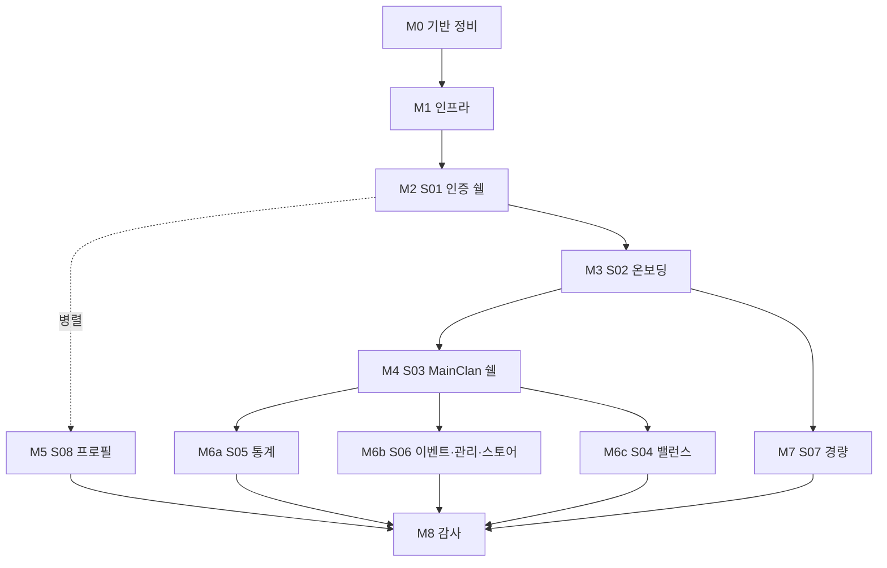

# Phase 2 — Next.js `src/` · Supabase · RLS

> **허브**: [TODO.md](./TODO.md) · **Phase 1(종료)**: [TODO_Phase1.md](./TODO_Phase1.md) · **세션 로그**: [TODO_LOG.md](./TODO_LOG.md)  
> **기획 기준**: [pages.md](./01-plan/pages.md) (라우트 요구) · [schema.md](./01-plan/schema.md) (DB 설계) · [FEATURE_INDEX.md](./01-plan/FEATURE_INDEX.md) (슬라이스)
> **실제 구현**: `src/` · `supabase/migrations/`와 대조한다. 아래 `live`는 구현 표기이며 원격 배포·품질 게이트 통과를 보증하지 않는다. 시연은 [QA_시나리오.md](./QA_시나리오.md) 참조.

| 항목 | 값 |
|------|-----|
| **단계** | Phase 2 — 기능 구현 후 품질 점검, M8 미완료 |
| **마지막 갱신** | 2026-10-16 — 예약 내전 자동 생성·참석 투표 |

## 2026-10-16 디자인 불일치 6항목

일정 등록·편집을 고정 헤더/하단 작업과 본문 스크롤의 우측 패널로 통일했다. 날짜 입력·캘린더 날짜 구분·상세 표시는 한국 시간이며 UTC 저장과 매주/매월 반복 규칙을 유지한다. 일정·통계 토글 정렬, 구독 카드, 로비 생성 버튼과 부가 정보 크기·모바일 행 배치도 정리했다. [점검 보드와 검증 범위](03-analysis/alpha-review-2026-10-16/README.md)에 D1–D6을 완료로 갱신했다.

## 2026-10-16 알파 성능·운영 점검

로비는 기존 publication·RLS 아래 방/예약/참석 변경을 구독하고 120ms로 합친다. 전체 조회는 30초 보완, 숨김·오프라인 중단과 복귀 재조회로 정리했다. 경기 설정/안내는 지연 로딩, 클랜 표시 점은 LIMIT 1을 사용한다. QA 프로덕션 빌드·집중 E2E 5건과 타입/린트를 확인했다. 측정 방법·반례·디자인 제안과 화면 링크·OCR 및 1개 클랜/100명 알파 손익은 [별도 보고서](03-analysis/alpha-review-2026-10-16/README.md)에 둔다. 운영 DB·배포·상시 워커 연결은 실행하지 않았다.

## 2026-10-16 예약 내전 자동 생성

- `내전 자동 종료`로 표기를 바꾸고 `예약된 내전 자동 생성` 토글과 들여쓴 분 입력을 추가했다. 기본 On·10분 전이며 1~1,440분을 자동 저장한다. Off는 예약 시각이 지나도 자동으로 열지 않으며 수동 열기는 유지한다([기준](02-design/session-lobby.md#3-예약반복참여-응답)).
- 후속 UI는 두 카드 아래 저장 상태 하나를 공유한다. 한 설정의 실패나 진행 중 저장을 다른 설정의 완료로 덮지 않으며 재시도는 실패 항목만 처리한다. Off의 빈 하단 여백과 도움말 기본값 문장을 제거하고 공통 카드·제목·들여쓰기와 맞췄다. 신규 클랜의 두 토글은 DB 기본 On을 사용하며 기존 클랜의 선택은 유지한다. 집중 E2E 3건·린트·타입과 320/390px를 확인했다.
- QA에 `20261016010956_balance_room_automatic_open.sql` 적용·타입 동기화. 기존 분 단위 워커는 클랜별 사용 여부·선행 시간을 반영하며, 검증 호출은 임시 클랜만 처리한다. 권한·범위·동시 워커·중복 방/경기 방지·참석 투표 마감, 저장·오류·Off/On 선택 복원과 320/390px를 확인했다. 관련 E2E 11건·방 DB 9건·린트/타입·빌드 통과. 보안 진단은 기존 28건으로 새 경고가 없다. 운영 DB/배포 보류.

## 2026-10-16 내전 생성·참석 투표 예약

- 생성 창을 공통 설정 카드·제목 툴팁·하단 고정 버튼·모바일 전체 너비로 정리했다. 날짜 휠은 분 단위이며 초·조작 안내·요약 문장을 제거했다. 깜짝 예약의 참석 투표 자동 개설은 날짜·시각으로 지정하고 이벤트의 공개 참석/불참 투표와 로비 참여 현황을 함께 갱신한다([기준](02-design/session-lobby.md#3-예약반복참여-응답)).
- QA에 `20261016010532_balance_room_attendance_polls.sql`을 적용하고 타입을 동기화했다. 개설 전/마감 후 차단·방 권한·동시 선택·토글 복원·예약 변경/취소·조기 개장·출전 명단 분리를 확인했다. 기존 일수 기반 QA 예약은 보존하며 신규 투표만 방과 연결한다.
- 관련 E2E 11건(예약 자동 생성 포함)과 기존 방 DB 9건, 린트·타입·프로덕션 빌드 통과. 화면 검증은 프로덕션 서버와 후속 Webpack 서버에서 수행하고 320/390/1304px 배치를 확인했다. 보안 advisor는 기존 28건이며 새 경고는 없다. 공유 QA 시드·운영 DB·배포는 수행하지 않았다.

## 2026-10-16 Discord 내전 알림 구분

- 내전 카드의 구분 줄에 정규/깜짝 내전을 표시한다. 발송 직전 현재 방 정보를 조회해 열린 방은 시작·진행 중, 예약은 시작 예정 시각과 실제 남은 분으로 안내한다. 갤러리·설정 설명도 같은 기준으로 정리했다([기준](guides/discord-bot-setup.md#종류별-발송)).
- 격리 QA의 두 종류×예약/즉시 방 모의 발송, 기존 라우팅·설정/모바일 갤러리 3건과 카드·시간·링크/길이 단위 검사 4건, 린트·타입 검사를 통과했다. 오래된 공지 링크 기대값은 현재 상세 경로로 갱신했다. 실제 외부 발송·전체 빌드·운영 배포는 수행하지 않았으며 기존 QA 명단·DB 스키마를 보존했다.

## 2026-10-16 깜짝 내전 설정·미리보기

- 깜짝 내전에서는 선수 카드 점수·팀 비교·예측 승률·관전자 승부예측 설정을 숨긴다. 예시 카드와 상세 정보에서도 점수를 제외하고, 편성·경기 안내와 종료 설명을 실제 동작에 맞췄다. 세션 전적·맵 투표·영웅 밴·전략 아이템은 유지한다([기준](02-design/formation-modes.md#실제-페이지-적용-범위-2026-09-16)).
- 멤버 호스트·클랜장 양쪽의 실제 점수 응답 차단·미리보기·툴팁·설정 저장·경기 안내와 320/390px 배치를 격리 UI 회귀로 확인했다. 정규 내전 미리보기 2건·깜짝 내전 전략 아이템 1건을 포함해 4건, 린트·타입 검사·프로덕션 빌드 통과. 기존 QA 명단·스키마·운영 배포는 변경하지 않았다.

## 2026-10-16 Discord 알림 하위 설정 표시

- 전체 사용 토글을 `Discord 알림 사용` 제목 오른쪽으로 옮겼다. 켠 경우에만 기본 채널과 종류별 알림을 들여쓰기·연결선·배경으로 묶어 표시하며, 끌 때 선택값을 보존한다([설정](guides/discord-bot-setup.md#공용-앱과-연결)).
- 변경 파일 린트·타입 검사와 격리 UI 회귀 1건을 통과했다. Off 저장/재진입·On 복원·채널/종류별 선택 보존·운영진 읽기/멤버 접근 차단·390px 배치와 갤러리를 검증하고 실제 QA 화면을 확인했다. UI 검증은 별도 Webpack 서버에서 수행했으며 기존 QA 설정·DB 스키마·운영 배포는 변경하지 않았다.

## 2026-10-16 클랜 구성원 최근 활동 갱신

- 클랜 방문 RPC가 방문일만 기록하고 `last_activity_at`을 갱신하지 않아 가입일 기준으로 비활성 처리되던 누락을 수정했다. 현재 열람자는 첫 화면부터 활성으로 표시하고 기존 방문 기록으로 활동 시각을 보완한다. 과거 일자의 입력 시각은 해당 KST 일자 말일로 제한하며 탈퇴·강퇴자는 갱신하지 않는다.
- QA 마이그레이션·공개 타입 동일 확인, 린트·타입·빌드, 격리 활동/계정 분리 회귀 4건과 탈퇴·재가입 DB 6건을 통과했다. 본인만 갱신·익명/타 클랜/탈퇴/강퇴 차단·5분 간격·당일 중복 방지와 실제 QA 새벽별 활성 표시를 확인했다. 기존 QA 명단 보존·운영 DB/배포 보류.

## 2026-10-16 클랜 탈퇴·재가입과 이전 구성원

- 프로필의 내 클랜에서 자진 탈퇴하며 구성원 관리를 현재/이전으로 분리한다. 이전 구성원도 개인 기록 링크를 유지하고 최근 탈퇴·강퇴일과 재가입 차단/허용을 표시한다. 같은 계정의 신청은 기록 선택 없이 기존 참가자·멤버십을 재사용하여 승인하고 일반 멤버로 복귀한다([정책](02-design/clan-participants.md#탈퇴강퇴와-같은-계정의-재가입-2026-10-16)).
- 강퇴 시 대기 신청을 취소하고 DB에서도 재신청·승인을 차단한다. 운영진의 재가입 허용은 차단만 해제하며 본인 신청과 승인이 필요하다. 클랜장 탈퇴, 진행 중 출전자와 예정/진행 깜짝 내전 호스트의 탈퇴·강퇴는 정리 전 차단한다. 기존 권한·정원·게임 인증·게임별 소속 제약을 유지한다.
- QA에 `20261015170527_clan_membership_returning_members.sql` 적용 후 공개 타입을 동기화했다. 기존 QA 행·탈퇴일을 일괄 갱신하거나 시드하지 않았다. 별도 임시 계정·클랜에서 DB 6건과 기존 권한/승인 DB 9건, 집중 UI 1건과 기존 기록 연결/온보딩 3건을 통과했다. 원본 기록·점수·코인 보존, 같은 계정의 이름 변경 후 복귀, 중복 승인, 직접 API 차단, 운영진 역할 미복원, 차단 해제 후 재신청·승인과 390px 화면을 확인했다.
- 변경 소스 ESLint·타입 검사·Webpack 프로덕션 빌드 통과. QA DB 보안 advisor 경고는 기존 28건이며 새 소속 변경 함수의 지적은 없었다. 임시 검증 데이터는 정리했다. 전체 회귀·운영 DB·배포는 미실행이다.

## 2026-10-16 내전별 전략 아이템 구성

- 주장 선택을 2열로 배치하고 전략 아이템을 켜면 좌측 구성 화면을 연다. 모바일에서는 설정 패널 안에 배치한다. 클랜 공통 카탈로그 편집은 클랜 관리에서 정규 내전의 경기 설정으로 옮겼다.
- 깜짝 내전 호스트는 기본 아이템을 선택해서 쓰고 해당 방 전용 아이템을 추가·수정·삭제한다. 기본 내용·가격은 읽기 전용이다. 전용 구성은 설정 적용 시 저장하고 같은 방의 다음 경기로 이어진다. 다른 방과 분리하고 편성 시작 뒤에는 잠근다([기준](02-design/formation-modes.md#실제-페이지-적용-범위-2026-09-16)).
- QA에 `20261015163412_balance_round_auction_catalog.sql`을 적용하고 타입이 기존 공개 타입과 동일함을 확인했다. 기존 QA 행을 갱신하거나 시드하지 않았다. DB는 malformed/중복/가격/개수/기본 ID 충돌·정규 전용 항목 위조·비호스트/외부/탈퇴 계정·stale revision·시작 후 잠금·다음 경기 상속을 검증했다.
- 변경 소스 ESLint·타입 검사·Webpack 프로덕션 빌드, 집중 편성 로직/UI 32건과 관련 DB 11건 통과. 실제 편성 시작에서 선택한 기본/전용 아이템과 가격이 반영되고 제외 항목은 추첨되지 않는 것을 확인했다. 기존 미리보기 회귀의 누락된 팀 조정 단계를 기대값에 반영했다. QA 브라우저와 390/1244px 배치도 확인했다. DB advisor의 아이템 관련 신규 지적은 없었다. 전체 회귀·운영 DB·배포는 미실행이다.

## 2026-10-16 경기 설정 도움말·좌측 미리보기

- 경매 아이템 목록의 사용 상태를 공통 디자인의 토글로 바꾸고 하단 안내 문구를 제거했다. 저장·실패·중복 입력 차단은 기존 액션 흐름을 유지한다.
- 경기 설정의 편성·화면 표시·밴픽 미리보기는 840px부터 좌측 공간을 사용하고 더 작은 화면에서는 패널 안에 배치한다. 정적인 옵션·미리보기 설명을 제목의 우측 우선·충돌 회피 툴팁으로 옮겼다. 키보드로 포커스한 도움말에서 Escape를 누르면 설정창·초안을 유지하고 도움말만 닫는다. 잠금·동시 수정·투표 초기화 경고는 유지한다([기준](02-design/formation-modes.md#실제-페이지-적용-범위-2026-09-16)).
- 선수 카드와 상세 정보의 마이크 표시를 제거했다. 기록·승률·점수와 원본 데이터는 유지한다. 기존 실제 내전 회귀의 기대 문구도 변경했다.
- 변경 소스 ESLint·타입 검사와 격리 UI 회귀 2건(경매 토글 저장·새로고침, 설정 초안/저장·툴팁·Escape·마이크 미표시·840/1054/1244px 좌측 배치·320/390px 모바일)을 통과했다. 실제 QA 브라우저에서도 확인했다. 테스트는 별도 Webpack 서버에서 실행했고 시드·기존 QA 데이터 변경·DB 스키마 적용·전체 회귀·빌드·배포는 하지 않았다.

## 2026-10-16 구성원 작업 아이콘과 미가입 명부 정리

- 구성원 행의 기록 연결·승격·강등·강퇴와 참가자 추가·닉네임 수정을 아이콘으로 통일했다. 접근성 이름·마우스 설명·기존 확인과 권한 처리는 유지한다. 연결된 기록은 미가입 목록에서 제외하고 구성원 쪽에서 관리하며 해제하면 목록에 복귀한다. 명부에서 불필요해진 연결 계정 정보 조회도 제거했다([정책](02-design/clan-participants.md#구현-경로)).
- 변경 소스 ESLint·타입 검사와 격리 승인/연결/해제 회귀 1건을 통과했다. 아이콘의 접근성 이름·편집 창 진입, 연결 후 검색 제외·해제 후 복귀·재연결 후 제외와 390px 화면을 확인했다. 실제 QA 브라우저에서도 아이콘과 기존 연결 관리 진입을 확인했다. 검증은 기존 Turbopack 작업자 오류를 피한 별도 Webpack 서버에서 실행했고 기존 QA 명단·운영 DB·배포는 변경하지 않았다.

## 2026-10-16 클랜 관리 메뉴 재배치

- 구성원 관리의 항목을 구성원 → 가입 요청으로 정렬하고 분류 첫 진입도 구성원으로 연결한다. 운영 통계는 클랜 운영의 클랜 꾸미기 다음으로 옮긴다. 기존 `?tab=` 주소와 서버 권한 검사는 유지한다([배치](01-plan/pages/12-Clan-Manage.md#사용자-흐름)).
- 변경 소스 ESLint·타입 검사와 격리 관리 회귀 1건(메뉴 순서·분류·뒤로 가기·새로고침·모바일·운영진/멤버 권한)을 통과했다. 실제 QA 브라우저에서도 확인했다. 테스트 서버의 Turbopack CSS 작업자 오류로 해당 실행만 Webpack을 사용했고, 닫히는 툴팁을 제외하도록 테스트 선택자를 보정했다. 기존 QA 명단·운영 DB·배포는 변경하지 않았다.

## 2026-10-15 가입 승인 선택과 플레이어 기본 정보

- 후속 UI 조정: ‘이전 기록 연결’을 누르면 선택지 두 개를 숨기고 검색·기록 목록만 표시한다. 검색에 포커스를 두고 ‘취소’ 대신 ‘이전’으로 선택 단계에 돌아가며 검색·선택·오류를 초기화한다. 집중 가입 승인/연결/해제 E2E 1건, 변경 소스 ESLint·타입 검사와 실제 브라우저의 단계 이동을 확인했다.
- 가입 승인 창에서 먼저 ‘이전 기록 연결 / 연결 없이 가입’을 명시적으로 선택한다. 선택 전에는 승인할 수 없고 검색·후보 목록은 숨긴다. 비슷한 이전 이름이 있으면 연결 선택지에 추천 배지를 표시한다. 연결은 기록을 지정해야 승인할 수 있고, 연결 없이 가입은 즉시 승인 가능하다. 방식 변경은 검색·선택을 초기화하며 기존 승인·연결 트랜잭션은 유지한다.
- 개인 기록 배너는 해당 게임의 전체 배틀태그를 우선 표시하고 성별·출생연도를 함께 표시한다. 신청 카드·승인 창에도 같은 기본 정보를 제공한다. 성별 비공개는 그대로 유지하고, 태그가 없는 기존 계정은 기존 이름과 미등록 상태를 표시한다. 미가입자의 기본 정보는 추정하지 않는다.
- 전체·초기·상세 통계 조회는 기존 개인 기록 열람 권한으로 허용된 대상 ID만 서버에서 조회한다. 이메일을 조회·전달하지 않으며 다른 클랜·권한 미달 대상의 정보는 반환하지 않는다. DB 스키마·기존 QA 명단·기록·코인은 변경하지 않았다.
- 최종 빌드와 격리 E2E 6건(관리 2·가입 승인/연결/해제/동시성 2·통계 필터 1·게임별 태그/기본 정보/권한 1), 변경 소스 ESLint·타입 검사 통과. 실제 브라우저에서 두 선택지와 승인 활성화 조건·시연 계정 배너를 확인했다. 기간 키보드 회귀는 앞선 휠/호버의 간섭을 제거하고 팝업·첫 옵션 포커스를 기다리도록 보정했다. 시드·운영 DB 적용·수동 배포·전체 회귀는 실행하지 않았다.

## 2026-10-15 배틀태그 이름과 가입 승인 디자인

- 신규 가입의 닉네임 입력·검증·메타데이터를 제거했다. 연동 전에는 이메일 앞부분 대신 `새 회원`을 사용하고 오버워치 연결 후 전체 배틀태그의 이름을 동기화한다. 표시 이름 중복은 허용하고 전체 태그는 게임별 대소문자 무시 중복을 차단한다. 태그와 불변 제공자 ID를 분리하며 재연동·이름 변경은 ID·경기·코인을 유지한다. [정책](02-design/clan-participants.md#배틀태그-이름과-계정-구분-2026-10-15).
- 가입 승인 창은 배틀태그 이름·#번호, 이전 기록 검색·선택, 연결 결과와 승인 순서로 정리했다. 연결하지 않을 때는 ‘가입 승인’, 선택하면 ‘연결 후 가입 승인’으로 구분한다. 해제 화면은 분리되는 기록과 유지되는 가입 후 기록·코인을 안내한다. 구성원의 전체 태그 표시·검색과 연결된 기록의 계정 정보도 통일했다.
- 가입 오류의 입력값을 유지하고 이메일 확인이 필요한 경우 안내 화면을 제공한다. QA에는 별도 SMTP가 없어 실제 확인 메일 수신은 미검증이다. 새 Auth 계정은 관리자 API로 테스트 범위 안에서만 생성하며 전역 이메일 확인 정책·기존 QA 계정은 변경하지 않는다. 실제 Battle.net OAuth와 운영 적용은 후속이다.
- 검증: 최종 빌드와 가입 폼 오류/입력 유지·새 프로필 이름·동명 태그·대소문자 중복 거부·재연동 ID 유지·로그인/잠금 회귀 6건 통과. 승인/연결/해제·원자성/권한 회귀 2건, 기존 참가자 3건·클랜 관리 2건·격리 온보딩 1건도 통과했다. 관련 DB 권한/정산 회귀 9건, ESLint·타입 검사 통과. QA 보안 진단 28건은 기존 경고이며 새 이름 동기화 관련 지적은 없다. 390px 기록 관리와 실제 브라우저 승인/가입 화면을 확인했다.

## 2026-10-15 가입 승인과 기존 기록 연결 통합

- 미가입 참가자 추가·수정은 닉네임만 입력한다. 닉네임 중복을 허용하고 기존 별칭·원본 기록은 보존한다. 별도 별칭·연결 링크 발급·요청 처리 화면은 가입 승인과 구성원 화면으로 통합했다.
- 가입 승인 창은 신청자의 닉네임·등록된 배틀태그로 후보를 추천하며 자동 선택하지 않는다. 이전 닉네임 검색, 경기 수·최근 참가일·최근 3경기 날짜/맵으로 기록을 확인한다. 기록 연결과 가입 승인은 같은 트랜잭션이며, 후보가 이미 처리되었거나 연결이 실패하면 가입도 되돌린다. 새 참가자로 승인하면 기존 미가입 기록은 그대로 둔다.
- 구성원의 이전 기록 관리에서 가입 후 연결·해제를 지원한다. 해제는 원본 귀속을 복원하고 가입 상태·가입 후 경기·코인을 유지한다. 사유 입력은 강제하지 않되 처리자·시각·처리 내용을 감사 이력에 남긴다. 이전 초대 링크 API와 이력은 호환 보존한다([설계](02-design/clan-participants.md)).
- QA에 `db:test:push` → `db:test:types` 적용·타입 동기화. 최종 프로덕션 빌드와 격리 E2E **8건**(추천/검색·연결/해제/재연결, 중복/동시 승인·실패 시 가입 롤백, 기존 연결/원본/평가 점수, 내전 전체 흐름, 관리 권한, 통계 정합성), DB 가입·권한 회귀 **9개 검사**, 변경 소스 ESLint·타입 검사 통과. 모바일 넘침과 신청일 시간대의 hydration 오류도 확인·보정했다. QA 보안 진단 28건 중 새 참가자 함수 관련 지적은 없다. 모든 쓰기 검증은 별도 임시 클랜/계정으로 수행하고 정리했으며 시드·기존 QA 명단 변경·운영 DB 적용·수동 배포·전체 회귀는 실행하지 않았다.

## 2026-10-15 미가입 참가자와 계정 연결

- QA에 클랜별 참가자 명부·별칭·본인 연결 신청·운영진 승인/거절/취소와 처리 이력을 적용했다. 기존 회원 ID는 유지하고 미가입자만 별도 참가자 UUID를 발급한다. 명부/내전에서 같은 참가자를 반복 선택하며 이메일·가짜 로그인 계정은 만들지 않는다. 동명이인은 별칭으로 구분하고 신청자 계정 구분 코드를 본인과 운영진에게 동일하게 표시한다.
- 운영진이 발급한 30일 링크에서 로그인한 본인이 신청한다. 클랜 가입은 신청 조건이 아니며 계정 연결은 가입·역할·게임 인증·코인 권한을 부여하지 않는다. 새 링크는 이전 링크를 무효화하고 승인 시 폐기한다. 같은 경기의 두 출전을 한 계정으로 합치는 연결과 진행 중 내전의 신원 변경은 거부한다. [정책·사용 경로](02-design/clan-participants.md).
- 원본 라운드/경기·점수와 경제 기록을 변경하지 않고 통계 조회 모델을 승인/취소 트랜잭션에서 갱신한다. 연결 상태에서 경기 내용을 정정한 뒤 취소해도 미가입 기록의 귀속을 복원한다. 과거 내전 통계·분석 관측·최근 평가 점수/참여순도 연결 계정을 따른다. 연결된 참가자의 자기 경기 승부예측은 차단한다.
- 최종 프로덕션 빌드와 격리 E2E **5건**(새 시나리오 3건·기존 내전 전체 흐름·통계 조회 모델) 통과. 별도 구성원/기록 정정/명단 회귀 3건, 세션·코인 풀 DB 회귀와 편성 DB 9개 검사, 변경 소스 ESLint·타입 검사도 통과했다. 모바일 명부를 실제 렌더로 확인했다. QA 보안 진단에서 새 참가자 관련 지적은 없었다.
- `db:test:push` → `db:test:types`로 QA만 적용·타입 동기화했다. 테스트는 `E2E_SKIP_SEED=1`과 실행마다 임시 클랜/사용자를 사용하고 정리했다. 기존 QA 명단·경기·코인을 초기화하지 않았다. 전체 회귀와 운영 DB·배포는 수행하지 않았다.

## 2026-10-15 구성원 인증 표시와 개인 기록 연결

- 구성원 목록은 이메일을 조회·전달·검색·표시하지 않는다. 해당 클랜 게임의 인증 여부를 표시하고 닉네임은 `stats?player=` 개인 기록으로 연결한다. 직접 링크는 기존 개인 기록 열람 범위에서만 대상을 선택하며 잘못된 대상은 허용된 목록으로 돌아간다. 구성원별 통계 자동 프리페치는 끈다.
- 변경 소스 ESLint·타입 검사와 격리 구성원/통계 회귀 2건 통과. 인증 완료·미인증·프로필 없음·다른 게임만 인증, 이메일의 HTML/화면/검색 제외, 새로고침·개인 기록 직접 이동·권한 제한·모바일을 확인했다. 통계 부문/기간의 좌측 정렬과 320px 넘침도 보정·검증했다. 전체 빌드·전체 회귀는 실행하지 않았다.

## 2026-10-15 연도·월 팝업 선택기 통일

- 후속 모바일 정리: 기간 종류도 작은 팝업 선택기로 표시해 연도·월·설정과 한 줄에 묶고, 개인 기록의 멤버 선택은 아이콘으로 줄였다. 변경 소스 ESLint·타입 검사와 격리 통계 회귀 1건으로 320/390px 정렬·가로 경계·HoF 두 줄/100px 이하·설정 열기·모바일 기간 전환/초점 복귀와 기존 통계 갱신을 확인했다.
- 통계의 세로 휠을 공통 `PeriodSelect`의 스크롤 목록 팝업으로 교체했다. 선택값만 표시하고 기간 세그먼트와 높이·정렬을 맞췄다. 명예의 전당의 부문/기간 배치를 나누고, 내전 통계·개인 기록·경기 기록 달력·관리의 클랜 페이지 연월/비교 연도에도 같은 디자인을 적용했다.
- 변경 소스 ESLint·타입 검사와 격리 통계/관리 E2E 2건 통과. 스크롤 중 값 유지·키보드/선택 취소·초점 복귀·중첩 달력·월별 일수/윤년·방문자 이름/권한·카드 유지·390px 터치/화면 경계를 확인했다. 최종 모바일 줄바꿈 수정 후 통계 회귀도 다시 통과했다. 별도 권한 회귀 파일은 선택자만 갱신했으며 전체 빌드·전체 E2E는 실행하지 않았다.

## 2026-10-15 클랜 페이지의 월 필터

- `사이트 이용 통계` 제목을 `클랜 페이지`로 바꾸고 최근 7/30일을 연월 입력으로 교체했다. 선택한 월의 1일~말일과 전월을 비교하며, 월 변경은 하단 비교 연도에도 반영한다. 카드·컨트롤과 날짜별/월별 방문자 툴팁은 유지한다.
- 변경 소스 ESLint·타입 검사와 격리 관리 E2E 1건 통과. 윤년 2월 29일·1월의 전년 12월 비교·월별 일수·빈 입력 유지·월/연도 연동·카드 높이/노드 유지·모바일/권한을 확인했다. 별도 권한 회귀의 제목 선택자도 현재 문구로 갱신했으며 해당 전체 파일은 재실행하지 않았다.

## 2026-10-15 방문 막대의 멤버 툴팁

- 사이트 이용의 날짜별·월별 막대에서 날짜/연월·방문 인원·멤버 이름을 같은 툴팁으로 확인한다. 월별 멤버는 반복 방문을 제외하고 한 번씩 표시한다. 하단 선택 문구는 제거하고 기존 동료 이름 조회와 운영진 전용 경계를 유지한다. 기록 없음·현재 이름을 조회할 수 없는 방문자도 구분한다.
- 변경 소스 ESLint·타입 검사와 격리 관리 E2E 1건 통과. 실제 이름·월별 중복 제외·연도 전환·빈 날짜/월·popup hover 유지·키보드/Escape·390px 터치/화면 경계, 기간/표 전환·카드 유지와 기존 관리 권한을 확인했다. 사용자 QA 데이터는 변경하지 않았다.

## 2026-10-15 Discord 설정 통합·통계 회귀 갱신

- Discord 전체 사용·기본 채널과 종류별 알림을 한 카드로 통합했다. 활용 예시는 연결 카드 상단의 버튼에서 여는 팝업으로 옮겼다. 기존 갤러리와 화면 확대를 재사용하며 모바일에서 확대/예시 순서대로 닫기와 초점 복귀를 검증했다.
- `stats-session-settings.spec.ts`를 현재의 개인 기록/명예의 전당 설정 시트·역할 선택으로 갱신했다. 두 영역을 각각 저장한 뒤 개인 공개 역할·순위·등재 기준과 기존 필드 보존, 미리보기·모바일을 확인했다.
- 변경 소스 ESLint·타입 검사와 격리 E2E 3건(통계 회귀, Discord 설정/권한/팝업, 자동 저장 실패·연속 변경·이동) 통과. 사용자 QA 명단·설정은 변경하지 않았다.

## 2026-10-15 제목 가이드 툴팁 정리

- 공통 가이드의 i 아이콘을 제거하고 제목 자체를 hover·키보드 초점·터치 트리거로 사용한다. 통계 제목과 등재 기준의 중복 제목도 합쳤다. 오른쪽 우선·충돌 시 반전/아래 배치·화면 안쪽 정렬은 Base UI 위치 계산을 사용한다.
- 변경 소스 ESLint·타입 검사와 현재 통계 설정을 포함한 격리 E2E 1건 통과. 제목/탭·초점/Escape/터치·오른쪽 배치·긴 설명의 가로 경계를 확인했다. 실제 390px 화면에서는 긴 설명이 아래로 이동해 화면 안에 표시되는 것을 확인했다.
- 기존 `stats-session-settings.spec.ts`의 옛 `설정` 버튼/`통계 공개 설정` 선택자 불일치는 후속 갱신으로 해결했다. 현재 분리된 설정 흐름에 맞춘 회귀가 통과했다([검증](#2026-10-15-discord-설정-통합통계-회귀-갱신)).

## 2026-10-15 투표·관리 화면 정리

- 투표는 활성/예정/종료 Rubber Segment, 압축 카드, 단일/다중 선택 문구와 도넛 결과로 정리했다. 공개 참여자는 hover·키보드·터치로 확인하고 익명 이름/타인 ID는 서버 응답에서 제외한다. 결과 창의 초기 초점은 제목으로 두어 도움말이 Escape를 가로채지 않는다.
- `starts_at`과 시작 전 DB/액션 차단·시작 알림 예약을 QA에 적용했다. 즉시 시작은 DB 시각을 사용하며 생성 후 해당 상태로 이동한다. 투표 생성/변경의 중복 클라이언트 refresh는 제거했다.
- 게시판은 가로 공간 탐색, 관리는 가로 3분류/8하위 항목으로 전환했다. 직접 링크·뒤로가기·대기 수·역할별 접근을 유지하고, 모바일 탭의 숨김 안내 요소가 가로 넘침을 만들지 않도록 영역을 제한했다. 선택한 경계선 스타일을 공통 가로 line 탭과 경로 링크에 적용했다. Rubber Segment·기본 채움 탭은 유지한다.
- 관리 상단의 클랜/역할/플랜 행과 반복되는 영역 제목 행을 제거했다. 해당 설명은 하위 탭 링크의 hover·키보드 초점·터치 툴팁으로 옮기고 내용 영역의 접근 가능한 이름은 유지했다. 후속 검증은 격리 E2E 2건으로 설명/이동/뒤로가기·관리 권한·모바일 넘침과 게시판/이벤트/통계/상점/프로필 전환, 변경 소스 ESLint·타입 검사로 확인했다.
- 보충 설명은 제목 도움말로 제공한다. Discord와 세션 자동 종료는 직렬 자동 저장·오류 재시도·후속 변경 보존·이동 중 저장을 제공한다. 새 클랜은 기본 경매 아이템 3개를 받으며 기존 목록을 덮어쓰지 않는다.
- 검증: 범위별 격리 E2E 15시나리오(게시판 2, 관리 2, 투표 4, Discord 5, 자동 저장 1, 경매 1), 경매/자동 종료 DB 2건, 변경 소스 ESLint·타입 검사·QA 환경 Next 빌드 통과. 추가 갤러리 촬영 1건은 옵션이므로 생략했다. 알림 시각 검증은 PC/QA DB 시계 차이를 고려해 확정된 과거 시각과 조건 대기를 사용한다.
- QA Supabase 보안 진단은 기존 인증 투표 RPC의 SECURITY DEFINER 실행 경고 1건을 확인했다. 현재 로그인·활성 소속·시작/마감·선택지 검증과 행 잠금을 유지하며 새 기본 아이템 트리거는 비공개 스키마에 두고 직접 실행 권한을 회수했다. 운영 DB·배포와 전체 회귀는 범위 밖이며 사용자 QA 명단은 재시드하지 않았다.

## 2026-10-15 배지 케이스 분류·N 표시 정리

- 전체·기념·동료(멤버/장기 동료)·내전(정규/깜짝)·활동(코칭/게시판)을 기존 Rubber Segment로 표시한다. 상단 선택 정보·새 획득 배너·핀 선택 밑줄은 제거했다. 창단·첫 정규도 상세 창을 열며 대표 지정/해제는 상세로 모았다.
- 새 획득은 전체/해당 분류의 N으로 표시하고 상세의 핀·연관 계열 확인만 반영한다. 부분 확인은 사용자/클랜/획득 시각별 브라우저 저장, 전체 확인은 기존 서버 기록을 화면의 마지막 획득 시각까지 전진시킨다. 늦게 들어온 새 획득은 보존하며 저장 실패 후 다시 상세를 열면 재시도한다. 스키마·발급/회수 기준은 유지했다([규칙](01-plan/clan-badge-expansion-v1.md#2026-10-15-케이스-분류와-새-배지-확인)).
- 변경 소스 ESLint·타입 검사와 격리 검증 5건 통과. 분류/키보드·N 부분 확인/새로고침·새 획득 도착/요청 실패 재시도·사용자 격리/전체 확인 동기화·주년 승급/연관 케이스·대표 선택·멤버 달성/회수·관리/공지·390/808px 표시를 확인했다([화면](design/clan-badges/case-ui-v2/README.md)). 별도 E2E 생성 캐시를 정리한 뒤 검증했으며 사용자 QA 명단/서버·운영 DB/배포는 변경하지 않았다. 전체 빌드/회귀는 이번 UI·확인 상태 범위에서 생략했다.

## 2026-10-14 선택한 6계열 배지·발급 QA 적용

- 선택은 정규 1안 교차하는 검·깜짝 1안 모여든 번개·동료 5안 같은 항로·첫 정규 1안 첫 교차·코칭 2안 열린 배움·게시글 1안 우리의 문장이다. 내장 이미지 도구로 20개 단계 핀을 한 장씩 추출하고 기존 투명 첫 정규를 재사용했다. 21개 1254px PNG의 원본 해시·투명 알파·문양 성장과 실제 화면을 확인했다([핀·프롬프트·촬영](design/clan-badges/expansion-v1/production-v1/README.md)).
- 30종의 배지는 9개 진열 슬롯이며 새 단계형 계열도 최고 달성 한 슬롯·좌상단 큰 그림/우상단 설명/아래 연관 단계 케이스를 사용한다. 동료·코칭·게시판 분류와 년/명/회/개 단위를 추가했고 첫 정규는 독립 핀이다. 기존 정규 10/500회·깜짝 1회 기록은 보존하고 대표 선택은 달성한 현재 계열로 표시한다.
- `read_clan_badge_metrics`는 정정·삭제를 반영한 원본과 깜짝 라운드에서 승/무/패가 있는 고유 개설 회차를 집계한다. 종료만 된 회차·무효·미기록·예약·중복 경기/회차를 제외한다. 완료 피드백과 자유 게시판 글은 고유 건수이며 댓글·편집·반복 완료를 세지 않는다. 삭제/완료 취소·인원 미달이면 남은 최고 단계로 돌아간다. 실패한 집계는 회수 전에 오류로 처리한다.
- 활성 장기 동료 10명 이상의 연속 가입 기간을 1/3/5/10년에 판정한다. 기존 시작일 미상은 추정하지 않는다. 새 활성 가입은 시작일을 기록하며 재활성화는 현재 시각으로 초기화한다. 내전/글/동료의 기준 날짜는 기록에서 계산하고 완료 시점이 없는 코칭은 최초 확인 획득일을 보존한다.
- QA 마이그레이션→타입 동기화 완료. 변경 소스 ESLint·타입 검사·QA 환경의 별도 `.next-e2e` 프로덕션 빌드를 통과했다. 격리 E2E 5건은 새 6계열의 20개 상세 이미지, 50회 정규/10회 깜짝과 중복 제외, 코칭 5/10/100/1,000·글 50/100/1,000/10,000/10,001 건수, 기록 삭제·완료 취소·글 삭제 후 회수, 동료 기간·가입일 미상·재가입, 기존 주년/멤버·대표/운영 현황·모바일을 검증했다. 게시판/코칭 DB 권한·알림 9건도 통과했다.
- QA 보안 Advisor에서 이번 집계/가입 함수 관련 항목은 없었으며 기존 프로젝트 경고는 변경 범위 밖으로 분리했다. 실제 사용자 QA 읽기 집계는 정규 267회차·깜짝 0·자유 글 1·완료 코칭 0·활성 멤버 12명이며 기존 데이터는 초기화하지 않았다. 운영 DB/배포와 전체 회귀는 수행하지 않았다.

## 2026-10-14 배지 확장 6계열·5스타일

- 사용자 요청의 정규/깜짝 누적·10명 이상의 장기 동료·첫 정규 내전·코칭·게시글에 각각 5스타일을 제작했다. 단계형 5계열 × 4단계 × 5스타일과 단독 5종으로 30개 PNG에 105개 배지 그림이다([비교](design/clan-badges/expansion-v1/README.md)). 금빛 테두리·에메랄드/민트/아이보리와 계열별 외곽을 유지하고 내부 그림이 고도화된다.
- 내장 `image_gen.imagegen` 원본을 수정 없이 복사했다. 25장 1942×809px 비교 시안·5장 1254×1254px 단독 핀의 SHA-256 일치, 단독 핀 네 모서리 알파 0, 전체 그림의 단계/숫자/문양과 모든 새 문서 링크·6개 요청 JSON을 확인했다([에셋 기록](design/clan-badges/expansion-v1/assets.json)).
- [발급 명세](01-plan/clan-badge-expansion-v1.md)에 승/무/패만 포함·무효/미기록 제외, 원본/편성 기록 중복 배제, 장기 동료 연속 가입 기준을 정리했다. 후속 답변으로 내전은 유효 결과가 있는 개설 회차당 1회, 코칭은 클랜 전체 완료된 피드백 신청, 게시글은 자유 게시판 고유 글로 확정했다. 문서만 갱신하고 diff를 확인했으며 발급 코드는 미변경이다. 재가입 시작일·완료 증빙·삭제 후 판정·과거 획득일 복원은 적용 전에 확인한다.
- 디자인 선택 전 단계다. 앱의 현재 16종·집계·발급/DB·QA 데이터는 변경하지 않았다. PNG/문서 변경이므로 전체 빌드·린트·E2E는 실행하지 않았으며 선택 후 개별 이미지와 집계/권한 변경의 해당 검증을 수행한다.

## 2026-10-14 단계형 배지 한 슬롯·공통 상세

- 사용자 수정에 따라 주년은 한 잎 1주년·세 잎 3주년·다섯 잎 5주년·무성한 10주년 나무로 정리했다. 금빛 테두리를 유지하고 1/10주년은 내장 이미지 도구로 편집, 3/5주년은 기존 정확한 잎 수 원본을 재사용했다. 네 1254px RGBA 파일의 해시·투명 모서리를 확인했다([원본·제작 요청](design/clan-badges/anniversary-growth-v3/README.md)).
- 후속 요청으로 주년뿐 아니라 멤버·정규·깜짝 내전과 이후 모든 단계형 배지를 공통 계열 진열로 묶었다. `series`와 `years`/`target`을 기준으로 순서에 관계없이 가장 높은 달성 단계 하나를 표시하고 첫 달성 전에는 가장 낮은 빈 홈이다. 미달 시 남은 최고 단계로 돌아가며 기존 단계별 발급 기록·판정은 유지한다.
- 상세 창은 상단 왼쪽의 큰 배지·오른쪽의 이름/이야기/조건/획득일·진척, 아래의 전체 연관 케이스다. 연관 단계 선택 시 상단 그림/설명을 함께 갱신하며 미획득은 회색 미리보기로 명시한다. 모바일 세로 배치·키보드 닫기/초점 복귀를 지원한다. 첫 화면 대표 이미지와 상세 그림은 즉시 로드하고 연관 케이스는 지연 로드한다.
- 저장된 과거 대표 단계는 같은 계열의 현재 최고 단계로 표시하며 같은 계열 중복은 하나로 합친다. 대표 저장/해제는 최고 키를 사용하고 최대 3계열을 유지한다. 관리/대시보드의 축약 케이스에서도 동일한 상세를 읽으며 대표 편집은 전체 케이스의 운영진에게만 제공한다. 서버 액션·DB 스키마·기존 권한은 변경하지 않았다.
- 변경 파일 ESLint·타입 검사, 관련 Playwright 4건(브라우저 3·계열 판정 1) 통과. 주년 0/1/3/5/10년 한 슬롯·전체 단계 상태/이미지·대표 중복/승급/해제·데스크톱 배치/390px 모바일·초점 복귀, 멤버 9→10→9명/획득일 보존·회수, 정규 99→100회/5단계와 깜짝 2단계 상세, 관리/공지 회귀를 검증했다. 실제 사용자 QA의 5슬롯·멤버 상세도 확인했다.
- 초기 멤버 검증은 개별 주년을 기본 대표로 가정해 이미 기본 진열된 멤버를 다시 지정하려다 대기했다. 새 계열별 기본 대표와 상세 흐름에 맞춰 수정한 후 통과했다. 첫 화면 이미지 로드 변경 후에는 해당 상세/판정 시나리오만 다시 확인했다.
- 별도 임시 계정/클랜만 생성·정리했고 사용자 QA 명단을 재시드하지 않았다. 전체 빌드/전체 회귀와 운영 DB/배포는 수행하지 않았다.

## 2026-10-14 멤버 성채·주년 나무 성장

- 멤버 5스타일 중 사용자 선택인 [우리의 성채](design/clan-badges/members-v1/README.md)를 10·20·50·100명에 1·3·5·7개 탑으로 제작·적용했다. `멤버` 분류를 더해 전체 16종이며 홈은 첫 성채의 아치 실루엣을 공유한다.
- 사용자 확정 규칙은 현재 활성 인원 기준·미달 시 회수다. `clan_members.status = active`만 세며 실패한 조회는 0명으로 판정하지 않는다. 첫 조건 확인 시각을 획득일로 저장하고 보유 중에는 기존 날짜를 유지한다. 조건 미달이면 발급 기록과 대표 표시를 회수하며 재획득 시 새 확인 시각을 기록한다. 가입 시점의 과거 인원 달성일을 추정하지 않는다.
- [자라는 역사 성장형 V2](design/clan-badges/anniversary-growth-v2/README.md)는 1·3·5·10주년에 잎 3·5·7·9개와 점점 굵어지는 줄기/뿌리로 구분한다. 후속 요청으로 모든 테두리를 첫 깃발·성채와 같은 금빛으로 편집했다. 창단/주년 키·기준일/윤일 규칙·기존 기록을 유지하고 1주년 실루엣을 홈으로 공유한다.
- 내장 이미지 생성 도구의 1254px 투명 PNG 8종을 수정 없이 복사하고 해시·크기·알파 및 내부 문양의 성장을 확인했다. 기존 금속 등급 원본과 비교 요청은 이력으로 보존하며 제작/마감 요청은 디자인 폴더에 둔다. 공통 경로는 새 금빛 파일명을 사용해 이전 그림의 캐시와 구분한다.
- 변경 소스 ESLint·타입 검사와 [격리 E2E 1건](../e2e/clan-badge-growth.spec.ts)을 통과했다. 대기 포함 10명 중 활성 9명 미획득→활성 10명 획득→탈퇴 후 9명 회수, 획득일 보존·대표 진열/회수, 네 주년 이미지 로딩, 390px 모바일 넘침을 검증했다. 실제 사용자 QA의 멤버 분류·10명 획득 표시도 확인했다.
- 별도 임시 계정/클랜만 생성·정리했으며 사용자 QA 명단을 재시드하지 않았다. DB 스키마·운영 DB/배포는 변경하지 않았고 전체 빌드·전체 회귀는 생략했다.

## 2026-10-14 주년 배지 자라는 역사·금속 등급

- 사용자 선택인 [자라는 역사](design/clan-badges/anniversary-v1/README.md)를 1주년 동·3주년 은·5주년 금·10주년 플래티넘으로 제작·적용했다. 다섯 잎·나무·뿌리·별·방패 형태를 유지하고 테두리만 변경한 1254px 투명 PNG 4종이다. 홈은 동 배지의 최적화 이미지를 공유하며 대표 진열은 즉시, 전체 케이스의 주년 이미지는 지연 로드한다.
- 기존 1주년 키 `anniversary`와 UTC 창단 시각/윤일 이월 규칙을 유지하고 해당 연도의 기준일에 판정한다. 3·5·10주년을 더해 전체 12종이며 발급·대표 최대 3개·획득 확인은 기존 테이블/권한을 사용한다. DB 스키마는 변경하지 않았다.
- 린트·타입 검사, 주년 날짜 단위 테스트 2건, 격리 E2E 1건(1주년 획득/3·5·10주년 미획득, 네 종류 획득·원본 이미지 로딩, 10주년 대표 저장/정원 제한, 기준일 이전 회수, 데스크톱/모바일)을 통과했다. 실제 사용자 QA 클랜의 공통 방패 홈·외부 정보도 확인했다.
- E2E는 임시 계정/클랜만 사용하고 정리했다. 시드·사용자 QA 명단·운영 DB/배포는 변경하지 않았다. 전체 빌드·전체 회귀는 생략했다.
- 후속 금속 시안에서 사용자가 3번 블랙 루테늄을 선택해 10주년 이미지를 교체했다. 이 교체는 이미지 경로만 바꾸며 기존 판정·홈·대표 저장을 유지한다. 변경 소스 린트와 QA 최적화 이미지 응답/표시를 확인하고 DB/E2E 회귀는 반복하지 않았다.

## 2026-10-14 배지 케이스 눌린 홈·외부 정보

- 케이스를 매트한 안감·각인·모양별 눌린 홈으로 구성하고 배지 슬롯의 글자/개별 카드 테두리를 제거했다. 진열 크기를 셀에 맞게 확대하고 미획득 배지는 빈 홈으로 표시한다. 첫 깃발의 홈과 그림은 최적화 이미지 요청을 공유한다.
- 선택 정보는 케이스 밖의 이름·획득 방식·획득일 세 항목이다. 전체 화면은 위의 고정 정보 행, 대표 진열은 아래의 정보 행을 사용한다. 분류 변경 시 표시 중인 배지로 선택을 맞추며 대표 지정/해제와 획득 확인을 유지한다. 발급·권한·데이터 모델은 변경하지 않았다.
- 변경 소스 린트·타입 검사, 임시 클랜의 격리 E2E 1건(상태 판정/외부 정보/분류/대표 진열 저장/획득 확인/모바일)과 실제 QA 브라우저 표시를 확인했다. 시드·사용자 QA 명단·운영 DB/배포는 변경하지 않았다. 전체 빌드·회귀는 생략했다.

## 2026-10-14 추억 폴라로이드 목록·게시일 자동 표시

- 기존 전체 보기의 폴라로이드 목록을 기본으로 유지하고 앨범 전환·원형 회전 코드/스타일을 제거했다. 사진 선택·상세/원본·24개 페이지·모바일 목록은 유지한다.
- 촬영일 입력/표시를 제거하고 최초 게시 시각 `created_at`의 한국 날짜를 사용한다. 기존 촬영일 기록은 보존하지만 표시에는 사용하지 않고, 편집도 원래 게시일을 유지한다.
- 변경 파일 린트·타입 검사와 격리 사진 E2E 1건(업로드/미리보기, 두 사진의 기본 목록, 전환 버튼/촬영일 입력 제거, 한국 자정 경계의 게시일, 편집 후 날짜/기존 기록 보존, 모바일·삭제/탈퇴 접근 차단)을 통과했다. 실제 QA 목록/입력창도 확인했다. 이번 범위는 관련 개발 서버 시나리오로 검증했고 전체 빌드/회귀는 반복하지 않았다. 기존 QA 데이터·운영 DB/배포는 보존했다.

## 2026-10-14 게시판 상세 디자인·수동 방송 상태

- 글/공지 상세를 제목·작성 정보, 방송/코칭 정보, 본문, 공감/댓글 요약과 댓글 입력으로 나눴다. 방송 시간/플랫폼·코칭 신청 정보를 반응형 열로 정리하고 글 편집/삭제와 채널 제거는 아이콘만 표시한다. 공지·규칙·코칭 프로필을 포함한 게시판 입력/편집 창에 테마 색의 얇은 스크롤·높이 제한을 적용했다.
- 방송 작성자가 직접 생방송 표시를 켜고 끄며 목록/상세에 동일한 상태를 표시한다. 서버 액션은 활성 소속·현재 작성자·채널 종류를 확인하며 운영진도 타인의 토글을 제공하지 않는다. 기존 JSON 상세에 상태를 저장하고 `updated_at` 비교로 동시 정보/상태 갱신의 덮어쓰기를 방지한다. 외부 API·자동 확인/만료는 없다.
- 채널 소개 입력/표시·목록 본문 조회를 제거했다. 기존 소개 본문은 보존하며 일반 채널 편집은 최신 생방송 상태를 유지한다. 새 채널은 방송 대기로 시작한다. QA 스키마·운영 DB·배포는 변경하지 않았다.
- QA 프로덕션 빌드에서 관련 격리 E2E 7건(게시판/앨범/코칭/목록/공지 관리 6건, 수동 상태/재접속/작성자·멤버·운영진 권한/편집 보존/모바일/스크롤 1건)을 검증했다. 변경 파일 린트·타입 검사와 실제 QA 상세 배치도 확인했다. 테스트는 임시 계정/클랜만 사용했고 사용자 QA 명단은 초기화하지 않았다. 호출/검증 진입점은 [게시판 명세](01-plan/pages/15-Clan-Board.md)에 둔다.

## 2026-10-14 게시판 목록·조회 최적화와 라이브 제거

- 피드백 목록을 상태·신청 내용/작성 정보·선생님·댓글 수의 열로 정리했다. 모바일은 두 줄로 압축하며 댓글 편집/삭제는 접근성 이름·툴팁을 가진 아이콘 버튼이다.
- 자유/피드백 목록의 본문 조회·전송, 목록 관리 필드, 채널/사진의 불필요한 댓글 집계를 제거했다. 소속·닉네임은 현재 렌더 요청 안에서 재사용하고 상세의 편집 가능한 피드백만 선생님 데이터를 추가 조회한다. 서버 재검증 후 중복 새로고침과 목록 링크의 자동 프리패치를 제거했다.
- 사용자 요청으로 라이브 API 경로·어댑터·폴링·상태 표시를 제거했다. 복수 플랫폼 링크와 기존 채널 글은 유지한다. 스키마·운영 DB·배포는 변경하지 않았다.
- QA 프로덕션 빌드, 변경 파일 린트·타입 검사, 격리 E2E 4건(글/댓글 아이콘 편집·삭제/공감/복수 채널, 사진/앨범/탈퇴, 코칭 신청·알림·권한, 목록 배치/페이지 이동/전송량)을 통과했다. 긴 본문 26개 픽스처의 24개 목록 응답은 125,469 bytes이며 1,369,104 bytes의 본문을 포함하지 않는다. 상세에는 전체 본문이 표시된다. 이는 픽스처의 전송량 검증이며 운영 지연 시간 개선률은 측정하지 않았다.
- 실제 사용자 QA에서 목록 열 배치를 확인했다. 테스트는 임시 클랜/계정만 생성·정리했으며 사용자 QA 명단은 초기화하지 않았다.

## 2026-10-13 코칭·복수 방송·원형 앨범 보완

- 클랜원이 직접 코칭 선생님 프로필/분야를 등록하고 신청 받기를 중단/재개한다. 새 리플레이 요청은 선생님을 지정하며 담당자는 상태만 변경하고 신청자 글을 편집/삭제하지 못한다. 기존 미지정 요청은 보존했다.
- 요청 저장과 같은 DB 트랜잭션에서 선생님 알림을 만들고, 새 댓글은 활성 신청자·선생님·이전 댓글 참여자에게 본인을 제외해 한 번씩 알린다. 댓글 정정은 재발송하지 않는다. 알림은 해당 글/댓글로 연결하고 보이는 탭에서 30초마다 확인한다.
- 방송 플랫폼을 최대 4개 추가/삭제하고 기존 단일 채널도 유지한다. YouTube/Twitch/CHZZK 공식 API 어댑터·최대 5분 캐시·플랫폼별 표시·미설정/실패 상태를 제공한다. 현재 키가 없어 실제 외부 라이브 조회는 미검증이고 SOOP 자동 확인은 미지원이다([연결 조건](guides/clan-channel-live.md)).
- React Bits 제공 소스의 orbit·스프링·드래그 관성/스냅을 폴라로이드 원형 앨범에 적용했다. 글 ID별 카드/사진을 유지한 채 회전해 이전 사진 잔상을 없앴다. 촬영일 클릭으로 달력을 바로 열고 어두운 테마 아이콘 대비를 높였다. 원본 보기·평면 전체 보기·모바일·키보드·동작 축소를 유지한다.
- QA 스키마/타입, DB 권한 하위 시나리오 7개(기존 4개+코칭 3개), 라이브 어댑터 테스트 3개, 빌드된 브라우저 관련 시나리오 4건(게시판/복수 채널, 사진/달력/회전, 코칭/알림, 기존 로그인/가입 후 알림 목적지), 린트·타입·프로덕션 빌드를 통과했다. 코칭 관련 Advisor 경고는 없다. 테스트 서버의 손상된 생성 캐시는 종료 후 정리했다.
- 사용자 QA에서 원형 사진 이동·실제 촬영일 달력/아이콘도 확인했다. 기존 명단·사진·공지·회원 데이터와 운영 DB/배포는 보존한다.

## 2026-10-13 클랜 게시판·배지 케이스

- 다섯 공간과 직접 상세 주소를 추가했다. 공지/규칙은 기존 데이터·편집 액션을 재사용하고 구 관리 주소·대시보드·Discord 링크를 연결했다. 일반 글/댓글/공감, 리플레이 신청 상태와 검증된 방송 채널 링크를 제공한다. 작성자와 운영진 관리 권한, 활성 클랜원 열람을 서버·RLS에서 확인한다.
- 사진은 QA 비공개 저장소에 원본 5MB 이하와 600px 미리보기를 저장한다. 폴라로이드 앨범/전체 보기·스와이프·방향키·모바일, 저장 실패 입력 보존과 첨부 정리, 요청마다 소속을 확인하는 원본/미리보기 경로를 구현했다. 공개 URL을 제공하지 않는다.
- 개설 정규/깜짝 회차를 분리하고 종료된 종류별 회차로 9종 핀 배지를 판정한다. 발급/사용자별 확인 이력, 실제 종료일 복원, 운영진 대표 3개 선정, 미획득 홈·상세 진행도·반복하지 않는 획득 연출을 제공한다. 정정으로 조건 미달이면 기존 정책대로 미획득으로 되돌린다.
- QA `db:test:push` → `db:test:types`, DB 권한 테스트 4개 하위 시나리오, 빌드된 화면의 관련 E2E 7건(일반 글·댓글·공감/피드백/채널, 사진·삭제·탈퇴, 회차·배지·대표 선정/확인, 공지/규칙 관리, 모바일 관리/권한, Discord URL·로그인/가입 후 목적지)을 통과했다. 변경 파일 린트·타입 검사와 QA 프로덕션 빌드를 확인했다. Supabase Advisor에서 이번 테이블/정책 관련 경고는 없으며 기존 별도 경고는 범위 밖이다.
- 테스트는 격리 픽스처를 생성/정리했다. 사용자 QA 명단은 초기화하지 않았다. 운영 DB/배포는 보류하며 시즌 성취·지정 코치·비공개 신청·방송 상태 자동 조회는 후속 범위다. 상세 결정은 [게시판·배지 명세](01-plan/pages/15-Clan-Board.md)에 둔다.

## 2026-10-12 운영 현황·대시보드 공지 정리

- 운영 현황의 소개/외부 링크 요약·관리 바로가기·가입 대기 카드/중복 안내를 제거했다. 구성원/여유 정원·총 내전/코인·설립일/최근 내전·클랜 배지로 구성하고 가입 대기는 관리 메뉴에만 표시한다. 인벤토리 추가 요청은 철회되어 기존 클랜 꾸미기를 유지한다.
- 총 내전은 정규·깜짝의 실제 개설 회차이며 예약만 있는 방은 제외한다. 배지는 종료된 정규 내전 회차로 100/500회 조건을 판정한다. 기존 경기 수로 판정하던 대시보드 배지도 같은 집계·컴포넌트로 통일했다. 서버는 상세 명단 없이 정확한 개수와 최근 날짜 한 행만 추가 조회한다.
- 공지와 게시된 진행 중 투표는 고정 우선·최신순으로 합쳐 최대 3개만 표시하고 내부 스크롤을 제거했다. 임시 클랜 회귀 4건과 모바일 배치 집중 재검증 1건, 변경 파일 린트·타입 검사를 통과했다. QA 명단·운영 DB/배포는 보존한다.

## 2026-10-12 투표 목록·참여·결과 정리

- 진행/종료·참여 완료·선택 방식과 선택지 요약이 보이는 목록에서 전용 창을 연다. 참여 화면은 큰 선택지 카드·선택 수·고정 제출 버튼을 사용하고 제출 후 같은 창에서 내 선택·득표수·비율을 보여준다. 변경 취소는 저장된 선택으로 복귀하고 저장 실패는 선택을 보존한다.
- 종료 결과는 득표순으로 정렬해 최다 득표/공동 1위를 강조하며 0표에는 1위를 표시하지 않는다. 복수 선택 비율은 총 선택 수 기준이다. 운영진 조기 종료를 참여 버튼과 분리했고 알림 직접 링크는 해당 투표 창을 바로 연다. Discord 활용 갤러리의 실제 투표 화면도 재촬영했다.
- 격리 E2E 3건(참여·변경·결과·직접 링크/모바일 12개 선택지, 생성 폼, 로그인·가입 승인 후 알림 목적지 복귀), 변경 파일 린트·타입 검사와 실제 QA 종료 결과 화면 확인을 통과했다. 사용자 QA 명단·운영 DB/배포는 보존했다.

## 2026-10-12 카카오 알림톡 제거

- 미사용 결정에 따라 수신 희망 체크박스·props·파싱과 Discord 저장 RPC의 알림톡 인자를 제거했다. QA 마이그레이션으로 기존 수신 희망 키를 정리하고 재저장·신규 알림톡 예약을 금지한다. 과거 로그와 클랜 오픈카카오톡 링크는 별개로 보존한다.
- QA 타입 동기화·변경 파일 린트·타입 검사와 빌드를 포함한 격리 회귀 5건(Discord 종류별 저장·리더/멤버 권한·예약/재시도·해제 후 미래 복원·퇴역 웹훅 API)을 통과했다. 사용자 QA 명단을 시드로 초기화하지 않았으며 운영 DB·배포는 보류한다.

## 2026-10-12 투표 생성 폼 정리

- 질문·선택지·마감 순서로 재배치하고 번호/추가/삭제와 선택지 바로 아래의 중복(복수 선택)/익명 토글을 제공한다. 후속 피드백으로 빠른 마감 버튼을 제거하고 날짜/시간을 나눠 큰 입력과 밝은 아이콘으로 표시한다. 입력 누락/중복과 마감·반복 하한을 입력란에서 안내하며 저장 중 변경/중복 제출/닫기를 막는다. 취소 후 새 초안과 최신 기본 마감으로 시작한다.
- 참여 알림을 켜면 실제 사이트 알림의 기본 모드를 선택하고 반복일 때만 한국 시간 설정을 표시한다. Discord 시작/종료 알림은 클랜 알림 설정을 따르며 기존 액션·권한·예약 구조를 유지한다. 제목/작업 버튼을 고정하고 별도 컨테이너에서 입력 영역만 스크롤해 모바일의 긴 선택지가 작업 버튼 아래로 넘치지 않게 했다.
- 임시 클랜·계정의 집중 E2E 1건으로 선택지 편집/최대 12개·토글 위치/기본값·빈 시간/반복 하한 오류 포커스·저장된 순서/플래그·한국 시간 브라우저와 UTC 서버 사이의 ISO 시각·사이트 알림 예약·모바일 고정 버튼·취소/재열기를 검증했다. 변경 파일 린트·타입 검사 통과. 사용자 QA 데이터와 운영 환경은 보존했다.

## 2026-10-12 Discord 알림 카드 구성 통일

- 일반 텍스트 발송을 초록색 강조선의 Discord 임베드 카드로 바꿨다. 설정 갤러리와 발송에 같은 카드 생성 함수를 사용한다. 내전·일정은 제목/한국 시간/알림 시점/링크를 표시하며 투표는 `{제목} 투표가 시작 됐어요` / `{제목} 투표가 종료 됐어요`와 참여/결과 링크를 제공한다.
- 공지는 같은 클랜의 현재 제목·본문을 발송 직전에 조회하고 하이퍼링크를 함께 보낸다. 본문 조회 실패 시 재시도하며 긴 본문은 임베드 제한 안에서 말줄임하고 전체 공지 링크를 보존한다. 초대와 채널 선택 검증에 Embed Links 권한을 추가했다. 기존 연결의 권한 추가 방법을 설정 화면에 안내한다.
- 관련 7개 테스트로 모의 Discord API의 5종 메시지·줄바꿈·최신 공지 본문·길이 제한·한국 날짜 경계·정확한 회차 링크·멘션/nonce·권한과 모바일 갤러리를 검증했다. 설정 화면 재촬영을 위한 집중 시나리오 1건, 변경 파일 린트·타입 검사·QA 빌드도 통과했다. 실제 Discord 임베드 수신은 미검증이며 사용자 QA 데이터·운영 DB/배포는 보존했다.

## 2026-10-11 클랜 Discord 알림·연동 통합

- 연결과 기본/종류별 채널·토글을 클랜 관리의 아홉 번째 영역 `알림·연동`으로 옮겼다. 이벤트 설정 아이콘은 관리 화면으로 연결하며 일정 등록/편집은 해당 일정의 발송 시점만 선택한다. Premium 클랜장 변경·운영진 읽기·일반 멤버 차단을 유지한다. 연결/채널 조회 실패 중에도 알림 끄기는 저장할 수 있다.
- 새 클랜 생성 후 선택형 `/welcome` 안내와 설정/나중에 링크를 제공한다. 격리 QA의 내전·캘린더·공지·투표 실제 촬영본 4종과 명시된 `발송 예시` 메시지를 아코디언 갤러리·확대 보기로 보여준다. 모바일은 선택 항목 바로 아래에 미리보기를 표시한다.
- 정규/깜짝 내전 10분 전(바로 시작하는 깜짝 내전은 즉시), 기존 일정별 선택 시점, 새 공지, 투표 생성/자연 마감/조기 종료를 내구성 outbox로 처리한다. 공지 수정·고정 및 중복 투표 알림은 재발송하지 않는다. 기본/종류별 채널·투표 시작/결과 토글, 현재 권한/플랜/소스 상태를 발송 직전에 다시 확인한다. 같은 시각·제목의 내전 방/캘린더 10분 전 중복 안내를 제외한다.
- 취소/시각 변경·꺼진 기간의 과거 알림 미재생·미래 예약 복구·서버 변경 시 채널 초기화와 클랜 범위 claim을 검증했다. 모의 Discord HTTP로 성공/실패·재시도·최종 시도 lease 정리를 확인했다. 외부 서비스의 nonce 보존 기간 밖까지 정확히 한 번을 보장하지는 않는다.
- 알림의 내전 방·공지 본문·일정 회차·투표 결과 링크를 보존한다. 안전한 `next`를 로그인/회원가입·게임 인증에 전달하고 미가입 클랜은 승인 후 같은 클랜 목적지만 복원한다. 설치된 Next.js 16 규약에 맞춰 인증 진입점을 `src/proxy.ts`로 옮겼다. 일정 상세의 서버/브라우저 시간대 차이도 한국 시간 표시로 정리했다.
- QA 마이그레이션 3개 적용·생성 타입 동기화, 관련 E2E 26건(인증/쿠키/권한/관리/모바일/갤러리/알림), 최종 링크·캘린더 재검증 2건, 격리 DB 회귀 25건, 변경 파일 ESLint·타입을 포함한 QA 빌드 통과. 방 설정 상속 테스트는 저장 시 정규화된 원본과 비교하도록 기존 기대값을 갱신했다. 사용자 QA 재시드·운영 DB·운영 배포 없음.
- **남은 연결:** QA 앱 키는 설정되어 있다. 분 단위 호출용 `scripts/discord-notification-worker.mjs`의 상시 실행과 실제 서버 초대/채널 연결·Discord 발송은 미확인이다. 기존 Vercel 하루 1회 cron은 그대로다. 자동 스크림 일정의 Discord 알림·반복 일정 장기 예약 연장은 후속 범위다. [실행·연결 안내](guides/discord-bot-setup.md).

## 2026-10-11 이벤트 캘린더 반응형 일정 패널

- 월간 캘린더 옆에 선택 날짜 패널을 배치하고 1024px 미만에서는 날짜 클릭/Enter로 하단 드로워를 연다. 빈 날짜·일정 등록/상세 전환·닫기 후 포커스 복귀·너비 변경 시 선택 유지에 같은 목록을 사용한다.
- 데스크톱 우측 패널은 캘린더와 같은 높이로 고정하고 목록과 상세를 같은 영역에서 전환한다. `목록으로`의 선택 일정 포커스 복귀·이전/다음 일정 이동·긴 본문 내부 스크롤·하단 작업 버튼을 제공하며 기존 참가/편집/취소를 공유한다. 날짜·월·탭 이동 시 상세를 초기화하고 모바일 전환 시 같은 상세를 유지한다.
- 편집창은 닫힘 완료까지 컨테이너를 유지한다. Escape 후 상세 재선택 시 닫힌 편집창이 다시 남아 클릭을 가로막는 경로를 수정·검증했다.
- 날짜 헤더·시작 시각·장소/반복 정보의 크기와 간격을 정리했다. 모바일 상세도 목록과 같은 하단 드로워로 통일했으며 집중 E2E에서 하단 정렬·전체 너비를 검증했다.
- 중복된 날짜별 추가 버튼·헤더 건수를 제거하고 상단 등록 버튼에서 선택 날짜를 유지한다. 긴 목록은 내부 스크롤로 표시하며 캘린더 날짜 셀도 고정 높이·최대 두 줄 제목을 사용한다. 격리 E2E에서 일정 1/3/12건·빈 날짜의 동일 높이, 세 번째 일정 등록·시간순 목록·이전/다음 이동·긴 상세와 고정 작업 버튼·모바일 등록을 검증했다.
- 임시 사용자 1명·별도 클랜의 집중 E2E 1건과 변경 파일 ESLint·타입 검사 통과. 실제 QA 화면에서 복수 일정의 데스크톱 목록/상세·390px 모바일을 확인했다. 사용자 QA 데이터 재시드·DB 스키마·운영 반영 없음.

## 2026-10-10 이벤트 공용 Discord 봇

- 소개·스크림 안내·오늘 버튼을 제거하고 외부 채널 알림을 설정 아이콘 드로어로 옮겼다. 일정 등록·편집에 Discord 사용 및 등록·변경/하루 전/1시간 전/10분 전/시작 시 선택을 넣었다.
- 클랜장 + Discord 서버 관리 권한을 확인하는 OAuth 연결, 권한 있는 텍스트 채널 선택, 서버 전용 봇 자격증명, service-only 연결 테이블과 설정 RPC를 구현했다. 레거시 웹훅 저장 API는 인증 사용자에게 차단한다.
- 일정/in-app/Discord 예약과 등록·변경 outbox를 원자적으로 저장한다. 병렬 claim·sent 보존·재시도 5회/DLQ·전역 해제·채널 변경·취소를 처리하며 기존 투표 발송도 봇으로 전환했다. 마지막 시도 중 중단된 lease는 5분 뒤 DLQ로 정리한다.
- QA 마이그레이션 4개·생성 타입 적용. 관련 E2E 12건(봇/이벤트 4, 보안 규칙 4, 권한·시간 규칙 3, 레거시 웹훅 차단 1), 기존 격리 DB 회귀 9건, 변경 파일 ESLint·타입·QA 빌드 통과. Advisor 경고 67건은 기존 항목이며 이번 변경 관련 항목 없음. 실제 Discord HTTP는 모의 발송으로 검증했으며 5분 lease 만료를 실제 기다리는 테스트는 생략했다.
- **남은 연결:** 실제 Discord 앱 등록·환경변수·서버 초대·실제 메시지 발송과 분 단위 예약 호출. 현재 Vercel cron은 하루 1회여서 정시 사전 알림을 보장하지 않는다. 운영 DB·배포·사용자 QA 명단은 보존했다. [연결 안내](guides/discord-bot-setup.md) · [이벤트 명세](01-plan/pages/11-Clan-Events.md#discord-공용-봇-2026-10-10-qa).

## 2026-10-10 개인 기록 공개 역할 토글

- 멤버 정렬 이름을 접근성에만 남기고 정렬 필터를 설정 아이콘 바로 왼쪽에 배치했다. 기록 공개는 서버장/운영진/멤버 중 최소 열람 역할을 선택하고 상위 역할을 포함한다.
- 서버장 선택 시 운영진도 전체 모델·상세 API에서 개인 기록을 받지 못한다. 설정 권한은 열람과 분리해 제한된 설정 담당 운영진에게 설정만 제공한다. 기존 설정은 명시 저장 전까지 유지하며 멤버 공개 항목과 포인트 제한을 보존한다.
- QA 전용 역할 키 마이그레이션과 타입 확인, 관련 회귀 6건과 운영진 화면/API 검증을 포함한 집중 시나리오 재실행 통과. 최초 추가 실행은 로그인 직후 격리 클랜 페이지의 일시적 404로 중단됐고 재실행에서 통과했다. 변경 파일 ESLint·타입·QA 환경 빌드 통과, Advisor 기존 68건 중 변경 함수 지적 없음. 실제 QA의 정렬 간격 8px와 3개 토글을 확인했다. 사용자 명단 재시드·운영 반영 없음.

## 2026-10-10 탭별 통계 설정·공개 권한

- 네 통계 탭의 필터 행에 설정 아이콘을 분리하고 명예의 전당 필터 배경과 상단 고정을 통일했다. 부문·기간 표시 문구는 제거하고 접근성 이름은 유지한다.
- 클랜장이 경기 열람·추가·편집·삭제의 운영진·멤버 허용 대상을 독립 설정한다. 기존 정정 권한의 미설정 작업 호환, 열람 동반 조건, 서버 액션·DB 함수의 실제 작업별 검증을 유지한다. 내전 통계도 역할별 열람을 설정한다.
- 개인 기록은 멤버 공개 여부와 본인만/구성원 서로 열람, 전적·평가·분석·예측 적중·예측 포인트·엠블럼을 선택한다. 비공개 원본을 전체 모델과 상세 API에서 제거하며 점수만 공개 시 전적·관계가 전달되지 않는다. 포인트의 본인/운영진 제한과 상대 관계의 운영진 제한은 유지한다.
- 설정 저장은 활성 멤버십과 설정 권한을 DB에서 재확인하고 행 잠금 후 해당 JSON 키만 병합한다. 다른 탭 값·외부 프로필 공개가 유지되며 잘못된 범위·역할, 권한 없는 직접 호출을 거부한다. 두 마이그레이션을 QA에만 적용하고 생성 RPC 타입을 동기화했다.
- 격리 픽스처 회귀 7건(새 설정 집중 1건, 기록 정정 CRUD 1건, 기간 UI 1건, 읽기 모델 정합성 1건, 권한/환경 규칙 3건)과 변경 소스 ESLint·타입·QA 환경 빌드 통과. 실제 QA의 필터 배치와 권한 창을 확인했다. 사용자 데이터는 재시드하지 않았으며 운영 DB·배포는 보류한다.

## 2026-10-10 통계 그래프·순위 한마디

- 개인 기록의 점수 변동 이력·승부예측 그래프를 데스크톱 2열, 모바일 1열로 배치하고 지정된 통계 도움말 11개를 제거했다. 작성창은 `순위 보고 한마디`로 표시한다.
- 한마디는 과거→최신 순으로 쌓이며 본인 글만 오른쪽에 표시한다. 초기 조회·등록은 최신 위치로 이동하고 이전 댓글을 위에 추가할 때 읽던 위치를 유지한다. 작성 여부는 서버의 현재 사용자로 확인하며 운영진 삭제 권한과 구분한다.
- 임시 픽스처 집중 Playwright 2건에서 순서·페이지 추가·새로고침·공감·운영진/본인 표시·삭제와 2열/모바일 배치·기간 필터를 확인했다. 변경 파일 ESLint·타입 통과. 기존 테스트 선택자를 현재 UI에 맞췄으며 사용자 QA 데이터·DB 스키마·운영 배포는 보존한다.

## 2026-10-10 통계 설정 사이드바·내전 참여율

- 통계 공개 설정을 우측 440px 사이드바로 전환했다. 등재 기준 탭의 좌측에 독립 미리보기를 배치하고 좁은 화면에서는 설정 아래에 표시한다. 경기 수 최대 200, 미리보기 명시, 전환점 이동 버튼 제거, 순위 등재 최소 요구 경기·순위 등재 가능 문구와 기준을 구분한 이유의 도움말을 적용했다.
- 최다 참여는 유효 경기에 출전한 정규 내전 ID당 1회로 집계한다. 같은 날 다른 내전도 각각 세며 부모 내전 없는 기록은 참여로 추정하지 않는다. 전체 정규 내전 중 최소 참여 비율만 적용한다(`eligibility_session_pct`, 기본 30%). 경기 출전의 고정 최소 횟수는 참여에 적용하지 않고, 미달 기록은 운영진에게만 `--`·부족 횟수로 표시한다.
- `20261009174429_clan_stats_session_participation`을 `db:test:push` → `db:test:types`로 QA에 적용하고 기존 파생 요약만 갱신했다. 관련 Playwright 16건·변경 파일 ESLint·타입·QA 빌드 통과. 전체 기간의 누락/전체 횟수 초과 집계 0건, 기존 Advisor 68건 중 변경 함수 관련 지적 없음. 재시드·전체 회귀·운영 DB·배포 없이 임시 픽스처만 정리했다.

## 2026-10-10 내전 요약·등재 미리보기

- 경기 상세를 내전 회차·참여 인원·활성 시간 요약 아래로 배치했다. 회차는 클랜 전체 정규 내전 개설 순서이며 선택 날짜에 필요한 세션 메타데이터와 누적 개수만 추가 조회한다. 출전 인원과 개설부터 마지막 기록까지의 시간은 선택 내전 전체 기록으로 계산해 필터 영향을 받지 않는다. 미연결 수동 기록의 회차는 `—`다.
- 공개 설정을 열람·공개 / 순위 공개 / 등재 기준 세 탭으로 구성했다. 기존 저장 필드와 권한 검증을 유지하고 비활성 탭 입력도 보존한다. 전환점 전후의 비율·고정 출전 수 카드와 경기 수/출전 수 슬라이더가 실제 등재 함수로 필요 출전·등재 여부를 미리 보여준다. 시뮬레이션 수치는 저장하지 않는다.
- 필터 아래 중복 합계와 경기 기록 도움말·당일 표 설명을 제거하고 경기 설정의 `밴픽` 탭을 `경기 구성`으로 변경했다. 집중 Playwright 1건에서 번개 제외 누적 회차·고유 출전·자정 이후 활성 시간·필터 유지·세 탭 저장·등재 경계·390px 넘침을 확인했다. 변경 파일 ESLint·타입 통과, 전체 회귀·빌드·DB 스키마 변경 없이 임시 픽스처만 정리했다. 사용자 QA 데이터·운영 DB·배포는 보존한다.

## 2026-10-10 통계 순위·공감·필터 정리

- 통계 탭·명예의 전당의 중복 도움말을 제거하고 공개 설정을 열람·공개 / 순위 공개 범위 / 공개 시점 / 승률 등재 기준으로 나눴다. 기간 요약을 최소 규정 경기 박스에 합치고 순위·댓글 카드를 36rem로 통일했다. 운영진에게는 규정 미달자도 승률순으로 배치하되 `--`·점선·부족 경기 수로 구분하며 정식 순위와 멤버 공개 범위는 유지한다.
- 작성창의 기본 이모티콘 12종과 댓글 공감 6종을 연결했다. 공감은 댓글당 멤버 하나의 선택을 저장하며 교체·취소가 가능하다. 공개된 부모 댓글의 RLS를 따르고 본인 공감만 변경하며 댓글 삭제 시 함께 제거한다. 집계 조회는 댓글 페이지 30개로 제한하고 통계 전체를 다시 조회하지 않는다. 자체 이미지 이모티콘 업로드는 후속이다.
- 내전 통계 기간을 스크롤 중 상단에 유지하고 선호 맵에 독립 맵 유형 필터를 추가했다. 카드의 반복 설명·기간 표시, 도넛의 기타 묶음·전체 항목 펼치기를 제거하고 전체 항목을 기존 224px 목록에 직접 표시한다. 기존 QA 화면에서 전체 목록과 유형 필터·상단 고정을 확인했다.
- 집중 Playwright 2건(공감 저장·취소·이모티콘·기간/부문 분리·운영진 미달 순위·설정·모바일, RLS 소속/작성자/공개/공감 권한)과 변경 파일 ESLint·타입·격리 QA 빌드 통과. `20261009164022_hof_comment_reactions`를 `db:test:push` → `db:test:types`로 QA에만 적용했다. 보안·성능 Advisor에서 신규 테이블/RPC 관련 WARN/ERROR 없음. 임시 픽스처만 사용했고 사용자 명단은 재시드하지 않았으며 운영 DB·배포는 보류한다.

## 2026-10-10 통계 화면 유지·경기 기록 정정

- 기간·날짜·필터가 바뀔 때 카드·제목·선택기·SVG 영역을 유지하고 숫자·그래프·목록만 갱신한다. 로딩/빈 상태도 같은 크기로 표시하며 이전 기간의 수치는 새 기간 아래 표시하지 않는다. 향후 UI 개발 원칙을 `AGENTS.md`에 추가했다.
- 맵별 경기·영웅 밴·선호 맵의 높이를 맞추고 목록을 224px의 숨김 스크롤로 구성했다. 경기 기록의 기간 필터를 제거하고 달력으로 날짜를 선택한다. 상세와 당일 표는 560px로 통일했으며 승/무/패를 한 열의 `1/2/3`으로 묶고 표 스크롤바 색을 통일했다.
- 기록 보기·정정 권한을 가진 계정은 날짜·한국 시간·맵·결과·출전자·역할을 추가/수정하고 기록을 제거할 수 있다. 통계 전용 정정 투영으로 원본 라운드·코인 정산을 보존하며 저장 시 당일 전적과 기간 요약을 함께 갱신한다. DB 권한 재검증·버전 충돌·중복 생성 방지·현재 출전자 소속 검증을 적용했다([설계](02-design/clan-stats-read-model.md#경기-기록-추가정정제거)).
- 집계·정규화 20건, 집중 브라우저/DB 5건(기간·날짜 화면 유지, 기록 CRUD·권한·충돌·날짜 이동·원본 보존, 조회 모델 정합성, 명예의 전당 댓글 2건), 변경 파일 ESLint·타입·격리 QA 빌드 통과. 로컬 SQL 검증과 QA 마이그레이션 3건·생성 타입 확인 완료, Advisor의 신규 WARN/ERROR 없음. 임시 픽스처만 사용했으며 사용자 QA 명단을 재시드하지 않았다. 운영 DB·배포는 보류한다.

## 2026-10-09 통계 조회 모델·1만 경기 검증

- 전체 경기·출전자·라운드를 읽고 모든 기간을 계산하던 첫 화면을 DB의 전체/연도/월 요약 조회로 전환했다. 과거 기간, 경기 날짜, 개인 기록을 선택할 때 해당 범위만 조회한다. 엠블럼은 선택 멤버의 마감된 수상 기록을 별도로 구성한다([설계·측정](02-design/clan-stats-read-model.md)).
- 경기·출전자·결과·라운드·세션·방 종류·맵 투표·예측 변경 시 투영과 집계를 갱신한다. 커밋 시 클랜별 변경을 합쳐 한 번 집계하며 결과와 같이 롤백된다. 닉네임·공개 설정·권한은 요청마다 확인하고 서비스 전용 RPC는 일반 멤버/익명 호출을 차단한다.
- QA 임시 클랜 1만 경기·출전자 10만 행: 기존 전체 조회는 94,138ms 후 DB statement timeout. 새 첫 화면 통계 모델은 725/257/209ms, JSON 38,285 bytes. 선택 날짜 24경기는 235ms/32,456 bytes, 결과 정정·요약 커밋은 3,334ms. 브라우저 전체 로딩 시간이 아닌 서버 조회 측정이다. 쓰기 시 전체 기간 재집계와 개인 전체 이력의 추가 확장 여지는 명세에 기록했다.
- 집계/정규화 로직 20건, 조회 정합성·기간 UI·1만 경기 측정·권한/엠블럼/정산 관련 집중 Playwright 9건, 코인 풀·세션 DB 17건 통과. 기존 보안 UI 테스트의 엠블럼 팝오버·기간 선택자를 현재 화면에 맞췄다. 변경 파일 ESLint·타입·격리 QA 빌드 통과.
- `db:test:push` → `db:test:types`로 QA 적용 및 타입 일치 확인. Advisor에서 이번 모델 관련 WARN/ERROR는 없고 비공개 테이블의 무정책 RLS와 소규모 표본의 GIN 미사용 INFO만 남았다. 요약 누락·미처리 큐 0건, 대량 테스트 임시 클랜·계정 정리 완료. 사용자 QA 명단·경기는 재시드하지 않았으며 운영 DB·배포는 보류한다.

## 2026-10-09 승부예측 가이드

- 드로워 상단의 `가이드`에서 참여·마감·코인 분배/반환·개설자 예외·공개 순위 설명을 묶어 보여준다. 기본 화면의 반복 설명을 제거하고 참여 상태와 실제 코인·정산 데이터는 유지한다. 기존 고정 보상 경기의 설명은 해당 가이드로 옮겼다.
- 가이드에서 돌아와도 예측 선택과 입력 중인 코인을 유지한다. 집중 E2E 2건에서 개설자의 무코인 참여·관전자 입력 보존·2분 설정 반영·모바일 넘침 없음·기존 참여/취소/마감/정산/순위 공개를 확인했다. 변경 파일 린트·타입·QA 빌드 통과, 사용자 QA 데이터·DB·배포 변경 없음.

## 2026-10-09 역할 자동 배정 후 팀 조정

- 자동 역할 배정·팀 추첨을 곧바로 완료하던 흐름을 `review` 단계로 분리했다. 운영진이 같은 역할의 플레이어끼리 교환하며 점수·팀 비교를 확인하고 `다음 단계`로 확정한다. 마지막 입력 저장을 기다린 뒤 밴픽·경기 시작으로 진행하며 직접 역할 배정·주장 지명·경매 흐름은 유지한다.
- QA 마이그레이션 `20261009110743`은 기존 운영진 전용 CAS에 팀 조정을 추가한다. 출전자·배정 역할·추첨 정보를 보존하고 권한 없는 변경·동시 저장·조정 완료 전 경기 시작을 차단한다. 팀 조정 진입 때 미선택 맵 팝업을 다시 열지 않으며 공유 화면과 새로고침도 저장된 팀 배치를 유지한다.
- 편성 로직 27건·편성/경기 준비 DB 16건·집중 브라우저 3건(팀 교환/공유/복원/최종 저장·전체 내전 흐름·완료 대기 오버레이), 변경 파일 린트·타입·QA 빌드 통과. QA 타입은 기존 공개 스키마와 일치하고 Advisor의 변경 함수 지적은 없었다. 사용자 QA 명단·운영 DB·배포는 보존한다.

## 2026-10-09 승부예측 마감 시간 설정

- 승부예측 사용 아래 마감 시간을 분 단위로 직접 입력한다. 기본 2분, 정수 1~10분이며 사용을 끄면 세부 입력은 숨기고 초안은 유지한다. 미리보기·경기 전 드로워 안내와 서버 공통 마감에 반영하며 다음 경기에도 설정을 이어간다.
- QA 마이그레이션 `20261009103843`은 경기 현황 진입 시 저장된 시간으로 마감을 계산한다. 경기 시작 후 변경·권한 없는 변경·잘못된 범위의 RPC/직접 쓰기는 차단한다. 기존 진행 경기의 마감과 사용자 QA 명단은 변경하지 않았다. QA 타입은 기존 공개 스키마와 일치하며 운영 DB·배포는 보류한다.
- DB 33건·집중 Playwright 31건·변경 파일 린트·타입·QA 빌드 통과. 기본값·초안/저장/재진입·예고/실제 마감·다음 경기 상속·새로고침 시 마감 유지·코인/권한·모바일 표시를 확인했다. 기존 5분을 기대하던 브라우저 검증은 2분으로 수정 후 해당 시나리오를 재검증했다.

## 2026-10-09 승부예측 마감 디스플레이

- 내전 제목·호스트를 카드 중앙에 맞추고 중복 유형·진행 중 배지를 제거했다. 우측 예측 탭은 기존 크기를 유지하며 맵 행 오른쪽 테두리에 검은 바탕·초록 글씨의 초 단위 남은 시간을 표시한다. 모바일에서는 탭과 겹치지 않게 안쪽에 둔다.
- 늦게 연 드로워에도 경과한 서버 시간을 전달한다. 집중 E2E 1건과 린트·타입에서 중앙 정렬·테두리 배치·시간 갱신·마감/결과 전환·호버/모바일 열기·320/390px 넘침과 겹침을 확인했다. 임시 내전만 사용했고 기존 QA 경기·명단·마감 시각과 운영 DB·배포는 유지했다.

## 2026-10-09 편성 완료 화면 전환

- 첫 완료 확인의 1.5초 대기를 없애고 완료·공개 연출 종료 시 바로 서버에 확인한다. 갱신이 끝날 때까지 다음 요청을 막으며 같은 상태의 실패·재확인에만 1.5초 간격을 둔다.
- 후속 피드백에 따라 준비 화면으로 교체하지 않고 기존 편성 보드·맵·도구·제목을 유지한다. 옅은 블러와 `경기 준비 중…`를 화면에 겹쳐 클릭·키보드 조작을 막고 실패 시 오버레이 안에서 재시도한다. 맵이 이미 선택돼 있으면 경기/영웅 밴 시작 응답까지 같은 화면을 유지한다. 공유 추첨 연출을 먼저 마치고 서버 확인 후 실제 다음 단계로 전환한다.
- 집중 E2E 2건과 변경 파일 린트·타입 통과: 완료·경기 시작 응답 지연, 배경 보드 유지, 클릭·Esc·Tab 차단, 모바일 너비, 시작 요청 실패·재시도와 두 계정 공유 추첨·자동 전환·기록을 확인했다. 기존 선호 저장 요청은 5초 검증 제한에 걸려 UI 저장과 같은 20초로 맞춘 뒤 공유 흐름을 재검증했다. 임시 클랜만 사용하고 기존 QA 경기·명단과 운영 DB·배포는 보존했다.

## 2026-10-09 클랜 관리 구조·조회 최적화

- 클랜 운영(운영 현황·공지/규칙·꾸미기), 구성원 관리(가입 요청·구성원), 운영 설정(내전/경매·운영 통계·코인/플랜)의 세 묶음과 여덟 영역으로 나눴다. 데스크톱은 왼쪽 탐색, 모바일은 그룹별 선택을 제공하며 `?tab=`으로 새로고침·뒤로 가기를 유지한다. 기존 플랜 해시 링크도 연결한다.
- 관리 첫 화면에서 공지·구성원 이메일·구매 내역·전체 경기 통계를 미리 불러오지 않는다. 선택 영역만 서버에서 조회하고 중복 대기 수·구매자 조회를 줄였다. 운영 통계는 불필요한 예측 원본·닉네임 조회를 생략하고 일반 멤버는 집계 전에 차단한다. 권한·금액의 요청 간 캐시는 추가하지 않았다.
- 내전 화면은 현재 경기를 읽은 뒤 점수·선호·투표·예측·참가자·호스트의 독립 조회를 동시에 처리한다. 실시간 갱신 중 들어오는 요청은 한 번의 후속 갱신으로 모으고, 자동 편성 확인은 갱신 완료를 기다린다. 오래된 버전으로 반복 요청하며 화면 전환이 지연되던 현상을 보완했다. 맵 확정의 다중 호스트 탭 요청은 투표 잠금 시 이미 확정된 결과가 있어도 성공으로 처리하고 최초 결과를 유지한다.

| 로컬 QA 3011 측정 | 변경 전 | 변경 후 |
|---|---|---|
| 관리 첫 화면 응답 본문(압축 해제 후) | 178KiB | 86KiB |
| 관리 반복 요청 전체 본문 수신 | 0.99~1.81초 | 0.26~0.35초 |

- 기존 QA 클랜에 읽기 전용으로 세 번씩 요청했다. 최초 컴파일 요청은 위 반복 시간에서 제외하며 네트워크·개발 서버 편차가 있다. 내전은 순차 대기를 줄였지만 시간 표본 편차가 커 고정 개선율로 계산하지 않는다. 운영 환경·브라우저 첫 표시 시간은 별도 검증이 남아 있다.
- 집중 관리 2건·경기 준비 2건·공유 내전 1건·편성 적용 로직 3건과 예측 공개 범위·관리 권한/통계 회귀를 확인했다. 변경 파일 린트·타입·QA 빌드 통과. 신규 경기의 기본 맵 팝업과 관전자 코인 풀 규칙에 맞춰 기존 테스트를 보완했으며, 쓰기 검증은 임시 클랜만 사용했다. 사용자 QA 명단·운영 DB·배포는 보존한다.

## 2026-10-09 맵 투표 자동 확정·결과 확대

- 운영진 화면에서 공유 마감 시각에 맵 확정을 자동 요청한다. 낙선 후보를 제거하고 확정 맵 하나를 650ms 동안 가로 전체로 확대한 뒤 1.2초 결과 확인 시간을 거쳐 영웅 밴 또는 경기 현황으로 진행한다. 중복 확정은 처음 저장한 맵을 유지하고 네트워크 실패 때만 재시도를 제공한다. 동작 줄이기에서는 확장을 생략하며 이미 확정된 맵을 새로 열 때 추첨·확장을 반복하지 않는다.
- 투표 인원·수동 확정 하단 행을 제거하고 예측 승률을 세션 종료 위로 옮겼다. 시간 입력 증감 버튼은 숨기고 기존 5~300초 범위를 유지한다. 공통 점수 합계 제목은 숫자와 같은 행 중앙에 표시한다.
- 집중 브라우저 6건 통과(개설자 예측 2건을 포함한 이번 범위 전체 8건). 두 계정 투표·공유 결과·낙선 후보 제거·확정 맵 전체 너비·자동 밴/경기 진입·영웅 밴 시작·설정 보존과 320/390px 그래프 넘침 없음을 확인했다. 변경 파일 린트·타입·QA 빌드 통과. 임시 클랜을 사용했으며 기존 QA 명단과 운영 DB·배포는 보존한다.

## 2026-10-09 개설자 무코인 승부예측

- 최초 내전 개설자는 관전 중 선택만 저장·변경·취소하며 양수 코인 요청은 DB RPC에서 거부한다. 코인 풀·참여 인원·배당에 포함하지 않고 적중률과 순이익 0만 현재 내전 순위에 공개한다. 다른 운영진의 코인 참여와 출전자 제외·공통 마감은 유지한다.
- QA 마이그레이션 `20261009060813`으로 미정산 개설자 원금을 반환하고 선택은 보존한다. 무효·명단 편입·설정 해제·종료 때 무코인 선택을 정리하며 정산된 기록·이전 고정 보상은 유지한다. QA 타입이 기존 공개 스키마와 일치한다.
- 코인 DB 10건, 설정·경기 준비 DB 15건과 관전자 집중 E2E 2건 통과. 양수 요청 우회 차단·동시 저장/정산·선택 변경/취소·마감·적중자 없음·무승부/무효·코인 보존·현재 내전 공개 범위를 확인했다. 변경 파일 린트·타입·QA 빌드 통과. Advisor 오류와 변경 함수 지적은 없으며 기존 범위 밖 경고 68건은 유지한다. 운영 DB·배포는 보류한다.

## 2026-10-09 화면 표시·밴픽 설정 미리보기

- 화면 표시 설정을 닉네임 카드와 팀 비교로 나누고 점수·아래 정보·호버 상세를 카드 그룹에 묶었다. 실제 카드·상세 팝업·비교 그래프 구성요소로 초안을 미리 보며 보조 정보 내용은 표시를 켰을 때만 선택한다.
- 맵 투표·영웅 밴을 끄면 시간·개수 입력과 미리보기 단계도 숨긴다. 켠 단계의 시간·밴 개수와 예시 선택을 바로 반영하며 끄기 전 입력은 유지한다. 데스크톱은 왼쪽 보드, 모바일은 옵션 위에 배치하고 예시 선택은 실제 투표·경기 맵을 변경하지 않는다.
- 변경 파일 ESLint·TypeScript와 집중 E2E 3건에서 초안 반영·적용/재진입·비활성 세부 항목·호버 상세·기존 편성 미리보기 및 플랜 조건을 확인했다. 320/390px 팀 이름·그래프 겹침과 가로 넘침을 검사하고 실제 QA 화면도 확인했다. 사용자 QA 데이터·DB·운영 배포 변경 없음.

## 2026-10-09 관전자 승부예측 코인 풀·공개 순위

- 새 경기부터 관전자 개인 코인을 예약 차감하며 편성 중 참여·변경·취소를 허용한다. 경기 현황 전환 시 서버 공통 5분 마감을 시작하고 결과 확정 시 원금 포함 전체 풀을 적중자 참여 금액 비율로 정산한다. 정수 나머지도 모두 배분하고 무효·적중자 없음·명단 편입·설정 끄기·미시작 종료/삭제는 반환한다.
- 현재 내전의 닉네임·적중률·누적 순이익을 멤버에게 공개하며 다른 내전과 잔액/개별 선택은 섞지 않는다. 개인 통계는 원금 차감·배당·반환 원장을 함께 집계한다. 기존 경기의 고정 보상·원장은 보존한다. 마이그레이션 2건과 생성 타입은 QA에만 적용했다.
- 승부예측 드로워도 내전 기록처럼 데스크톱 호버로 열고 외부 이동으로 닫는다. 클릭·키보드·모바일 접근과 닫기 후 포커스 복귀를 유지하며 점수 편집 중에는 열리지 않는다. 린트·타입·집중 E2E 2건에서 호버 유지/닫힘·즉시 재열림 방지·관전자 참여·점수 편집 차단을 확인했다.
- 린트·타입·QA 빌드 통과. 코인 풀/설정/경기/자동 종료/권한 DB 검증과 집중 브라우저·집계 7건에서 금액 보존·동시 제출/정산·RLS·마감/새로고침·환불·이전 경기 호환·공개 범위·모바일 넘침 없음을 확인했다. 임시 픽스처만 사용했으며 사용자 QA 경기·명단과 운영 DB·배포는 보존한다. 대화창 예시는 실제 저장 없이 참여부터 배당·순위까지 체험한다.

## 2026-10-09 점수 편집 외부 조작 차단·기록 표 너비

- 점수 입력·저장·취소에만 마우스와 키보드 포커스를 허용하며 바깥 클릭은 저장 없이 편집만 취소한다. 취소한 클릭으로 팀 결과·다른 점수·기록·예측이 열리지 않도록 하고 기존 저장·범위·권한을 유지한다.
- 기록 표의 고정 최소 너비를 없애고 열 비율·줄바꿈·닉네임 말줄임으로 마지막 연속 승패까지 표시한다. 린트·타입·임시 내전 집중 E2E 3건 통과. 320/390/490/1111/1220px에서 가로 스크롤 없음, 포커스 순환·외부 클릭·점수 저장/취소와 기존 기록/예측 흐름을 확인했다. 사용자 QA 데이터·DB·운영 배포 변경 없음.

## 2026-10-09 경기 버튼 배치·승부예측 미리보기

- 승부예측 버튼을 우측 내전 기록 탭 아래로 옮기고 세션 종료를 무승부·무효/재경기 행에 합쳤다. 결과 확정 뒤에는 세션 종료와 다음 경기를 함께 표시하며 기존 권한·종료 확인·미확정 종료 차단을 유지한다.
- 린트·타입 검사와 임시 내전 집중 E2E 2건 통과. 버튼 순서·종료 행 정렬/확인·관전자 예측 변경·설정/플랜 접근 조건·점수 직접 편집을 확인했다. 대화창 예시는 실제 저장 없이 선택·변경·마감·결과 확정·5코인 지급/미적중/무효를 체험하도록 구성한다. 사용자 QA 데이터·DB·운영 배포 변경 없음.

## 2026-10-09 내전 기록·경기 현황 조작 간소화

- 기록 요약을 왼쪽 경기 목록 위로 돌리고 창 외부 여백을 늘렸다. 데스크톱은 밖으로 마우스를 옮기면 닫히며 모바일은 내전 정보 → 참여자 통계 → 경기 기록 순서와 테마 스크롤을 적용한다. 중복 헤더 기록 버튼은 제거했다.
- 경기 맵 배너와 승부예측을 한 행으로 합치고 팀 전체 강조·클릭 확인 팝업으로 결과를 기록한다. 점수 조정 드로워 대신 플레이어 점수를 직접 입력하며 편집 중 팀 강조를 해제한다. 증감 버튼·숫자의 점 단위·불필요한 결과 설명을 제거하고 하단 여백을 줄였다. 기존 권한·-10~10 범위·고정 분석 점수는 유지한다.
- 변경 파일 ESLint·TypeScript·QA 빌드와 임시 내전 집중 E2E 5건 통과. 기록 권한·외부 닫힘·모바일 순서/스크롤, 팀 전체 강조·확인 취소/실패 재시도·네 결과, 점수 입력/저장/취소/범위·분석 보존과 승부예측 접근을 확인했다. 기존 사용자 QA 데이터·DB 스키마·운영 배포 변경 없음.

## 2026-10-09 현재 내전 기록·경기 진행

- 기록 범위를 현재 열린 내전으로 바로잡고 다른 방·같은 날짜의 경기는 합산하지 않는다. 우측 중앙 탭의 마우스 오버/클릭으로 열며 왼쪽 경기 카드를 드래그·화살표·방향키로 넘긴다. 오른쪽 통계 위에 완료 경기·참여자·진행 중 요약을 배치한다. 승/무/패와 기본 승률 내림차순을 유지한다.
- 맵 선택 팝업은 쟁탈 맵을 기본으로 펼친다. 편성 완료 시 선택된 맵으로 곧바로 경기 또는 영웅 밴에 진입한다. 팀 영역 선택은 왕관으로 표시하고 별도 결과 확정으로 저장한다. 무승부는 양 팀 강조·`=`, 무효·재경기는 회색·회전 아이콘으로 구분한다. 화면의 라운드는 경기로 통일한다.
- 변경 파일 ESLint·TypeScript·QA 빌드, 집중 브라우저/규칙 14건·경기 DB 회귀 7건 통과. 현재 내전 범위·다른 방 제외·드래그/키보드·모바일·사전 맵 유지·영웅 밴 자동 전환·왕관 선택/저장/실패 재시도·무승부/무효·권한을 확인했다. 기존 사용자 QA 데이터·DB 스키마·운영 배포 변경 없음.

## 2026-10-09 편집 맵 배너·팝업

- 수동 맵 선택을 클랜원 목록 위 사진 배너와 팝업으로 바꿨다. 미선택 편집 진입 시 팝업을 열고 선택 즉시 닫으며, 저장된 맵은 배너 클릭으로 변경한다. 맵 저장 전 미완료 명단 저장을 기다린다. 배너·목록은 네 방향으로 함께 부착하고 점수 토글은 참여자 목록 왼쪽 위에 둔다. 팀 제목을 카드 중앙에 맞추고 하단 버튼 위 여백을 줄였다.
- ESLint·TypeScript·집중 E2E 4건 통과. 팝업 선택/닫힘·배너 이미지·부착/높이·명단 드래그/저장·분석 갱신·사전 선택 유지·팀 정렬·모바일을 확인했다. 테스트 서버의 방 생성/단계 갱신 대기를 보완했으며 사용자 QA 명단·DB 스키마·운영 배포 변경 없음.

## 2026-10-09 중앙 팀 비교 그래프

- 편성 화면의 중앙 VS를 평가/분석 점수 합계 그래프로 바꿨다. `화면 표시 > 팀 비교 그래프`에서 합계 또는 Premium 정규 내전의 예측 승률을 선택하며 기존 점수 토글·선수 교체에 따라 갱신한다. 설정은 편성 이후에도 결과 초기화 없이 저장한다. 미완성 명단·미등록 점수·실제 모델 미연결을 구분하고 QA 승률의 샘플 표시를 유지한다.
- 변경 파일 ESLint·TypeScript·빌드, 집중 UI 1건·점수/예측 로직 4건·관련 DB 8건 통과. QA 마이그레이션·타입 생성과 보안 오류 진단도 확인했다. 기존 QA 명단과 운영 DB·배포 보류를 유지한다.

## 2026-10-09 클랜원 목록 부착·플레이어 드래그

- 클랜원 목록을 기본 왼쪽에 두고 제목 왼쪽의 손잡이로 위·왼쪽·오른쪽·아래에 부착한다. 손잡이 클릭·방향키와 좁은 화면의 세로 배치도 지원한다. 좌우 패널은 빈 목록에서도 참여자 목록과 높이를 맞춘다. 클랜원을 참여자 자리로 끌어 추가/교체하며 기존 참여자는 목록으로 돌아간다. 가득 찬 명단의 클릭/터치 교체와 기존 자리 교환·제거·되돌리기·자동 저장을 유지한다.
- 변경 파일 ESLint·TypeScript·임시 클랜 집중 E2E 1건과 자동 저장 로직 8건 통과. 실제 네 방향 드래그/배치, 추가/교체·중복 없는 10명 유지, 자동 저장·새로고침 복원, 모바일 검색/추가 및 충돌·실패 복구를 확인했다. 기존 QA 명단·DB·운영 배포는 보존한다.

## 2026-10-09 미리보기 4초 재생·수치 요소 강조

- 모든 미리보기 컷을 4초로 맞추고 긴 카운트다운·추첨 발표를 비례 재생한다. 입력 순서는 입찰 연장 → 낙찰 후 준비로 변경했으며 크레딧 행·버튼·타이머 등 실제 요소만 강조하고 화면 높이를 유지한다. 전후 값은 화면 낭독기에 제공한다.
- 변경 파일 ESLint·TypeScript·미리보기 E2E 1건 통과. 4초 전환/반복, 연속 10명 발표, 카운트다운, 입력 순서, 강조 범위·정지/재개·모바일·동작 줄이기와 설정 미저장을 확인했다. QA 명단·DB·운영 배포 변경 없음.

## 2026-10-09 편성 완료 후 사전 선택 맵 유지

- 주장 지명·추첨 완료 뒤 미리 선택한 맵이 있으면 별도 준비 요약 없이 경기 또는 영웅 밴으로 이동한다. 맵이 없으면 기존 선택 화면을 유지하며 편성 중 선택·변경도 보존한다. 화면 제목과 안내를 선택 상태에 맞췄다.
- 변경 파일 ESLint·TypeScript, 임시 클랜의 맵·분석·경기 준비 E2E 4건 통과. 지명/추첨의 선택 맵 유지·영웅 밴/경기 진입, 명시적 맵 변경·미선택 흐름과 기존 투표를 확인했다. 영웅 밴 검증은 QA DB와 PC의 시계 오차를 1초 허용하고 마감 경계 후 시작한다. DB·시드·운영 배포 변경 없음.

## 2026-10-09 설정 미리보기 수치 편집 위치 강조

- 경매 수치 6종의 입력 포커스·편집 시 해당 장면으로 이동해 일시정지하고 적용 요소 내부에 테두리·배경과 초기 설정 → 편집 값을 표시한다. 연장 0초를 명시하며 재생·구간 이동·방식 전환 시 강조를 해제한다.
- 변경 파일 ESLint·TypeScript 및 임시 클랜의 미리보기 E2E 1건으로 6종 장면/전후 값, 자동 재생 정지·재개, 동작 줄이기·모바일 경계와 DB 설정 미저장을 확인했다. 기존 QA 명단·설정은 보존한다.

## 2026-10-09 주장 입찰·편성 맵·분석 점수

- 입찰 버튼과 요청을 해당 팀 주장으로 제한하며 최고가 팀의 자기 증액을 UI·서버·CAS에서 차단한다. 낙찰 공개 2.5초 뒤 준비 시간에는 다음 선수를 표시한다. 관리·지명·아이템 제어는 기존 권한을 유지한다.
- 맵 투표를 끄면 편성 화면에서 맵을 먼저 고른다. 분석 V1은 정규 내전 전체/역할/맵 전적을 10경기 prior로 보정하고 -10~10으로 표시한다. 명시 match 중복·무효·미기록·깜짝 경기는 제외한다. 표본이 없으면 A=null, 평가 점수는 유지한다. 경기 시작 시 A를 고정하고 점수 RPC는 평가만 저장한다.
- QA 마이그레이션 3개·타입 확인 완료. ESLint·TypeScript·빌드와 관련 Playwright 31건(규칙25·미리보기1·준비2·경매1·맵분석1·점수비교1), 임시 DB 회귀15건 통과. 맵별 +5→-5 변화, 동일 M 유지, 분석 입력/저장 부재, 위조 A·빈 RPC로 분석 삭제 불가, 운영진 비입찰 및 최고가 재입찰 차단을 확인했다. 초기 테스트의 예측 식별자 변경 거부 코드는 기존 trigger 메시지로 검증하고 원본 보존을 확인했다.
- [설계](02-design/formation-modes.md#2026-10-09--주장-입찰편성-맵분석-점수). 운영 DB·배포는 보류하며 사용자 QA 데이터는 재시드하지 않았다.

## 2026-10-09 경매 타이밍 설정·미리보기

- 낙찰 후 준비 0~60초(기본 5초), 입찰 연장 0~30초(기본 5초)를 추가했다. 준비는 낙찰 시점부터 계산하고 최소 2.5초 결과 공개와 겹쳐 진행한다. 마지막 선수에는 별도 준비 대기를 넣지 않는다. 연장은 남은 시간을 설정값으로 확보하며 기본 시간+30초 상한을 유지한다. 전략 아이템 준비 10~120초는 경매 전 별도 단계다.
- QA DB에서 기본값 비교·정수/범위·권한 검증·감사 기록을 확장했다. 기존 라운드를 일괄 수정하지 않고 저장/조회 시 기본값을 보완한다. 실제 두 주장 화면에서 12초 준비·다음 선수 자동 공개·아이템 선택·편성 완료를 확인했다.
- 경매 미리보기의 입찰/낙찰은 한 세트로 줄였으며 설정값 변경·준비 카운트다운·연장 고지·아이템 이름과 가격·모바일 배치를 확인했다. ESLint·TypeScript·빌드, 관련 Playwright 34건과 임시 DB 15건 통과. 운영 적용은 보류한다.

## 2026-09-30 대시보드 순위 조회 복구

- 정규 내전이 1,304경기로 늘어난 QA에서 대시보드의 1,000행 제한으로 모든 MVP 조회가 오류 처리되던 문제를 수정했다. 경기·종료 라운드·월간 예측을 ID 정렬 후 500행씩 조회하고, 페이지 오류·불완전 응답·조회 중 건수 변화는 부분 순위로 공개하지 않는다.
- 페이지 경계·후속 요청 실패·빈 기록·조회 중 변화 테스트 3건, 별도 임시 클랜의 대시보드 통합 1건 통과. 통합 픽스처를 공유 QA와 분리하고 월말 날짜 계산을 보정했다. 변경 파일 ESLint·TypeScript 통과, 실제 QA의 MVP 3부문·배지 정상 표시 확인. 스키마·권한·운영 DB 변경 없음.

## 2026-09-27 통계 초기 로딩 최적화

- 최초 응답에는 명예의 전당·내전 집계와 멤버 선택용 요약만 포함한다. 경기 기록은 해당 탭에서, 개인 기록은 선택한 멤버 한 명씩 인증된 API로 조회한다. 페이지 내 재선택은 응답을 재사용하고 점수 수정·페이지 갱신 시에는 다시 조회한다. 실패 시 재시도를 제공한다.
- 각 상세 요청에서 현재 활성 멤버십·공개 설정·권한을 다시 확인하고 `private, no-store`를 적용한다. 일반 멤버는 허용된 본인 기록만, 운영진은 기존 권한 범위의 멤버·예측 원장을 조회한다. 초기 요약에서도 최근 출전 기준 멤버 정렬을 유지한다.
- 개인·경기·내전 탭 코드를 분리하고 초기 DB 조회에서 편성 상태/설정을 제외했다. 개인 전체 이력·원장·관리 전용 집계를 초기 응답에서 생성하지 않으며 과거 월·연도 명예의 전당은 기간별로 한 번 분류한 기록을 사용한다.
- 측정: 로컬 QA `next dev` 3011, 기존 QA 리더/클랜(유효 1,261경기), `node scripts/measure-qa-pages.mjs /stats`로 3회씩 HTTP 본문 수신까지 측정했다. 변경 전 **3,364/3,640/3,071ms · 13,637KiB**, 최종 **1,831/806/751ms · 1,022KiB**(압축 해제 본문). 브라우저 상호작용 완료나 운영 환경 수치를 의미하지 않는다.
- 검증: 집계·경기 기록 19건, 기간/상세 UI 1건, 예측 원장/점수 수정/권한 경계 1건 통과. 집계 동일성·최초 상세 제외·재시도·재사용·점수 수정 후 갱신, 비로그인/타 클랜/타인/공개 해제 후 접근 차단을 확인했다. 변경 파일 ESLint·TypeScript·프로덕션 빌드 통과. 실제 QA 개인 기록·포인트 그래프 확인. 스키마 변경·공유 QA 시드 재실행·운영 DB 변경 없음.

## 2026-09-27 운영진 예측 열람·평가 점수 이력 수정

- 운영진이 같은 클랜 멤버의 승부예측 실제 정산 포인트와 그래프를 볼 수 있다. 일반 멤버의 타인 조회는 유지해 차단한다. 시너지 차트의 닉네임을 위로 옮기고 프로필 이미지와 링 사이를 띄웠다.
- `edit_mscore` 기본 허용을 클랜장·운영진으로 바꾸고 점수 이력에서 완료된 정규 내전의 평가 점수만 수정하도록 했다. 서버·DB에서 권한과 점수 범위·출전자를 확인하고 직접 점수 필드 쓰기는 차단한다. QA 마이그레이션·타입 생성과 집중 E2E를 확인했다.

## 2026-09-27 무승부 예측·개인 통계 보완

- Premium 정규 내전의 비출전 멤버가 블루·레드 외에 무승부를 예측할 수 있다. 무승부 적중도 5코인을 지급하고 실패는 차감하지 않으며 무효 경기에는 지급하지 않는다. 적중력은 무효를 제외한 적중 확률로 집계한다.
- 맵별 승률 목록은 필터와 관계없이 높이를 유지하고 스크롤바 대신 남은 방향의 가장자리를 흐리게 표시한다. 역할·시너지 표의 승률/경기 열을 바꿨다. 예측 그래프는 본인의 실제 코인 원장만 반영하고 타인의 포인트 흐름은 비공개로 표시한다. QA 마이그레이션·타입 생성, DB 테스트 13건과 관련 E2E 10건 통과.

## 2026-09-27 개인 기록 표·맵 범례 정리

- 플레이어 요약의 수치 카드 3개를 전체·역할별 경기/승·무·패/승률 표로 교체했다. 맵별 승률은 기타 합산 없이 전 맵을 다섯 줄 높이에서 스크롤하고, 도넛 중앙에 선택 맵 승률을 표시한다. 시너지 기본 아바타를 원형 도넛 안에 확대했다.
- `멤버 선택`을 배너에서 고정 기간 필터 오른쪽으로 옮겼다. 타입·린트·기간/시너지 집중 E2E와 QA 화면을 확인했다. QA 시드·DB 변경 없음.

## 2026-09-27 역할·맵 기록 재분리

- 개인 기록의 역할별 승률을 3행·6열 표로 분리하고 승·무·패·라운드·승률을 함께 표시했다. 맵별 승률은 기존 도넛·목록을 유지하면서 역할·맵 형식 필터를 추가했다. 시너지 차트는 하트에서 원형 도넛으로 변경했다.
- 타입·린트·기간/시너지 집중 E2E 1건과 실제 QA 화면을 확인했다. QA 시드·DB 변경 없음.

## 2026-09-27 개인 기록 후속 피드백

- 개인 기록의 내전 기록을 시너지 앞에 배치하고, 기간 필터를 상단 고정했다. 설명 문구·연승/연패 날짜·역할 조합표를 제거했다. 하트 게이지는 위쪽 중앙부터 채우며 기본 아바타를 확대했다. 실제 사진 필드는 아직 없다.
- 승부예측 카드의 수치 상자를 0 기준 누적 그래프로 바꿨다. 본인은 실제 정산 `pt`, 다른 멤버는 적중·실패 누적 `건`을 표시해 포인트 비공개 정책을 유지한다. 타입·변경 파일 린트·기간/시너지 E2E 1건과 QA 화면을 확인했다. QA 시드·DB 변경 없음.

## 2026-09-27 개인 기록 화면 재구성

- 출전·승/무/패·승률·최근 흐름·최장 연승/연패를 하나의 플레이어 요약 카드로 묶었다. 시너지 표의 승·무·패는 한 칸에 표시하면서 각각의 정렬 조작은 유지한다.
- 역할별 기록 카드를 내전 기록에 통합했다. 왼쪽 역할 필터는 선택 기간의 역할 전적·맵 도넛·맵별 전적을 함께 바꾸며, 오른쪽 맵 정렬은 출전순/승률순을 유지한다. 시너지 역할 조건과 독립이다. 변경 파일 린트·타입, 기간/시너지 집중 E2E 1건과 실제 QA 화면을 확인했다. 공유 QA 시드·DB 변경은 없다.

## 2026-09-27 시너지 승률 차트

- 시너지의 근거 경기 패널을 없애고 멤버 이름 호버·키보드 초점·선택 시 표 오른쪽에 하트형 도넛 승률 차트를 표시한다. 좁은 화면은 표 아래로 배치한다. 중앙은 닉네임과 기본 프로필 아바타이며 현재 사용자 사진 필드는 없다.
- 승률 해석은 5% 경계로 구분하고 같은 팀 30% 이하 `최악의 듀오`, 70% 이상 `운명의 상대`를 적용한다. 상대 팀은 대결에 맞는 표현을 사용한다. 변경 파일 린트·타입, 기간/시너지 UI E2E 1건과 실제 QA 화면을 확인했다. 공유 QA 시드·DB 변경은 없다.

## 2026-09-26 내전·개인 기록 화면 피드백

- 내전 역할 아이콘·맵 유형 아이콘/이름, 같은 행의 준비/종료 버튼, 로비 종료 목록 제거를 반영했다. 정규 기록은 보존한다.
- 개인 배너와 대표 엠블럼 3개·컬렉션 팝업, 역할 조합표 아이콘, 상위 10개+기타 맵 출전 도넛과 승률 범례를 적용했다. 선택 멤버의 예측 참여/적중 통계를 복원하고 포인트 원장은 본인만 유지한다.
- 별도 QA 프로덕션 빌드·변경 ESLint·타입 검사, 집중 E2E 3건 통과: 내전 준비 행 정렬/맵·영웅 흐름, 개인 연월/엠블럼 호버·키보드·모바일 폭/도넛, 예측 직원·멤버 조회 경계. 실제 QA 배너·컬렉션·맵 도넛도 확인. 공유 QA 시드·운영 DB 변경 없음.

## 2026-09-26 QA 통계 분포·연도 확대

- 사용자 요청으로 `add-qa-stats-variety.mjs`를 QA에 적용했다. 2021~2026년 종료 내전 195회, 973경기(무효 20), 선호 맵 투표 8,902개, 관전자 예측 1,129개를 추가한다. 기존 균등한 과거 데이터는 유지하며 새로운 기록만 고정 ID로 구분한다. 계정·설정 변경, 코인 정산 RPC, 시드 초기화는 수행하지 않는다.
- 생성기는 기간별 성수기/비활동, 출전·출석 차이, 승률·예측 정확도, 가중 맵 선택과 영웅 밴을 재현한다. 2024년 3월은 최소 4경기 대비 `QA_Member_06` 3경기·`QA_Member_12` 1경기, 2021년 4월은 빈 달이다. 실제 게임 출시 연표 재현용 데이터는 아니다.
- 생성기 검증 4건과 스크립트 린트 통과. 최초 저장값 비교에서 JSON 직렬화가 `-0`을 `0`으로 바꾸는 차이를 발견해 생성기의 0 표기를 정규화했다. 재실행은 누락 내전/미완료 경기 0이며 모든 경기 필드·맵 투표·예측이 생성 결과와 일치한다. 재실행 전후 기존 클랜·내전·명단·설정·코인 스냅샷도 동일하다.
- 실제 QA 화면에서 6개 연도 선택·연도별 추이, 전체 내전 276회·완료 1,260경기, 승률 37.6~57.5%, 맵/선호 득표 차이, 2024년 3월 운영진 미달 목록 2명을 확인했다. 기존 애플리케이션 코드는 변경하지 않았으며 운영 DB·수동 배포는 보류한다.

## 2026-09-26 통계 기간 필터·선호 맵·순위와 반응

- 경기 기록을 독립 상단 탭으로 분리했다. 전체/연도/월/일 필터가 내전 요약·참여 추이·맵·영웅 밴·선호 맵을 함께 바꾸며, 전체→연도/연도→월/월→일 추이와 호버·키보드 수치 조회를 제공한다. 집계는 KST 개최일 기준이며 고유 인원을 기간별로 다시 계산한다.
- 오른쪽에 요약 3개를 통합하고 맵·밴·선호 맵은 도넛과 전체 상세 목록으로 표시한다. 7개 이상은 상위 5개+기타. 영웅 밴은 밴 건수, 선호 맵은 실제 후보 득표가 분모다. 운영 관리의 후보·득표·최종 선정 표는 유지한다.
- 제목 위 배치·부문/기간 명칭·연월일 휠을 적용했다. 큰 순번·상위 3명 강조, 최소 규정 경기 안내와 운영진 전용 미달 목록(미출전자 포함)을 추가했다. 댓글은 말풍선·하단 작성창과 가벼운 대화 문구로 바꿨으며 자체 이모티콘 등록·첨부는 후속 명세로 남겼다.
- QA 프로덕션 빌드·타입 검사·변경 파일 린트, 집계/HoF/댓글/기간 UI 회귀 **22건** 통과. 임시 클랜에서 기간별 지도·값 변경, 휠·방향키·호버, 미달 명단의 멤버 응답 제외, 댓글 저장·분리·페이지 이동·삭제, 390px 넘침을 검증했다. 실제 QA 화면에서 순위·반응·그래프 오른쪽 요약 배치도 확인했다. 공유 QA 시드·운영 DB·수동 배포 없음.

## 2026-09-26 명예의 전당 반응

- 누적 순위 변동 컴포넌트·타입·집계·응답 데이터·전용 테스트를 제거했다. 기존 부문 필터와 현재 순위를 유지하고 오른쪽에 반응 창을 배치한다. 좁은 화면은 위아래로 표시한다.
- 클랜·부문·전체/연도/월별 댓글 저장, 500자 제한, 최신순 30개와 커서 기반 더 보기, 새로고침, 본인/운영진 삭제를 구현했다. 선택된 대화만 조회하고 댓글 변경 시 통계를 재집계하지 않는다.
- `20260926011407_hof_comments.sql`을 QA에 적용하고 생성 타입을 동기화했다. 활성 멤버·공개 부문·기간별 공개 정책과 작성자/작성 시각 변경 금지를 DB에서도 적용한다. 운영 DB 적용은 보류한다.
- 타입·변경 소스 린트, QA 프로덕션 빌드 및 관련 회귀 **19건** 통과. 임시 클랜에서 DB 직접 접근(비로그인/타 클랜/탈퇴/작성자 위조/비공개/삭제 권한), 실제 화면의 저장·새로고침 유지·부문/기간 분리·페이지 경계·멤버/운영진 삭제·390px 표시를 검증했다. 기존 QA 데이터는 보존했다.

## 2026-09-25 클랜 페이지 응답 최적화

- 과거 순위 집계에서 `Intl.DateTimeFormat`을 행마다 생성하던 비용을 제거하고 경기 날짜·현재 연월을 반복 계산하지 않게 했다. 권한 8개는 매번 별도 RPC/설정을 읽지 않고 해당 요청에서 읽은 소속·설정으로 판정한다. 요청 간 인증/권한 캐시는 추가하지 않았다.
- 관리 페이지는 운영 통계만 계산하고 명예의 전당·전원 개인 기록 집계를 생략한다. 개인 기록의 반복 아군/상대 객체는 응답 안에서 재사용해 RSC 중복 직렬화를 줄인다. 상점의 잔액·상품·보유 목록 조회는 병렬화했다.
- 동일 QA 클랜 303경기, `next dev` 3011에서 각 페이지를 3회 요청하고 마지막 2회 본문 수신 완료 시간을 비교했다. 통계 **9.60~9.72초 → 0.70~0.74초**, 관리 **9.95~10.08초 → 0.49~0.56초**, 상점 **0.42~0.98초 → 0.30~0.39초**. 나머지 홈·로비·이벤트는 최종 0.26~0.48초다. 통계의 압축 해제 후 본문은 5002 → 3343 KiB로 줄었다. 최초 컴파일·브라우저 렌더 완료·운영 배포 성능 측정은 아니다.
- 재현: QA 서버 실행 후 `node scripts/measure-qa-pages.mjs`. QA 허용 DB·기존 계정을 사용하며 시드는 실행하지 않는다. 변경 파일 린트·타입 검사, QA 대상 프로덕션 빌드 및 집계/계정 격리/개인 공개/관리 접근/상점 표시 26건을 확인했다. 기존 개인 공개 테스트의 계정 전환 오류를 수정하고 해당 1건은 개발 서버에서 재검증했다. 중단된 재시도의 임시 클랜·계정도 정리했다. 운영 DB·수동 배포는 실행하지 않았다.

## 2026-09-25 명예의 전당 순위 변동·필터

- 공개된 네 부문 중 하나를 골라 현재 순위와 기간 내 누적 순위 변동을 함께 본다. 월별은 기록일, 연도별·전체는 월별 시점을 사용하고 공개 시점·상위 노출 설정을 같은 집계에 적용한다. 선택형 통계 필터는 탄성 세그먼트로 통일하고 긴 월 선택은 연도·월로 나눴다.
- 명예의 전당 집계 회귀 6건, 변경 파일 린트·타입 검사 및 QA 화면에서 부문·월별 전환을 확인했다. QA 데이터와 운영 DB는 변경하지 않았다.

## 2026-09-24 통계 인터랙션·개인 공개 설정

- 설명을 `i` 도움말, 기간·역할·정렬을 Option Wheel로 압축했다. 개인 기록은 기본 운영진 전용이며 `hof_config.member_personal_records`가 true일 때만 멤버 본인 데이터/탭을 제공한다. 설정 저장은 활성 운영진과 `set_hof_rules` 권한을 모두 확인한다.
- 개인 기록의 중복 출전 목록을 제거하고 시너지 명칭·승/무/패 형식을 적용했다. 과거 월/연 상위 3위의 금·은·동 엠블럼을 표시하며 정정에 따른 재계산을 허용한다. 영구 수상 스냅샷은 미구현이다. 관련 회귀 22건·타입·린트·QA 빌드를 검증했다.

## 2026-09-24 통계 화면 피드백 반영

- 명예의 전당의 네 부문과 과거 월/연도 선택, KST 출석 집계 및 기간별 내전 횟수·개최 일수·경기 수를 구현했다. 부문 배치는 위의 최신 화면 구성을 따른다.
- 승률·출석·출전·맵·밴·개인 역할/맵 기록에 비율 게이지, 월 추이에 꺾은선을 적용했다. 편성 점수 차이는 관리 전용 응답/화면으로 옮겼다. 회귀 20건·린트·타입·QA 빌드와 반응형 배치를 검증했다.

## 2026-09-24 클랜 통계 1차 구현

- `/stats`를 명예의 전당·내전 통계·개인 기록으로 재구성하고, 사이트 방문을 운영진 `관리 → 개요`로 옮겼다. 정규 내전의 유효 결과만 사용해 승·무·패, 세션 참여와 경기 출전, 맵·밴·편성·경매·점수 차이·예측을 집계한다. 과거 월·연 순위는 현재 원본으로 재계산하며 영구 스냅샷은 아니다.
- 일반 멤버에게 원본 경기·타인 상세를 내려주지 않으며, 개별 점수는 `view_mscore`에 묶었다. 방문 원본과 확정 후 예측 원본 RLS를 운영진/본인 범위로 조정했다. 진행 중 투표 열람은 유지한다. 개인 비공개 오버라이드의 영속화 전에는 타인 상세·상대별 행을 운영진으로 제한한다.
- QA 마이그레이션 2개를 적용하고 타입을 생성했다. 집계·기간 공개·권한·화면을 격리 E2E로 검증했고 타입·변경 파일 린트·빌드가 통과했다. 사용 중인 QA 명단은 시드로 초기화하지 않았으며 운영 DB·배포는 보류한다. 전체 기획의 남은 항목은 [통계 명세 §7](01-plan/pages/10-Clan-Stats.md)에 기록한다.

## 2026-09-23 보안·기능 검토 수정

- 보안 7건·기능 오류 8건과 경매 증감 단위를 수정했다. 권한을 서버/DB에서 강제하고 투표·정산 경합을 직렬화했으며 기존 멤버 집계 화면과 내전 흐름을 보존했다. 독립 재검토에서 확인한 달력 시간대 회귀도 수정했다.
- QA 마이그레이션 80개 적용·생성 타입 동기화. 집중 회귀 19개, 기존 내전/밴픽/예측 DB 20개, 린트·타입·최종 빌드 통과. 운영 DB·배포 보류. 세부 범위와 검증 한계는 [수정 보고서](03-analysis/review-fixes-2026-09-23.md)에 기록한다.

## 2026-09-22 추가 영웅 밴 투표 검증

- D.Mon 단독 선택으로도 `팀별 밴 개수 이내로 서로 다른 영웅을 선택하세요.` 오류가 재현됐다. DB RPC의 구형 42명 허용 목록을 화면과 같은 53명으로 수정하고 미지원 ID 오류를 개수/중복 오류와 구분했다. 투표 권한·잠금·마감 식별자·기권 처리는 유지한다.
- QA 마이그레이션 78개 적용·생성 타입 동일. 격리 DB 테스트 7건(누락 11명 저장, 연속/동시 갱신, 중복·개수·미지원 거부, 권한·마감 포함), 집계 규칙 3건, 집중 브라우저 1건(더블클릭·취소/재선택·추가 영웅 확정), 린트·타입·빌드 통과. 변경 함수 보안 advisor 경고 없음. 브라우저 테스트는 사라진 네트워크 응답 본문 대신 실제 화면과 저장 결과를 검증하도록 보완했다.
- 동일 팀에서 서로 다른 두 영웅이 1표씩이면 1밴 설정은 영웅 ID 순서상 앞선 1명, 2밴 설정은 둘 다 선정된다. 서로 다른 팀의 투표는 각각 집계한다. 이 규칙은 변경하지 않았다. 운영 DB·사용 중인 QA 명단은 변경하지 않았다.

## 2026-09-18 경기 현황 간소화·승부예측 설정

- 점수 모드 토글은 편성 화면에만 두고 경기 현황 참가자는 이름만 표시한다. 기존 카드 표시 설정과 관계없이 개인 점수·팀 합계·보조 정보·정보 팝업을 숨긴다. 승부예측과 권한이 있는 운영진의 점수 조정은 각각 별도 드로워로 제공한다.
- 라운드 설정의 밴픽 탭에서 Premium 정규 내전만 승부예측 사용 여부를 바꾼다. 기본값은 기존 동작을 유지하는 사용이며 다음 라운드로 이어진다. Free·깜짝 내전은 UI에서 잠기고 예측 제출도 서버·RLS에서 거부한다. 경기 시작 후 변경은 금지하며 관전자·마감 시각 조건은 유지한다.
- 평가·분석 점수는 −10~10의 유한 소수를 허용한다. 잘못된 입력을 저장 시 보정하지 않고 UI·서버에서 거부한다. QA 마이그레이션 76개 적용·생성 타입 확인, 운영 50개 유지.
- 검증: 관련 DB 19건(새 설정 6·밴픽/선호 13), 점수 규칙 5건, 집중 E2E 2건(기존 정보 표시·새 설정/드로워), 변경 파일 린트·타입·빌드 통과. 운영진/멤버 화면, Free 잠금, Premium 저장·해제, 참가자 참여 거부·관전자 예측 변경, 모바일, ±10 저장과 10.1 거절을 확인했다. 테스트 전용 개발 캐시의 404를 정리한 뒤 통과했으며 사용자 QA 서버·명단·운영 DB·전체 회귀는 변경/실행하지 않았다.

## 2026-09-18 주장 지명·자동 경매·전략 아이템

- 지명·경매 영역을 참가자 표 위로 옮겼다. 주장을 겸하는 관리자는 자기 팀만 조작하며 서버도 상대 팀 입력을 거부한다. 경매는 좌우 증감 버튼, 현재 선수·타이머·낙찰 연출과 자동 다음 경매를 제공한다. 연결 중인 참가자 누구나 서버 기한 확인을 요청할 수 있어 관리자의 버튼 클릭이나 화면 유지에 의존하지 않는다.
- 아이템 기능을 켜면 무작위 3개 공개·전략 준비·선수 경매·양 팀 아이템 선택·편성 완료로 진행한다. 준비 시간과 경매 시간을 설정하며, 클랜 운영진은 내전 관리 설정에서 아이템을 관리한다. 기본 구매 규칙은 팀당 최대 1개·양 팀 동일 구매 가능·남은 예산 사용이고 효과는 운영진이 직접 적용한다. 공개한 내용은 경매별로 고정한다. 상세는 [편성 명세](02-design/formation-modes.md#주장-조작자동-경매전략-아이템-2026-09-18)를 따른다.
- 양 팀 동시 선택은 현재 편성 식별자와 최신 상태를 대조해 합치며 중복 차감·초기화 전 요청을 차단한다. 기존 라운드에 없는 새 설정값은 기본값으로 보완한다. QA 마이그레이션 75개 적용·생성 타입 확인, 운영 50개 유지. 사용자 QA 명단은 시드로 초기화하지 않았다.
- 검증: 편성 규칙 22건, 관련 DB 22건(편성 8·아이템 권한 1·밴픽/선호 13), 집중 E2E 3건(카탈로그·주장 경매·기존 직접 배정/공통 추첨), 변경 파일 린트·타입·빌드 통과. 실제 전략/입찰 기한·낙찰 후 다음 선수, 관리자 이탈 후 멤버 진행, 양 팀 동시 구매/기권과 중복 차감 방지, 초기화 전 요청 차단, 공개 아이템 고정, 858/390/320px 화면을 확인했다. 전체 회귀·운영 반영은 수행하지 않았다.

## 2026-09-16 내전 로비·예약

**추가 수정 — 편성 진행 간소화:** 직접 배정은 `다음 단계` 한 번으로 저장·맵 단계 이동을 처리한다. 공통 추첨은 별도 팝업 없이 현재 편성판에서 같은 서버 결과를 순차 공개하고 완료 후 자동 이동한다. 지명·경매도 편성 완료 시 자동 적용한다. 린트·타입과 직접 배정/밴픽 3건, 멤버 권한 1건, 공통 추첨·자동 전환·기록 1건, 편성 규칙 17건을 통과했다. DB 스키마·운영 환경은 변경하지 않았다.

**추가 수정 — 참가자 점수·전적:** M/A를 평가/분석 점수로 표시하고 개인 점수 배지와 팀 합계를 분리했다. 호버·키보드 정보창에는 현재 세션의 승·무·패/승률/연속 기록과 권한에 맞는 점수를 제공한다. 카드 점수·보조 정보·팀 비교 및 플레이어 정보 팝업의 표시 여부와 세션 전적/연승·연패 선택을 라운드 설정에 추가했고, 설정은 편성/화면 표시/밴픽 탭으로 분리했다. 결과에 실제 무승부를 추가했으며 무효와 분리 집계하고 보상 없이 다음 라운드로 진행한다. QA 70개·운영 50개(20개 대기). 상세 규칙은 [편성 명세](02-design/formation-modes.md#참가자-정보무승부-2026-09-18)를 참조한다.

검증: 관련 DB 7건·집계/점수 규칙 10건·집중 E2E 1건, 린트·타입·빌드 통과. PC/모바일, 점수 모드·합계·교환, 호버/Tab/Escape, 일반 멤버 비공개, 실제 무승부 입력 후 1승 2무 1패/25% 갱신을 확인했다.

**추가 수정 — 세션 자동 종료:** 새 클랜은 마지막 입력 후 3시간 자동 종료를 기본 사용한다. 운영진은 클랜 관리의 내전 관리 설정에서 기능을 끄거나 1~168시간으로 변경한다. 세션 편집·역할 선호·맵/영웅 투표·예측 입력이 활동 시각을 갱신하며 QA cron이 1분마다 만료 세션을 무효 종료한다. 기존 세션의 활동 시각이 배포 시각으로 초기화되던 문제를 실제 확인 가능한 마지막 입력 시각으로 보정했다. QA 67개·운영 50개(17개 대기). 별도 임시 클랜의 권한·비활성 유지·활동 갱신·만료 종료 DB 테스트와 실제 기존 정규·깜짝 세션의 예약 자동 종료를 확인했다. 사용자 QA 명단·전체 회귀·운영 DB는 건드리지 않았다.

**추가 수정 — 팀별 영웅 밴:** 팀당 1/2명 설정·초상화 즉시 투표·팀별 득표순(무투표는 없음)·밴 확정과 경기 시작 원자 저장을 적용했다. 역할/팀별 밴 맥락과 모델 입력 키를 준비했으며 실제 숙련도 승률 모델은 후속이다. QA 65개·운영 50개(15개 대기). 린트·타입·빌드·관련 DB 6건·집계 1건·집중 E2E 1건 통과. 새 분석 컬럼 저장 권한을 운영진 RLS 범위로 보완하고 멤버 쓰기 차단을 검증했다.

**추가 수정 — 정규 승부예측 제한:** 액션과 DB의 제한 정책으로 정규 방만 예측을 등록/수정할 수 있다. 기존 Premium·관전자·미종료·마감 조건을 유지한다. 깜짝 UI는 계속 예측 참여를 숨긴다. 팀 합계/총점·토글 옆 안내·카드의 중복 역할 표기를 제거했다. QA 63개 적용·운영 50개(13개 대기), 생성 타입 동일·새 정책 advisor 경고 없음. 린트·타입·빌드와 집중 E2E 1건 통과(정규 예측 등록/수정, 깜짝 신규 예측 거절·기존 예측 변경 불가·정규 예측의 깜짝 이동 거절, UI). 마이그레이션의 중복 정의를 제거한 후 QA 적용에 성공했다. 시드·전체 회귀는 실행하지 않았다.

**추가 수정 — 맵 결과·승률 간소화:** 실제 결과 팝업을 본문 카드 강조로 교체하고 승률을 선택 맵 반영 여부에 따라 바뀌는 한 줄로 통합했다. 이전 맵이나 일반 예측을 새 맵의 예측으로 재사용하지 않는다. 변경 파일 린트·타입 및 운영진/멤버의 실시간 확정·재접속·경기 시작 E2E 1건 통과. 표시 변경 범위라 DB·전체 빌드·전체 회귀는 생략했다.

**추가 수정 — 비교 위치·자동 참여:** M/A 토글을 출전 인원 표시 자리에 두고 팀 점수/일반 승률을 출전 카드 위에 통합했다. 맵별 승률은 맵 선택/투표 단계에만 노출한다. QA 전용 샘플 점수·승률은 저장하지 않으며 실제 점수 편집과 분리한다. 깜짝 생성자는 즉시/예약 모두 참여 처리하고 기존 활성 방의 누락 응답만 보완한다. 로비 버튼은 더보기 유무와 관계없이 같은 열에 배치한다. QA 62개·운영 50개(12개 대기), 생성 타입 동일·새 트리거 advisor 경고 없음. 린트·타입·빌드와 기존 집중 E2E 1건으로 점수/맵/샘플 비저장·생성자 참여·데스크톱/모바일 정렬을 검증했다. 계정 전환 쿠키와 모바일 캡처 대기만 보완했으며 앱 빌드를 반복하거나 QA 명단을 초기화하지 않았다.

**추가 수정 — 깜짝 수명·점수 비교:** 일반 멤버의 전체 기록 아이콘을 숨기되 열린 깜짝 세션 개설자는 해당 기록만 조회한다. 종료 트리거가 깜짝 방·라운드·참여·투표·예측을 삭제하며 정규 기록은 유지한다. 깜짝 결과는 영구 통계·코인 보상에 반영하지 않는다. 운영진 정규 편성의 M/A 토글·팀 점수 차이·예측/맵별 승률 UI를 추가했으며 실제 모델 연결 전에는 `—`로 표시한다. 수동 맵 선택은 즉시 비교 영역에 반영한다. 종료는 기존 편성 방식 설명 위치의 빨간 버튼과 확인창으로 이동했다. QA 61개 적용·운영 50개 유지(11개 대기), 생성 타입 동일·새 삭제 함수의 보안 advisor 경고 없음. 변경 파일 린트·타입·빌드와 집중 E2E 2건(권한/종료 삭제, 점수 토글/맵 즉시 표시/모바일/무보상) 통과. 테스트 선택자·경기 시작 준비 단계를 수정한 뒤 실패한 시나리오만 재실행했다. 전체 회귀·빌드는 반복하지 않았으며 기존 QA 명단은 시드로 초기화하지 않았다.

**추가 수정 — 기록 권한·방송 화면:** 내전 기록 버튼과 조회 액션을 활동 중인 운영진 이상으로 제한했다. 일반 멤버는 본인 깜짝 방을 운영해도 기록을 열 수 없다. 별도 방송 모달·버튼을 제거했다. 린트·타입·빌드 통과, 임시 계정 2개의 집중 권한 E2E 1건 통과(멤버 비활성화, 직접 액션 거절, 운영진 승격 허용·강등 즉시 거절). 첫 검증의 HTTP 재전송 형식을 실제 브라우저 요청으로 보완한 뒤 해당 1건만 재실행했으며 빌드는 반복하지 않았다. 점수·승률은 [제안](01-plan/product-design-evolution.md)에 기록했고 이번에는 구현하지 않았다. DB 변경 없음.

**추가 수정 — 예약·목록 간소화:** 캘린더 팝업을 날짜/시/분/초 휠로 교체하고 매주 예약은 요일/시각만 선택한다. 정규 내전을 상단에 배치하며 같은 반복 일정의 열린 세션과 다음 예약은 한 행으로 표시한다. 깜짝 내전은 목록에서 참여/취소하고 미정·불참 UI는 제거했다. 변경 파일 린트·타입, 임시 계정 1개를 쓰는 핵심 E2E 1건 통과(한국 시간·초 저장, 마우스 드래그, 주간 중복 행 제거·정렬, 참여/취소·새로고침, 390px 휠). 전체 빌드·DB 회귀·기존 전체 내전 E2E는 반복하지 않았다. DB·운영 변경 없음.

- `/balance`는 내전 목록과 추가 버튼을 표시한다. 방에 입장하면 `?room=` 주소로 기존 편성·밴픽·경기를 이어간다. 중복 Premium 표시를 제거하고 로비 안내를 새 흐름에 맞췄다.
- 정규 내전은 운영진 이상, 깜짝 내전은 활동 중인 클랜원이 개설한다. 깜짝 개설자는 자기 방을 운영하고 다른 방의 운영 권한은 얻지 않는다. 클랜장은 정규 방의 임시 진행 운영진을 지정·해제하며 종료 시 해제된다.
- 즉시 개설·예약·정규 매주 반복, 깜짝 내전 참석 응답(1~30일 전부터)을 지원한다. 참석 응답은 실제 출전 명단을 바꾸지 않는다. 세부 동작은 [로비 명세](02-design/session-lobby.md)를 따른다.
- QA 마이그레이션 60개 적용, 운영 50개 유지(10개 대기). 기존 기록은 방으로 연결해 보존했다. `balance-room-materializer` cron은 매분 활성화되어 실제 `succeeded` 실행을 확인했다. 보안 advisor에서 새 방 관련 경고는 없으며 기존 경고는 남아 있다.
- 검증: 빌드·타입·변경 파일 린트, QA DB 34건(방 8·세션/편성/밴픽/선호 26), 관련 Playwright 9건(브라우저 8·권한 규칙 1) 통과. 입장 링크의 접근성 역할과 비동기 반복 설정의 테스트 대기를 보완한 뒤 관련 6건을 재검증했다. 예약·위임·참석 응답·동시 방 격리·개인 선호·맵/영웅 밴·추첨/지명/경매·기록을 확인했다. 쓰기는 별도 임시 계정·클랜으로 검증했고 사용자 QA를 시드로 초기화하지 않았다. 데스크톱·390px 로비 레이아웃과 가로 넘침을 확인했다.
- 적용은 QA DB·로컬 앱·작업 브랜치까지다. 전체 회귀, main 병합 및 운영 반영은 별도 단계다.

## 2026-09-16 밸런스메이커 QA 피드백 반영

**추가 수정 — 맵 선택 화면:** 저장되는 `편성 적용` 단계 이후 맵 전용 화면으로 이동한다. 투표는 유형 복수 선택 → 선택 완료 즉시 시작하며, 수동 선택은 유형별 이미지 아코디언·저장된 맵 강조 후 경기 시작으로 이어진다. 팀 명단·설정은 라운드 도구 drawer로 옮겼고 안내는 현재 단계에 맞춘다. 전장 이미지 27개(약 1.9MB)의 출처는 `public/images/overwatch/maps/SOURCES.json`에 기록했다. 변경 파일 린트·타입, 편성 규칙 17건·관련 UI 3건 통과. 멤버 미확인 추첨 팝업이 맵 단계에서도 유지되도록 보완 후 내전 통합 1건을 재검증했다. 390px 키보드 조작·이미지 로드·단계별 안내·양측 화면/재접속과 데스크톱·모바일 스크린샷을 확인했다. DB 스키마 변경이 없어 전체 빌드·DB 회귀는 반복하지 않았다.

**추가 수정 — 경기 전 밴픽:** 편성 후에도 경기 시작 전까지 밴 사용·시간을 바꾸고, 유형별 맵 투표 또는 필수 수동 맵 선택 후 별도로 경기를 시작한다. QA 설정에 3·5·2표 연출 테스트를 제공하며 실제 투표·기록에는 쓰지 않는다. 규칙은 [편성 명세](02-design/formation-modes.md#경기-시작-전-밴픽-설정-2026-09-16)를 따른다. 빌드·타입·변경 파일 린트, 밴픽 2건+기존 내전 통합 1건, 관련 DB 26건 통과. 마지막 투표 식별 보완 후 밴픽 2건·DB 6건을 재검증했다. 서버가 브라우저의 투표 마감 시각과 현재 투표를 대조해 재시작 전 표를 거절하고 직접 테이블 쓰기를 막는다. 운영 DB·main 반영은 보류한다.

**추가 수정 — 역할 추첨 팝업:** 18초 공개·본인 순번 유지·개별 확인·완료 후 재접속 동작은 [편성 명세 §5](02-design/formation-modes.md#5-선호-추첨--공통-무작위-순서)를 따른다. 변경 파일 린트·타입·내전 통합 E2E 1건 통과. 검증은 위험도별로 선택하며 전체 빌드/회귀는 이번에 반복하지 않았다.

**추가 수정 — 멤버 입력·화면 간소화:** 멤버 전용 `127.0.0.1` 개발 리소스 차단을 명시적 허용 호스트 설정으로 해결했다(수정 전 403 → 수정 후 200, 실제 멤버 저장·새로고침 확인). 라운드 선호는 세 아이콘과 옵션 메뉴로 줄이고, 날짜·라운드는 편성 헤더에 통합했다. 설정·운영 가이드·방송 버튼은 멤버에게 숨기고 기록은 통계 아이콘으로 표시한다. 빌드·타입·변경 파일 린트, 관련 E2E **19건**, 기존 격리 선호 DB 테스트 **7건** 통과. DB/API·운영 환경 변경은 없다.

**추가 수정 — 역할 아이콘 입력:** 프로필·라운드의 텍스트 선호 목록을 아이콘 순서 입력으로 교체했다. 드래그·클릭 교환·좌우 방향키와 프로필 복귀/선호 없음/실패 복구를 확인했다. 빌드·타입·변경 파일 린트, 관련 Playwright 18건(17건 통과 후 저장 완료 대기를 보완한 내전 통합 1건 재검증) 통과. QA 운영진과 클랜원 클라이언트는 localhost/127.0.0.1의 별도 로그인으로 함께 테스트한다. DB/API 변경은 없다.

**적용 환경은 QA DB·로컬 앱이며 운영 반영은 보류한다.** `codex/live-session-formation`에서 작업한다. 최신 QA 스키마·검증 상태는 위 내전 로비 기록을 따른다. 현재 사용자의 QA 클랜·열린 라운드·명단은 초기화하지 않는다.

- **명단:** 400ms 자동 저장과 쓰기 순서 직렬화. 편성·설정 적용 전 미완료 저장을 기다리며 서버 revision 충돌·연결 오류에서 로컬 변경을 보관한다. 다른 화면 변경은 재적용 또는 최신 명단 불러오기로 해결한다.
- **선호:** 게임별 프로필 선호는 본인이 저장한다. 출전자는 편성 시작 전에 이번 라운드만 덮어쓰거나 프로필 기본값으로 복귀할 수 있다. 미설정/선호 없음은 남은 역할 자리에서 추첨하며 체크인·운영진의 선호 재입력은 요구하지 않는다. 비공개 순위는 본인 외 화면과 공개 편성 상태에 전달하지 않는다. 프로필 저장의 중복 경로 갱신을 제거하고 저장 응답에서 입력 잠금을 해제한다. 실패 시 마지막 확정값으로 복구한다.
- **설정:** 역할 직접 배정/공통 순서 추첨, 현재 팀 유지/역할별 추첨/주장 지명/경매, 같은 역할 주장, 경매 예산·최소/증액 단위·시간, 맵/영웅 밴을 한 패널에서 저장한다. 다음 라운드에는 규칙·밴픽을 이어 쓰고 주장 지정·개인 라운드 선호·추첨 이력은 초기화한다. 다른 운영진이 바꾼 설정을 오래된 편집본으로 덮어쓰지 않도록 기준값도 확인한다. 적용 중 패널 닫기를 잠그고 부모 화면이 저장 이후 revision을 받은 뒤 닫아 직후 시작 요청의 이전 설정 사용을 방지한다. 그 사이 다른 운영진이 다시 변경했으면 최신 규칙 확인을 안내한다.
- **동시성·복구:** 편성 시작은 클릭 당시 명단·설정·밴픽과 추첨 이력 길이를 확인한 뒤 최신 개인 선호를 해석하고 최종 revision CAS로 저장한다. 개인 선호만 먼저 저장된 경우는 수용하되 시작→초기화 뒤 도착한 오래된 시작 요청은 거부한다. Realtime 인증을 동기화하고 DB 구독 준비/재연결 시 놓친 변경을 재조회한다. 화면이 보이는 동안 활성 라운드는 2초(없으면 5초)마다 작은 revision 상태만 비교하며 변경 시 페이지를 갱신한다. 투표·예측·M/A 등 별도 상태는 30초 전체 갱신으로 복구한다.
- **공개·배치:** 서버가 저장한 추첨 식별자·순서·결과를 18초 동안 팝업과 참가자 영역에서 공개한다. 직접 배정+현재 팀 유지에는 가짜 추첨 연출을 넣지 않는다. 완료 결과용 명단을 중복 배치하거나 다시 보기 버튼을 만들지 않는다. 공유 화면은 읽기 전용이며 같은 결과·진행 시점을 사용한다.
- **안내·기록:** 안내 아이콘을 눌렀을 때만 대상 영역을 강조하는 단계별 도움말을 연다. 기록 아이콘은 데스크톱 넓은 drawer/모바일 전체 화면으로 최근 30세션을 조회한다. 개설 KST 날짜·라운드 명단/맵/결과, 유효 승패만의 고유 출전·승률·현재 연속 승패, 공개 추첨 순서/시각/규칙/초기화 이력을 표시한다. 0경기 승률은 `—`이며 개인 선호·베팅 내역은 포함하지 않는다.
- **검증 완료 범위:** 역할/편성 순수 로직 14건, 자동 저장 8건, 기록 6건, QA DB 전체 **44건**(기존 37+선호 7), SQL 린트·빌드·타입·src 린트 통과. 기록 조회의 회원/비회원 RLS와 사용자 QA의 안내·기록·설정 읽기 화면을 확인했다.
- **브라우저 검증 범위:** 전체 회귀 82건 통과 후 수정한 내전 통합 1건과 프로필 1건 개별 재검증 통과, **총 84시나리오**. 내전 통합은 자동 저장·개인 선호·실시간 반영·설정 적용 직후 시작·공유 추첨·지명·경매·기록을, 프로필은 연속 저장과 실패 시 확정값 복구를 확인한다. 새 내전 테스트는 독립 사용자 12명·임시 클랜을 생성/정리하며 프로필 테스트도 별도 임시 사용자를 쓴다. 실행 시 `E2E_SKIP_SEED=1`로 기존 세션을 보존한다.

세부 화면·후속 범위는 [편성 명세](02-design/formation-modes.md), 실행 명령은 [E2E 안내](../e2e/README.md)를 따른다.

## 2026-09-16 실제 내전 운영 페이지

**이 절은 최초 적용 당시 기록이다.** 사용자 지시로 QA DB·로컬 앱에 적용했고 운영 DB·운영 배포는 보류했다. 당시 운영 50개·QA 53개 마이그레이션이었으며 현재 상태는 위 피드백 반영 기록을 따른다.

- 세션 부모 `balance_session_series`와 라운드 `balance_sessions`를 분리했다. 개설 한국 날짜 고정·회차·다음 라운드 명단 유지·라운드별 결과/예측/기록을 저장한다. 기존 데이터는 각각 한 라운드 세션으로 보존한다.
- 수동 명단의 DD/T/SS 배치, 순차 입력, 선택자 숨김, 우클릭·드래그·되돌리기·초기화 및 최근 참여순을 반영했다. 최근 확정 100개 라운드를 정렬 근거로 사용하며 이력 밖 인원은 닉네임순이다.
- 역할 직접 배정/공통 무작위 순서, 현재 팀 유지/역할별 추첨/같은 역할 주장 지명/1,000P 경매를 조합했다. 당시 운영진 선호 입력은 위 후속 구현에서 프로필 기본값·본인 라운드 선호로 대체했다.
- 클랜원은 실제 계정 권한으로 실시간 상태를 확인하고, 주장은 자기 팀의 지명/입찰을 한다. 운영진은 대리 조작 가능하다. 공유 화면은 읽기 전용이며 개인 선호·베팅정보·설정을 제외한다.
- 경매는 서버 마감·5초 연장(최대50초)·예산 예약·무입찰 재경매/최소가 추첨을 검증한다. 운영진이 마감을 실행하며 백그라운드 자동 마감은 후속이다.
- 진행 중 라운드는 결과를 확정해야 다음 라운드/세션 종료가 가능하다. 시작 전 편집 라운드는 취소 기록을 남겨 닫을 수 있다. 일반 사용자의 상태 직접 쓰기·단계 역행·동시 중복 저장을 차단한다.
- 검증: QA DB 회귀 37건 통과(기존24·세션6·편성7). 빌드·타입·전체 src 린트 통과. 브라우저/로직 회귀 66건 통과(전체65건 및 새 내전 시나리오의 중복 문구 선택자 수정 후 해당1건 재실행). 보안 advisor에는 기존 경고만 남고 신규 세션/편성 관련 경고는 없었다.

## 2026-09-16 UX-01 기획·코드 대조 (구현 전 기록)

- [x] **후속 구현 완료(위 기록 참고), 당시 확인:** 참가자 목록 기본은 최근 참여순이다. 목업 `mockup/pages/main-clan.html`의 `mock-balance-pool-sort` 첫 옵션에도 있으나, 현재 [명단 RPC](../supabase/migrations/0019_balance_session_roster.sql)는 닉네임순으로 반환하고 [편집기](../src/components/main-clan/clan-balance-roster-editor.tsx)는 검색 필터만 적용한다.
- **현재 동작:** 결과 입력 후 기존 세션의 로스터는 유지한다. 세션 종료 후 [새 세션 생성](../src/app/actions/clan-balance-session.ts)에서는 로스터를 복사하지 않아 빈 기본값으로 시작한다. 최근 참여순 정렬, 참가 인원 선택 유지, 팀·역할 배치 복사는 별개의 동작이다.
- **검증 범위:** 코드·마이그레이션 읽기 확인만 수행했다. 운영 DB·브라우저 재현과 수정은 하지 않았다. 기존 정렬 반영과 별개로 직전 판 선택 재사용의 채택·범위는 [D-UX-01](01-plan/product-design-evolution.md#ux-01)에서 논의 중이다.

## 2026-09-15 로그인·페이지 이동 성능 개선

- 운영 함수가 미국 `iad1`, Supabase가 서울 `ap-northeast-2`에서 실행되는 것을 확인했다. `vercel.json`의 함수 지역을 `icn1`으로 지정했다. [Vercel 함수 지역 설정](https://vercel.com/docs/functions/configuring-functions/region).
- 정상 로그인은 검증된 비밀번호 인증 응답을 재사용하고 프로필 저장·잠금 초기화를 병렬 처리한다. 프로필이 없을 때 복구하는 경로는 유지한다.
- RSC 렌더 안에서만 인증 사용자·클랜 맥락·권한 조회를 재사용한다. 사용자 간 공유 캐시는 없고 Server Action은 새 권한을 조회한다. 클랜 공통 조회와 관리·이벤트 본문은 독립 요청을 병렬 처리한다.
- 페이지 이동 표시·경로별 로딩 화면을 추가했다. 홍보 정렬은 현재 목록을 재정렬하며 검색과 브라우저 기록을 유지한다.
- 회귀 검사에서 발견한 인증 쿠키 400일 덮어쓰기를 수정했다. 로그인·서버/브라우저 갱신에 24시간/30일 선택을 유지한다. 공지 편집창의 지연된 초기 초점도 수정해 빠른 제목·본문 입력이 섞이지 않도록 했다.
- 검증: 운영 설정 빌드·타입 검사·전체 `src` 및 변경 테스트 ESLint 통과. 전체 회귀 43건 중 42건 통과 후 공지 편집 수정·해당 1건 재실행 통과. DB 스키마 변경 없음.

운영 코드 `1fcbc8e`의 Git 자동 배포가 production READY이며 페이지 함수의 `icn1` 실행을 확인했다. Middleware는 Vercel의 분산 Edge 실행을 유지한다. 새 배포 error 로그 조회 결과 0건.

동일 PC의 Chromium·1280×800·한국어 환경에서 운영의 기존 QA 리더로 각 3회 측정했다. 매회 새 브라우저 컨텍스트를 사용하고, 로그인 제출/클릭/직접 진입부터 해당 화면 확인까지 재었다. 비교 기준은 `8f4cd7e` → `1fcbc8e`, 아래는 **중앙값(ms)**이다. 지역 변경과 코드 개선이 함께 반영된 결과이며 각각의 효과를 분리한 실험은 아니다.

| 동작 | 개선 전 | 개선 후 | 감소 |
|------|--------:|--------:|-----:|
| 로그인 → 게임 선택 | 8,156 | 1,911 | 77% |
| 클랜 첫 진입 | 5,430 | 1,822 | 66% |
| 밸런스메이커 | 4,953 | 1,372 | 72% |
| 클랜 통계 | 3,426 | 1,876 | 45% |
| 이벤트 | 7,007 | 1,357 | 81% |
| 클랜 관리 | 10,601 | 1,369 | 87% |
| 클랜 스토어 | 5,972 | 1,360 | 77% |

편차도 남아 있다. 배포 직후 첫 로그인은 6,165ms였고 두 번째 측정의 통계·이벤트는 각각 4,968ms·5,482ms였다. 이후 별도 요청 추적에서는 해당 편차를 재현하지 못했다. 소표본 측정이므로 응답 시간 보장으로 해석하지 않으며, 간헐 지연 원인은 후속 계측 대상이다.

## 2026-09-15 초기 리뷰 수정 기록

[코드 리뷰 보고서](./03-analysis/code-review-2026-09-15.md)에 결함별 수정·검증·운영 적용 범위를 기록했다. M8 완료 감사는 별도다.

| 검증 | 결과 |
|------|------|
| 프로덕션 빌드 | 컴파일·타입 검사·라우트 생성 통과 |
| 전체 `npm run lint` | 오류·경고 0건 |
| 전체 Playwright | 한국 브라우저·UTC 서버 시간대 검증을 포함한 20건 통과 |
| DB RLS·RPC·동시성 | 테스트 DB의 8개 시나리오 통과 (Node 상위 suite 포함 9개) |
| 테스트 DB 마이그레이션 | 48개 적용 |
| 운영 DB·앱 배포 | 마이그레이션 48개·권한 검증·타입 동기화 완료, Vercel production READY·공개 응답·cron 인증 확인 |
| 반응형·키보드·접근성 전수 감사 | 미완료 |

- [x] R01~R05: 서비스 RPC·사용자 쓰기·게임 인증·RLS·LFG 권한 수정과 테스트 DB 허용/거부 검증.
- [x] R06~R09: 알림 재예약·시간대·클랜/LFG 동시 승인 회귀 검증.
- [x] 앱 린트 오류 해소와 정적 목업·생성 파일 제외.
- [x] 운영 DB 적용 및 앱 푸시·자동 배포 검증.
- [ ] PR 필수 CI와 UI 게이트 실행 후 M8 재평가.

## 전제 (Q&A 확정)

- **Q1 (로케일)**: `src/app/[locale]/`는 제거. `pages.md` 라우팅 맵을 1:1로 따른다. 다국어 재도입은 Phase 2+에서 `next-intl` 등으로 별건 처리.
- **Q2 (범위)**: Phase 2 구현 범위는 아래 마일스톤별 체크리스트 기준. 게시판 단일 글 상세·스크림 매칭 MVP·승부예측 기본 코인 처리는 구현되어 있다. 스크림 채팅·게시판 댓글/반응·파리뮤추엘 배당 고도화·서비스워커 푸시·다국어는 Phase 2+다. 실제 게임 OAuth와 구독 결제도 후속 범위다.

## 마일스톤 로드맵

| 마일스톤 | 슬라이스 | 핵심 산출물 | 선행 | 상태 |
|----------|----------|-------------|------|------|
| **M0** 기반 정비 | — | `[locale]` 제거 · 랜딩 스텁 · 본 로드맵 문서화 | — | 완료 |
| **M1** 인프라 | — | Supabase 헬퍼 · `supabase/migrations/0001_init` · `middleware.ts` 골격 · ENV · `db:*` scripts | M0 | 완료 (Vercel preview 제외) |
| **M2** 인증 쉘 | **S01** | `/` · `/sign-in` · `/sign-up` · `/games` + D-AUTH-01 매트릭스 + D-AUTH-03/06/07 | M1 | 완료 |
| **M3** 온보딩 | **S02** | `/games/[g]/auth` (OAuth D-AUTH-02/05) · `/games/[g]/clan` (D-CLAN-01/02/04) + RLS 1차 | M2 | 완료 |
| **M4** MainClan 쉘 | **S03** | `/games/[g]/clan/[id]` 레이아웃·사이드바(D-SHELL-01/02/03)·`hasPermission()`(D-PERM-01)·플랜 토글 | M3 | 완료 |
| **M5** 프로필 | **S08** | `/profile` 네임플레이트·뱃지 케이스 (D-PROFILE-01~04) | M2 (병렬 가능) | 완료(기능 구현) · 품질 검증 별도 |
| **M6a** 통계 | **S05** | MainClan `/stats` 탭 · HoF (D-STATS-03/04) | M4 | 완료 |
| **M6b** 이벤트·관리·스토어 | **S06** | `/events`(D-EVENTS-03) · `/manage`(D-CLAN-02 소비자·D-MANAGE-01~04) · `/store`(D-STORE-01/02·D-ECON-03) | M4 | **완료(Phase 2 약정)** — 카카오 `event_notify` 옵트인·대진 초안에 팀 슬롯 라벨; 잔여 코인 호스트결제·실 카카오 파이프·스크림 채팅·대진 진행 UI는 Phase 2+ |
| **M6c** 밸런스 | **S04** | `/balance` 세션·맵밴 MVP·영웅 밴(OW)·M/A·예측 5분·결과 확정·클랜코인 적중 지급 | M4 | **완료(Phase 2 약정)** — Realtime 동기화·Playwright 스모크; **Phase 2+**: 파리뮤추엘식 배당 고도화·타 게임 히어로 풀·내전 통계 연동 등 |
| **M7** 커뮤니티 경량 | **S07** | `/games/[g]` 홈·홍보(D-RANK-01)·LFG(D-LFG-01)·순위·**스크림 탭**(MVP) · 게시판 **단일 글** `/board/[postId]`(읽기 MVP) | M3 | 완료 |
| **M8** 종료 감사 | — | `AUDIT-Phase2-YYYY-MM-DD.md` · Phase 2+ 이관 목록 · 허브 갱신 | M5·M6a~c·M7 | 대기 |

## 마일스톤 공통 완료 기준 (Gate)

매 마일스톤마다 아래 **기술 게이트 5 + UI/UX 게이트 3**을 전부 만족해야 다음으로 넘어간다.

### 기술 게이트 (5)

1. 해당 슬라이스의 **수용 기준 체크박스 전부 ✓**([FEATURE_INDEX.md](./01-plan/FEATURE_INDEX.md) 링크 참조).
2. [pages.md §페이지별 가드 체인 표](./01-plan/pages.md)의 대응 경로가 `middleware.ts`·Server Component 가드에서 **전부 통과**.
3. RLS 정책이 **leader / officer / member / guest** 4역할에서 최소 1 케이스씩 테스트 통과 (`supabase test db` 또는 직접 DB 접근의 허용·거부를 검증하는 테스트).
4. 본 문서의 **체크리스트·라우트 대응표 갱신**.
5. Nano-commit([.cursor/rules/git-nano-commit.mdc](../.cursor/rules/git-nano-commit.mdc)) 준수 + 세션 로그([TODO_LOG.md](./TODO_LOG.md)) 블록 추가.

### UI/UX 게이트 (3)

마일스톤에 UI 변경이 전혀 없는 경우(예: M1 인프라만)만 면제. 그 외 전부 필수.

6. **키보드 온리** — 마우스 없이 해당 마일스톤의 핵심 플로우 완주 가능(탭·엔터·스페이스).
7. **반응형 3폭** — 375 / 768 / 1280 px에서 레이아웃 깨짐·가로 스크롤 없음.
8. **로딩·에러·빈 상태** — 각 신규 화면에 세 상태 디자인이 전부 존재(빈 리스트 안내·실패 메시지·스켈레톤 또는 스피너).

> 시연·직접 재현 절차는 [QA_시나리오.md](./QA_시나리오.md)에만 유지한다.

## 체크리스트 (마일스톤별 상세)

### M0 — 기반 정비

- [x] `src/app/[locale]/` 제거 + 랜딩 스텁 (`src/app/page.tsx`)
- [x] `docs/TODO_Phase2.md`에 M0~M8 마스터 플랜 반영
- [x] `docs/TODO.md` 권장 프롬프트·마지막 갱신, `docs/TODO_LOG.md` 세션 로그 (M2 착지 시 갱신)

### M1 — 인프라 베이스라인

- [x] `@supabase/ssr` + `@supabase/supabase-js` 도입
- [x] `src/lib/supabase/{server,client,middleware}.ts` 헬퍼
- [x] `supabase/migrations/0001_init.sql` — `users`·`user_game_profiles`·`games`·`clans`·`clan_members` + 기본 RLS
- [x] `middleware.ts` 골격 (세션 refresh + **D-SHELL-02** 쿼리 정화: `?role=`·`?plan=`·`?game=` 프로덕션 드롭)
- [x] `.env.local` / `.env.example` 템플릿 (`next.config.ts` 서버 전용 ENV 분리는 M2 이후 서버 액션 도입 시 `env` 블록 or `serverRuntimeConfig` 로 확장)
- [x] `package.json` scripts: `db:reset` · `db:push` · `types:gen`
- [x] **Vercel preview URL 자동 발급** — `vercel link` + GitHub 연동 + Preview/Production 환경 변수 분리.

### M2 — S01 라우팅·쉘 (수직 슬라이스 첫 완주)

- [x] **픽스처·디버그** — [debug-and-fixtures.md](./01-plan/debug-and-fixtures.md) · **D-DEV-01**: `scripts/seed-fixtures.mjs` + `scripts/fixtures/qa-fixtures.mjs` + `npm run db:seed` — `QA_Member_01`·`QA_Leader_01`·`QA_Admin_01` + `QA_01_Clan`(리더 연결). 게임 카탈로그는 `0002` 시드.
- [x] `/` 랜딩 — **D-LANDING-04** 로그인 시 미들웨어에서 `/games` 리다이렉트(`?from=logo` 예외)
- [x] `/sign-in` — 이메일/비번 + **D-AUTH-06** 잠금(5회 연속/15분, [decisions.md §D-AUTH-06](./01-plan/decisions.md)) + **D-AUTH-07** 자동 로그인 토글(세션 쿠키 maxAge 24h/30d + `users.auto_login` 반영)
- [x] `/sign-up` — **D-AUTH-03** strong 비밀번호(8~72자)·출생연도(만 10세+)·약관
- [x] `/games` — Supabase 조회 기반 카드 + `routeFromGameCard` TypeScript · D-AUTH-01 라우팅(스텁: `/games/[g]/auth`·`/clan`·`/clan/[id]`)
- [x] 게이트: 익명 → `/sign-in?next=` · 로그인 후 `/games` · 카드 클릭 스텁까지 완주

### M3 — S02 게임·클랜 온보딩

- [x] `/games/[gameSlug]/auth` — **D-AUTH-02** 화면·CTA·비활성 게임 처리 · **D-AUTH-05** 안내 카피 · `?reauth=1` 분기 · 실 OAuth 전 **`DEV_GAME_LINK_SIMULATOR` / `NODE_ENV=development`** 시뮬레이터
- [x] `/games/[gameSlug]/clan` — 가입 탭(**D-CLAN-01** 검색·페이지 5 · **D-CLAN-02** 신청·취소·타 클랜 재신청 모달) + 생성 탭(**D-CLAN-04** payload + 서비스 롤 리더 멤버십)
- [x] RLS 1차: `0003` `clan_join_requests` 본인·운영진 SELECT, 본인 INSERT, 본인 pending→canceled UPDATE + `clans.game_id` 정합 `WITH CHECK`
- [x] 게이트: D-AUTH-01 미들웨어(`loadGameOnboarding`) — `/games/[g]`·`/auth`·`/clan`·`/clan/[id]` 분기

### M4 — S03 MainClan 쉘

- [x] `/games/[g]/clan/[clanId]` 레이아웃 + 사이드바 (**D-SHELL-01** 레일 hover·모바일 Sheet / **D-SHELL-03** manage 점 = pending 가입 신청)
- [x] 서버 헬퍼 `hasClanPermission` (**D-PERM-01** default + jsonb + 잠긴 키)
- [x] 플랜 게이트 — `clans.subscription_tier` + 클랜장 전용 dev 토글(`DEV_CLAN_PLAN_TOGGLE` / development)
- [x] 탭 스텁 5개 라우트 (`/balance`·`/stats`·`/events`·`/manage`·`/store`) · `/manage` 멤버 `forbidden()`
- [x] **D-SHELL-02** — 기존 미들웨어 정화 유지

### M5 — S08 프로필·꾸미기 (M2 이후 병렬 가능)

- [x] `/profile` — 네임플레이트·뱃지 스트립 (**D-PROFILE-01~03**, 5슬롯 dense-from-front) · 가입 신청 목록 (**D-PROFILE-02**)
- [x] 스키마: `nameplate_options` · `user_nameplate_inventory` · `user_nameplate_selections` · `badges` · `user_badge_unlocks` · `user_badge_picks` (`0010_profile_decorations_m5.sql`)
- [x] **부계동 D-MANAGE-03** · `user_alt_accounts` · `effective_view_alt_account_roles` (**`0043_user_alt_accounts.sql`**) · 인증된 게임 탭 내 UI·동의·서버 액션 (`14-Profile-Customization.md`)
- [x] `clansync:badge:picks:changed` · `clansync:nameplate:changed` 탭 동기화 — 리스너에서 `router.refresh()` · 활성 탭 `sessionStorage` 유지 (`profile-decoration-sync.ts`)

### M6 — MainClan 탭 묶음 (M4 이후, 권장 순서 a→b→c)

- [x] **M6a S05 클랜 통계** — 요약 KPI · HoF(설정 모달·등재 규칙·전체/월/연) · **D-STATS-03** 활동일 표·내전 막대 · **D-STATS-04** CSV 안내만 · 경기 기록 일자 목록(캘린더·정정은 M6b 후속)
- [x] **M6b S06 이벤트·관리·스토어** — **Phase 2 약정 범위 종료**(DB·`/events` MVP·`/manage`·`/store`·알림·스크림→일정 **`0041`** 등 기존 항목). 카카오 알림톡 수신 희망과 발송 계획은 2026-10-12 미사용 결정으로 제거했다. **대진표**: 초안 `snapshot` 팀 슬롯 라벨 생성·편집. **후속 Phase 2+**(본 체크 밖): 대진 진행·코인 입장연동, 스크림 채팅 등.
- [x] **M6c S04 밸런스메이커** — **Phase 2 약정 종료**( `0016`~`0026` 흐름: 세션·맵 후보 가중 무작위·영웅 밴 tally·예측 5분·`set_balance_match_outcome` 코인 처리·종료)·Realtime·운영 플로 UI. 픽스처 시드가 **`balance_sessions`(미종료) 삭제**. E2E: 편집→맵 건너뛰기→세션 종료 smoke. **Phase 2+**: 파리뮤추엘·Valorant 등 영웅 풀 확장·HoF/통계 깊은 연동.

### M7 — S07 MainGame 커뮤니티 (경량판)

- [x] `/games/[g]` — 홍보 `board_posts`(**D-RANK-01** newest/space) · LFG `lfg_posts`/`lfg_applications`(**D-LFG-01** MVP) · 클랜 순위 미리보기(`clan_active_member_counts` RPC)
- [x] 스크림 탭 — 월별 미니 캘린더·날짜 필터·날짜 헤더 목록(MainGame)·**상태·티어(SR 구간)·취소 숨김 필터 바**(`scrim-filter-bar`)
- [x] `/games/[g]/board/[postId]` — **단일 글 조회**(제목·본문·클랜 링크·복귀 `?tab=promo`) · `loadBoardPostDetail` · Phase 2+ 후보: 댓글·드로어 수준 고도화
- [x] LFG 만료 cron·알림(D-EVENTS-03 in-app) — `0039`·**`0042`**(`notification_log.lfg_post_id`·예약)·`expire_open_lfg_posts_batch`(plpgsql)·`/api/cron/dispatch-notifications`(만료 우선)·벨 **`clan_id` null 포함**·`?tab=lfg`

### M8 — Phase 2 종료 감사

- [ ] `docs/AUDIT-Phase2-YYYY-MM-DD.md` 생성 (Phase 1 감사 포맷 복제)
- [ ] Phase 2+ 이관 목록 확정 (스크림 채팅·2-phase·게시판 댓글·반응·승부예측 배당 고도화·서비스워커 푸시·다국어 등)
- [ ] [TODO.md](./TODO.md) 현재 단계 = "Phase 2 완료 · Phase 2+ 진입"

## 라우트 대응표 ([pages.md](./01-plan/pages.md) 기준)

| # | 제품 경로 | 목업 | 마일스톤 | 구현 상태 |
|---|-----------|-----|---------|----------|
| 01 | `/` | `index.html` | M0 스텁 → M2 | live (D-LANDING-04) |
| 02 | `/sign-in` | `sign-in.html` | M2 | live |
| 03 | `/sign-up` | `sign-up.html` | M2 | live |
| 04 | `/games` | `games.html` | M2 | live |
| 05 | `/games/[gameSlug]/auth` | `game-auth.html` | M3 | live |
| 06 | `/games/[gameSlug]/clan` | `clan-auth.html` | M3 | live |
| 07 | `/games/[gameSlug]/clan/[clanId]` | `main-clan.html#dashboard` | M4 | live (쉘+대시보드 스텁) |
| 09 | `/games/[gameSlug]/clan/[clanId]/balance` | `main-clan.html#balance` | M4→M6c | live (세션 편집→맵/영웅 밴 MVP·Realtime·예측 5분·M/A Premium A·코인 적중)·Phase 2+ 고도화 |
| 10 | `/games/[gameSlug]/clan/[clanId]/stats` | `main-clan.html#stats` | M4→M6a | live (M6a 본문) |
| 11 | `/games/[gameSlug]/clan/[clanId]/events` | `main-clan.html#events` | M4→M6b | live (캘린더·클랜 투표·대진 초안 팀 라벨·반복·스크림 RSVP · Discord 웹훅 MVP · 카카오 옵트인 플래그) |
| 12 | `/games/[gameSlug]/clan/[clanId]/manage` | `main-clan.html#manage` | M4→M6b | live (멤버 강퇴·역할·가입·플랜 패널) |
| 13 | `/games/[gameSlug]/clan/[clanId]/store` | `main-clan.html#store` | M4→M6b | live (MVP 구매·원장·거래 내역) |
| 08 | `/games/[gameSlug]` | `main-game.html` (홈·홍보·LFG·순위·스크림 MVP) | M7 | live |
| — | `/games/[gameSlug]` 스크림 탭 | `main-game.html#scrim` | M7 | live (MVP: 취소·호스트 일정 수정·게임 전체 클랜 상대 선택) |
| — | `/games/[gameSlug]/board/[postId]` | _(목업 없음)_ | M7 | live (단일 글 렌더; 댓글 등은 Phase 2+) |
| 14 | `/profile` | `profile.html` | M5 | live (M5 본문) |
| — | `middleware.ts` (전역) | _(해당 없음)_ | M1→M4 | 세션 refresh + D-SHELL-02 + **비로그인 `/games` 차단** · D-LANDING-04 · **D-AUTH-01** 게임 하위 경로 |

Phase 1 정적 목업(`mockup/`)은 참조용으로 유지; 운영 빌드에서는 제외 정책(**D-SHELL-02**)을 따른다.

## 구현 파일 찾기

- 앱·도메인 구조: [프로젝트 README](../README.md).
- DB 변경 이력: [`supabase/migrations/`](../supabase/migrations/). 설계 설명은 [schema.md](./01-plan/schema.md).
- 기능 요구·관련 파일: [FEATURE_INDEX.md](./01-plan/FEATURE_INDEX.md)에서 해당 슬라이스 하나를 선택.
- 과거 산출물 설명: [TODO_LOG.md](./TODO_LOG.md)와 Git 이력.

마이그레이션별 산출물 표를 별도로 복제하지 않는다.
