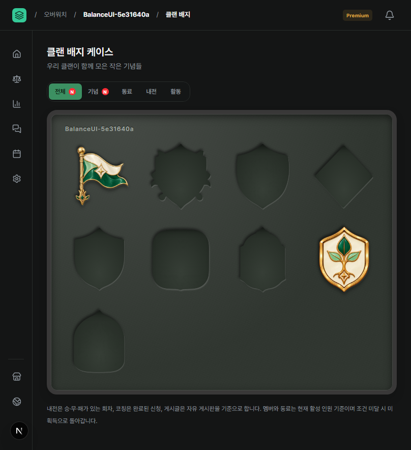
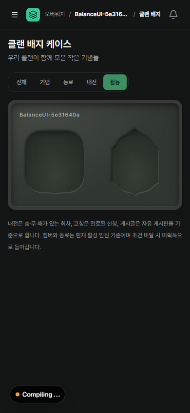

# 배지 케이스 분류 V2

2026-10-15. Rubber Segment 5개 분류·새 획득 N·상단 정보/배너/핀 밑줄 제거를 적용했다. 창단·첫 정규를 포함한 모든 핀에 공통 상세를 제공한다.

격리 임시 클랜의 [확인 상태 E2E](../../../../e2e/clan-badge-read-state.spec.ts)에서 촬영했다. 808px 전체 케이스는 새 배지를 확인하기 전이며, 390px 활동 분류는 전체 확인 후다. 사용자 QA 데이터는 촬영/테스트에 사용하지 않았다.

