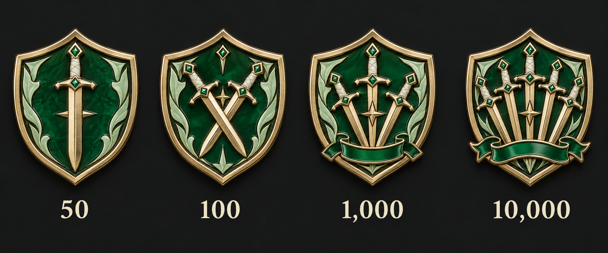
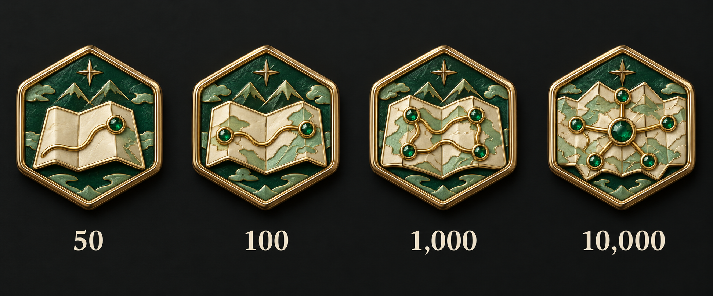
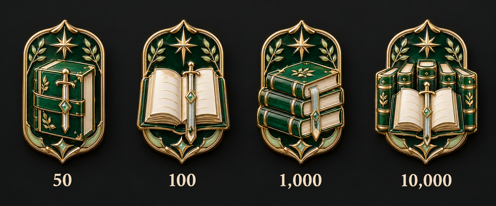
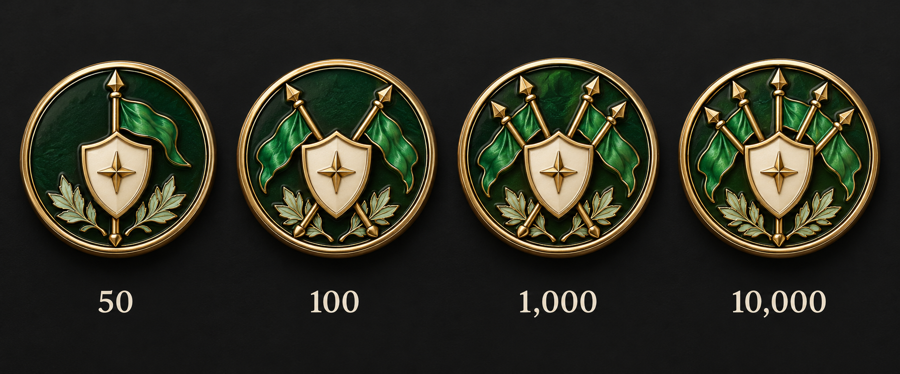
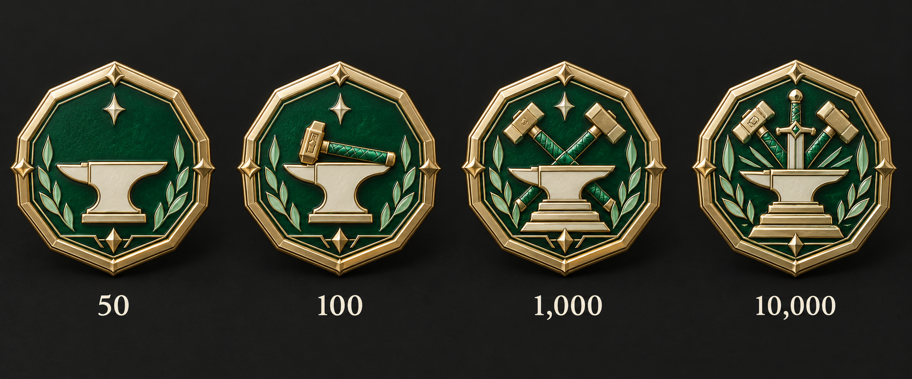

# 누적 정규 내전 · 디자인 5안

50·100·1,000·10,000회 순서로 내부 그림이 성장한다. 금빛 금속·에메랄드·민트·아이보리 에나멜을 공통 사용하며 수치와 이름은 배지 바깥에 표시한다.

선택 전 비교 시안이다. 횟수는 승·무·패 결과가 있는 기록만 포함하는 요청이며 집계 단위는 별도 확인 중이다. 앱의 현재 종료 회차 판정과 구분한다.

## 01 · 교차하는 검

## 02 · 전장의 지도

## 03 · 쌓인 연대기

## 04 · 깃발 아래의 기록

## 05 · 단련된 약속

[전체 계열 비교](../README.md) · [제작 요청](prompts.json)
