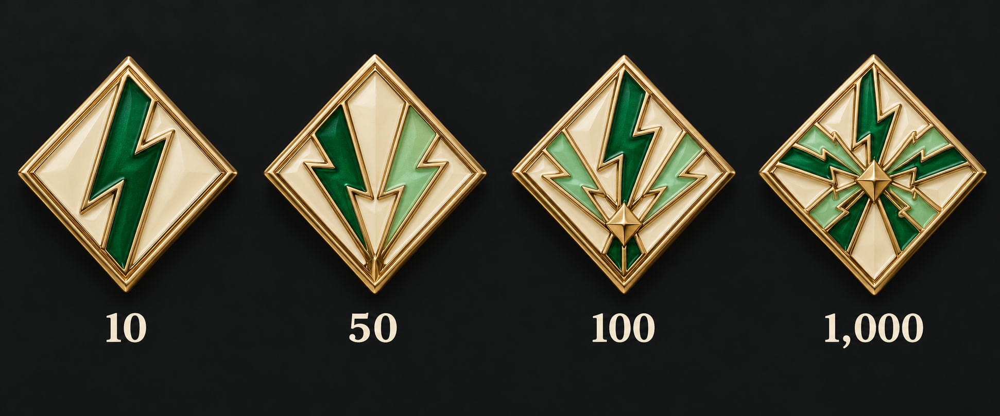
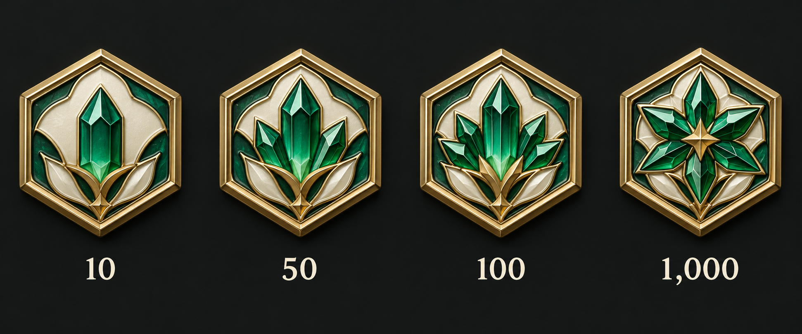
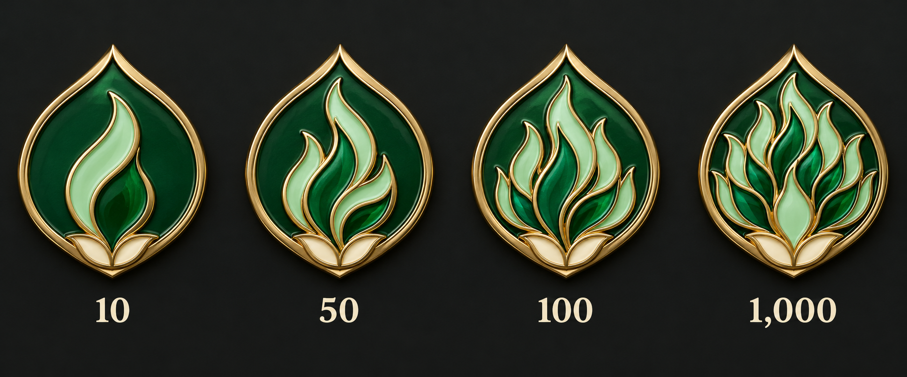
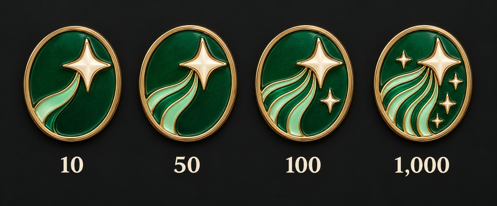
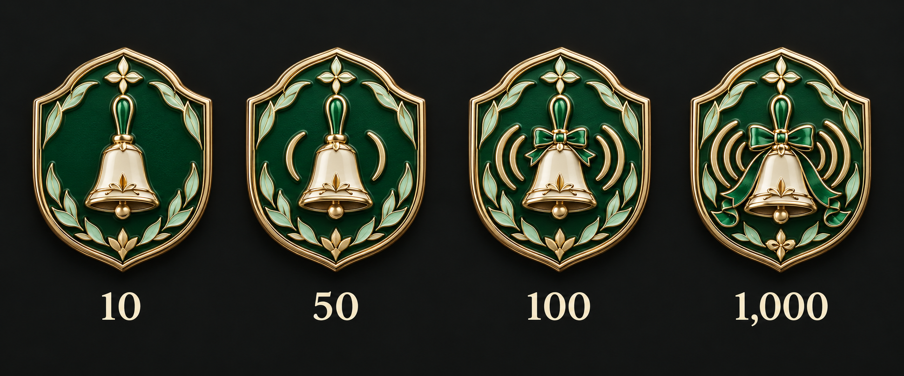

# 누적 깜짝 내전 · 디자인 5안

단계: 10회 · 50회 · 100회 · 1,000회 · 상태: 선택 전 후보

승·무·패 결과가 있는 깜짝 내전만 포함한다. 무효·미기록·취소는 제외한다. 경기 1개/결과가 있는 개설 회차 중 집계 단위는 확인 중이며 기존 종료 회차 배지와 구분한다.

금빛 금속·에메랄드/민트/아이보리 에나멜을 사용한다. 같은 스타일의 외곽을 유지하고 내부 그림이 단계별로 고도화된다. 각 그림은 왼쪽부터 낮은 단계→높은 단계다.

## 01 · 모여든 번개

번개가 하나에서 중심으로 모여든다.

## 02 · 번개의 코어

작은 에너지 결정이 완성된 코어로 자란다.

## 03 · 즉흥의 불꽃

단일 불꽃이 풍성한 불꽃 문양으로 자란다.

## 04 · 튀어오른 스파크

별의 궤적과 주변 별이 점점 늘어난다.

## 05 · 뜻밖의 소집

소집 종의 울림과 리본이 풍성해진다.

[전체 계열 비교](../README.md) · [제작 요청](prompts.json)
