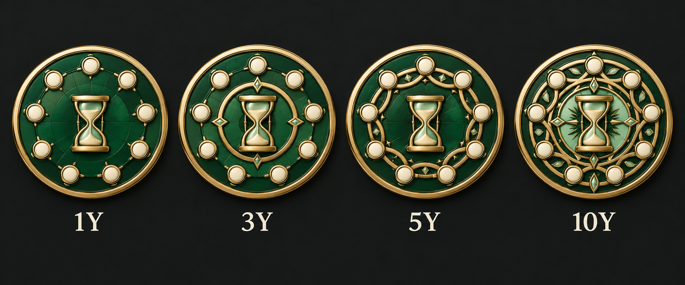
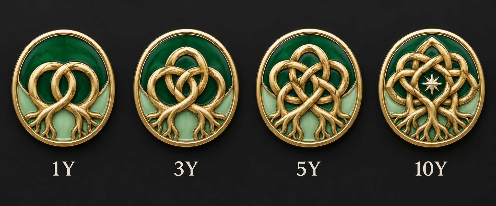
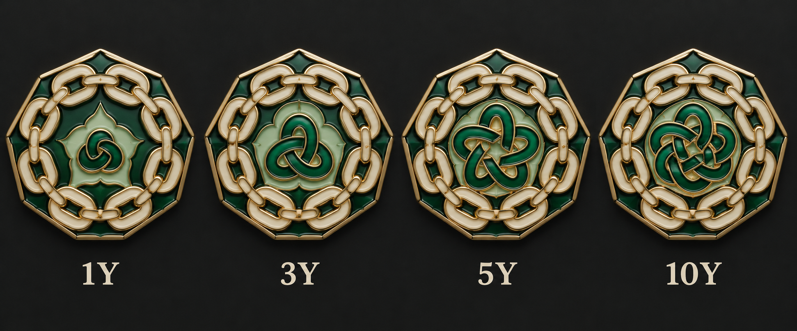
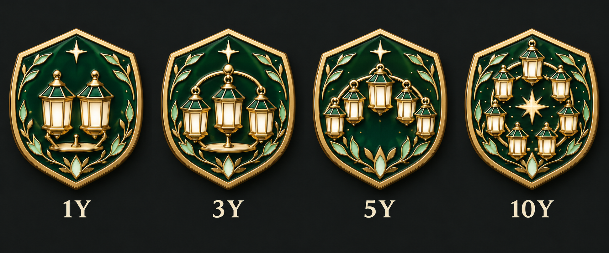
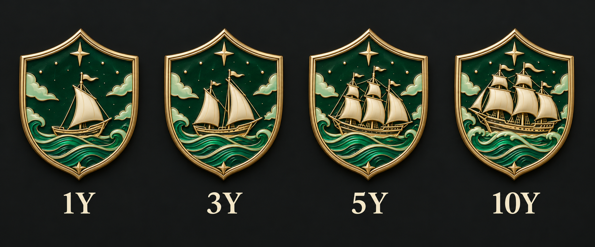

# 오래 함께한 열 동료 · 디자인 5안

단계: 1년 · 3년 · 5년 · 10년 · 선택: 5안 같은 항로·QA 적용

같은 클랜의 현재 활성 멤버 중 각각 1·3·5·10년 이상 연속 소속된 사람이 10명 이상인 조건이다. 창단 나이와 구분하며 탈퇴 후 재가입은 이전 기간을 합치지 않는다. 그림의 문양 수는 동행의 상징이다.

금빛 금속·에메랄드/민트/아이보리 에나멜을 사용한다. 같은 스타일의 외곽을 유지하고 내부 그림이 단계별로 고도화된다. 각 그림은 왼쪽부터 낮은 단계→높은 단계다.

## 01 · 시간의 원탁

시간의 중심을 동료들이 둘러싸는 원탁이다.

## 02 · 한 뿌리의 인연

서로 얽힌 뿌리가 단단한 결속 문양으로 자란다.

## 03 · 열 이름의 결속

연결된 고리 안에서 중앙 매듭이 고도화된다.

## 04 · 함께 켠 등불

함께 켠 등불이 하나의 원을 이룬다.

## 05 · 같은 항로

작은 배가 같은 항로를 지나는 큰 범선으로 자란다.

[전체 계열 비교](../README.md) · [제작 요청](prompts.json)
