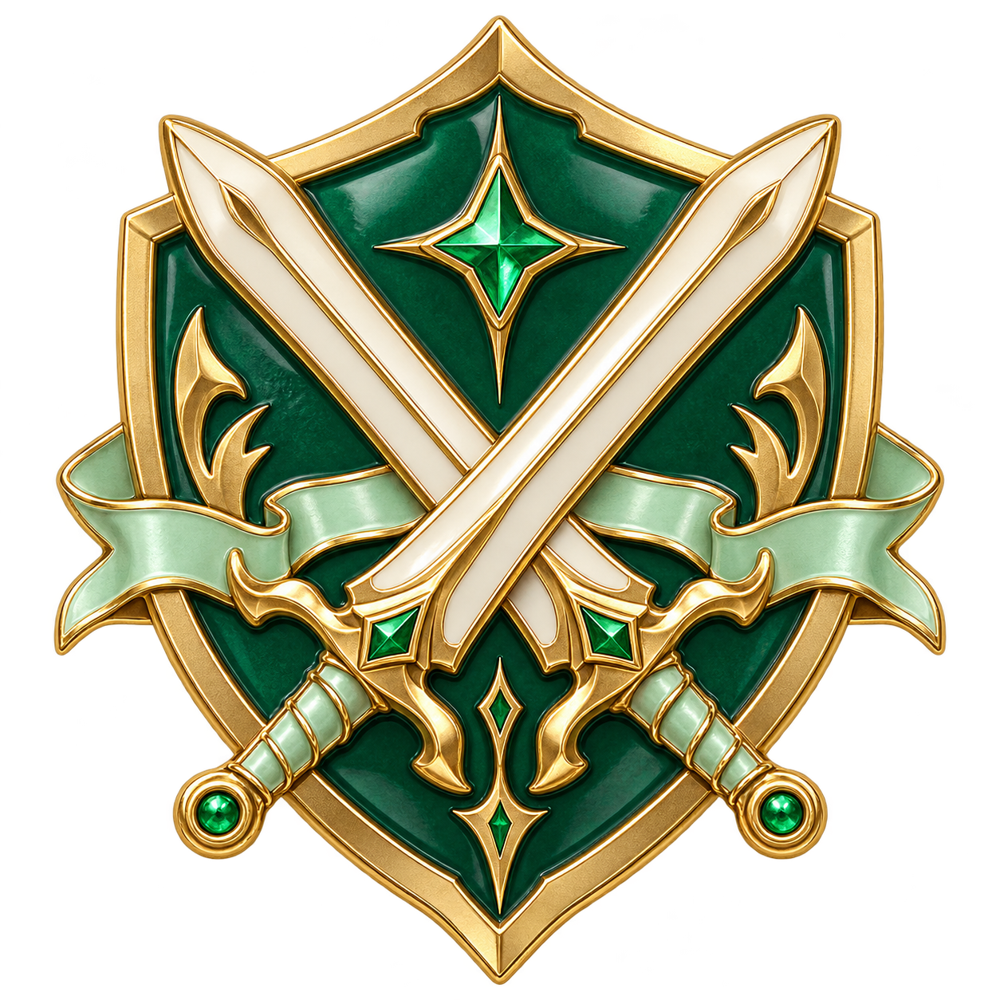
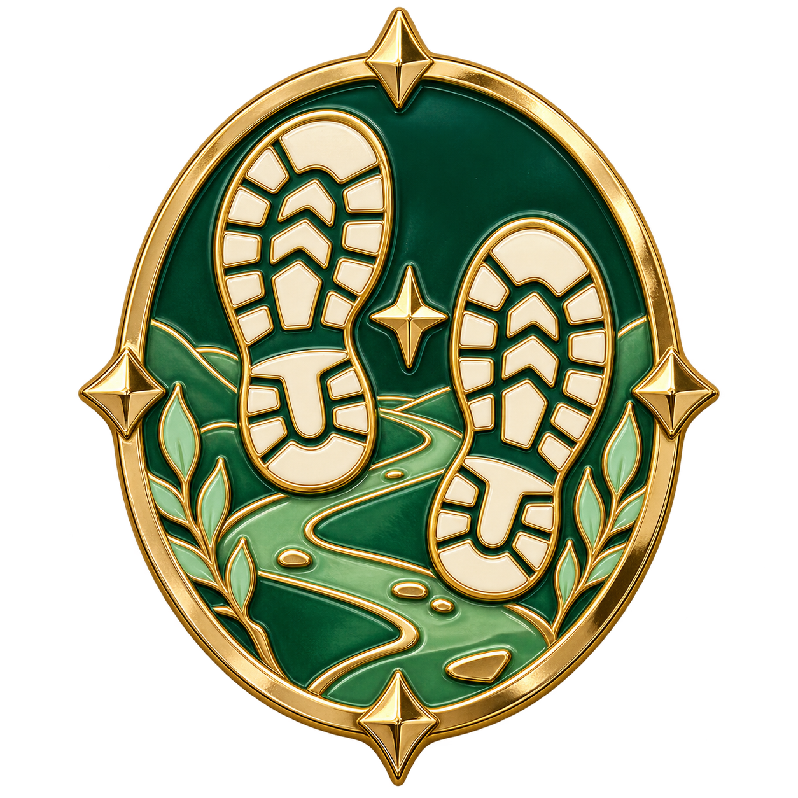
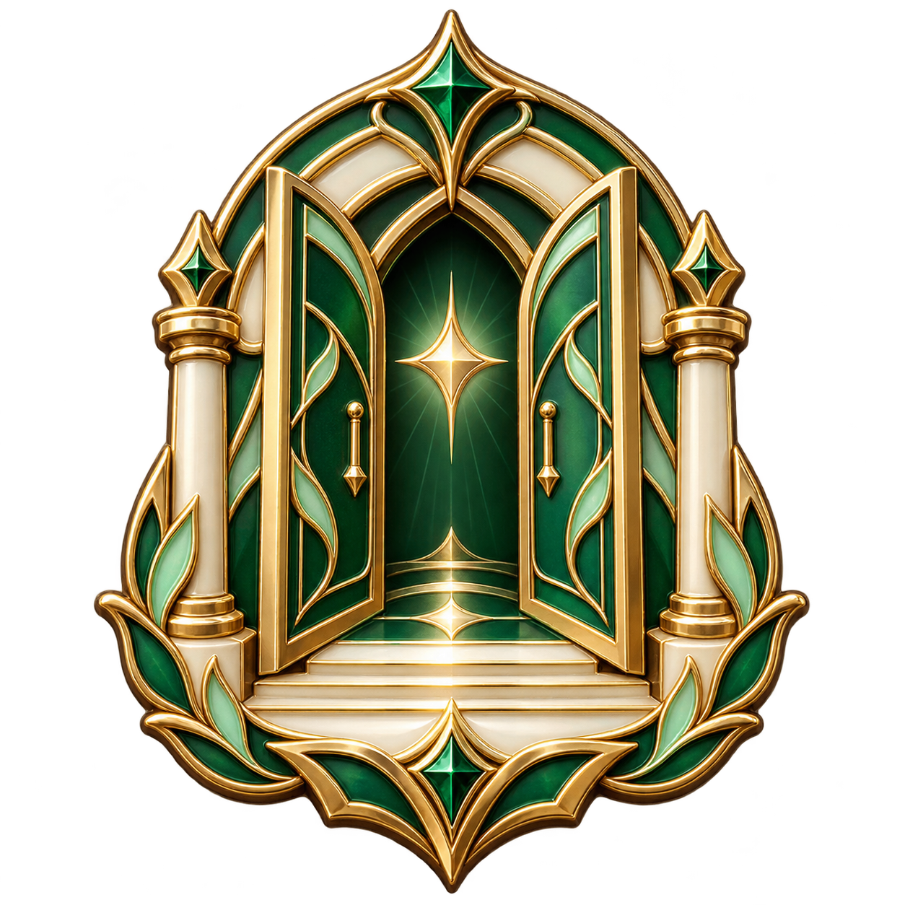
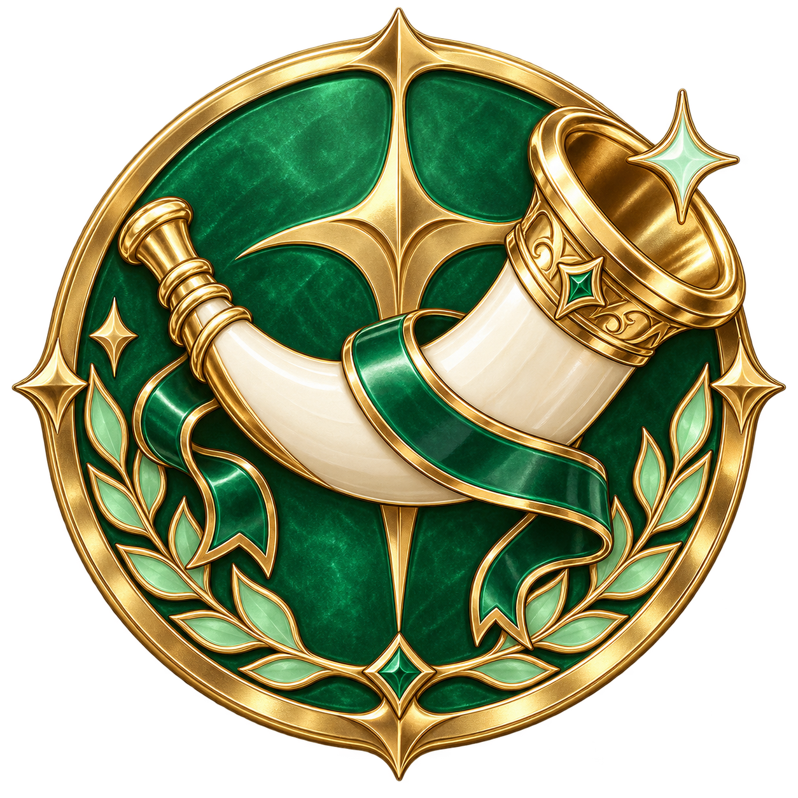
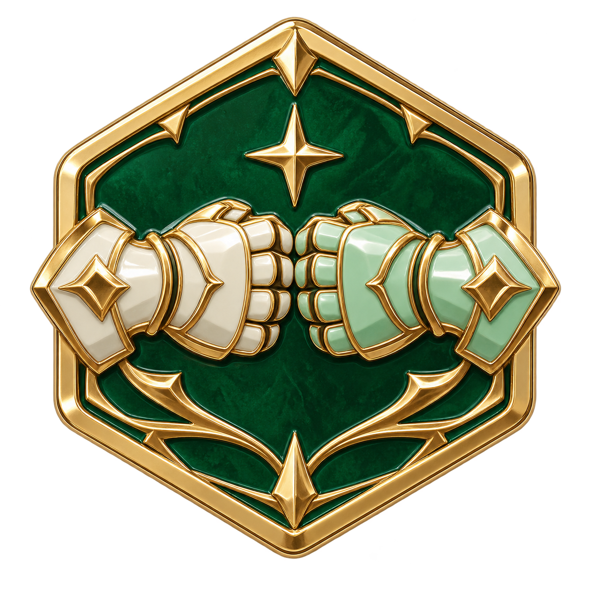

# 첫 정규 내전 · 디자인 5안

단계: 1회 · 선택: 1안 첫 교차·QA 적용

정규 내전에서 최초 승·무·패 결과가 기록된 때를 기념하는 독립 배지다. 나머지 누적 계열처럼 단계별 승급하지 않는다. 현재 후보는 배경이 투명한 단독 핀이다.

금빛 금속·에메랄드/민트/아이보리 에나멜을 사용한다. 단독 기념 핀 5종을 비교한다.

## 01 · 첫 교차

두 검이 처음 맞닿은 순간을 기념한다.

## 02 · 첫 발자국

함께 전장에 남긴 첫 발자국이다.

## 03 · 개막의 문

새로운 전장이 열리는 순간을 담는다.

## 04 · 첫 함성

첫 경기의 개막을 알리는 뿔나팔이다.

## 05 · 첫 합

첫 팀워크를 두 건틀릿의 합으로 표현한다.

[전체 계열 비교](../README.md) · [제작 요청](prompts.json)
