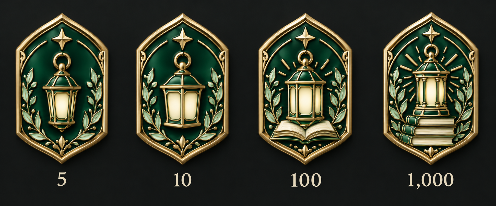
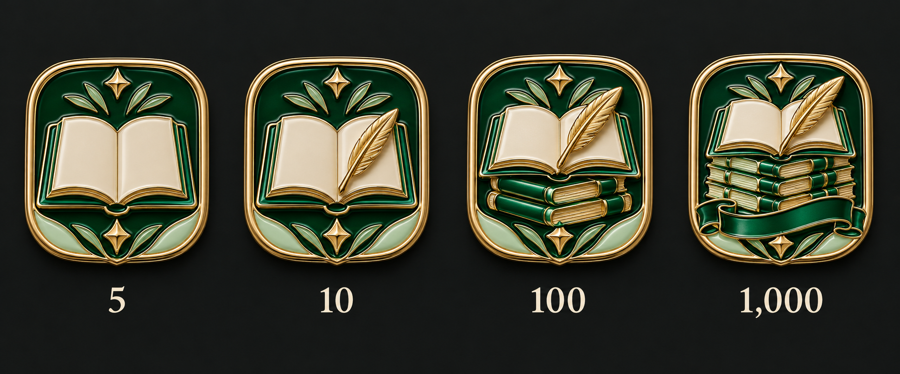
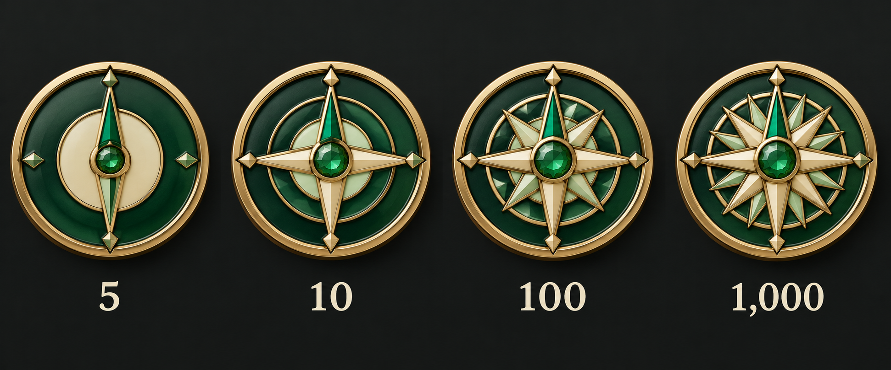
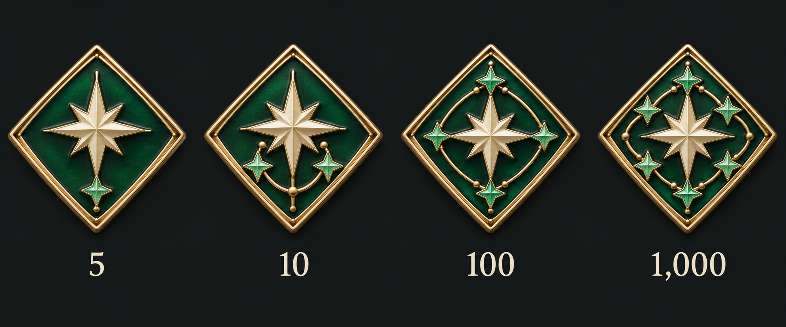
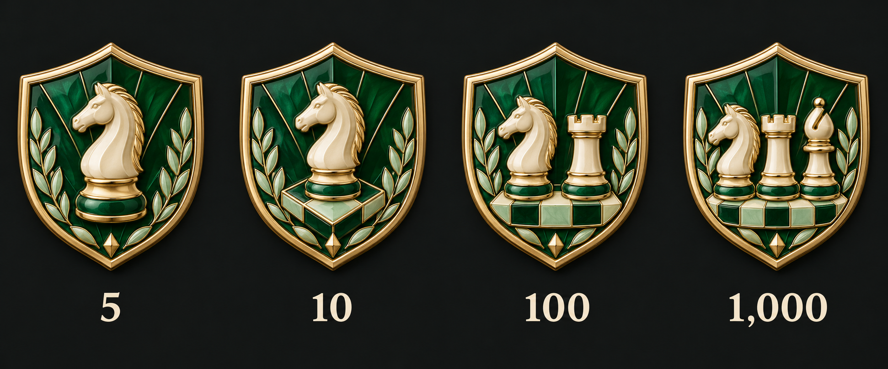

# 함께한 코칭 · 디자인 5안

단계: 5회 · 10회 · 100회 · 1,000회 · 상태: 선택 전 후보

클랜 전체의 완료된 피드백 신청 고유 건수로 집계 범위를 확정했다. 댓글·편집·완료 토글을 중복 집계하지 않는다. 담당 선생님의 실제 답변 등 완료 증빙과 완료 취소 후 판정은 적용 시 확정한다.

금빛 금속·에메랄드/민트/아이보리 에나멜을 사용한다. 같은 스타일의 외곽을 유지하고 내부 그림이 단계별로 고도화된다. 각 그림은 왼쪽부터 낮은 단계→높은 단계다.

## 01 · 지식의 등불

빛과 책이 더해지는 배움의 등불이다.

## 02 · 열린 배움

열린 책에 깃펜과 지식의 층이 더해진다.

## 03 · 성장의 나침반

단순한 바늘이 정교한 나침반으로 자란다.

## 04 · 길을 밝혀준 별

길잡이 별이 동료 별들과 연결된다.

## 05 · 전략의 수

하나의 체스 말이 함께하는 전략으로 확장된다.

[전체 계열 비교](../README.md) · [제작 요청](prompts.json)
