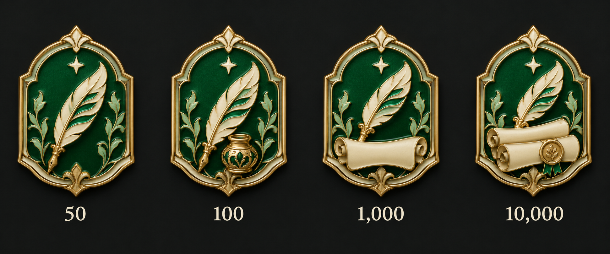
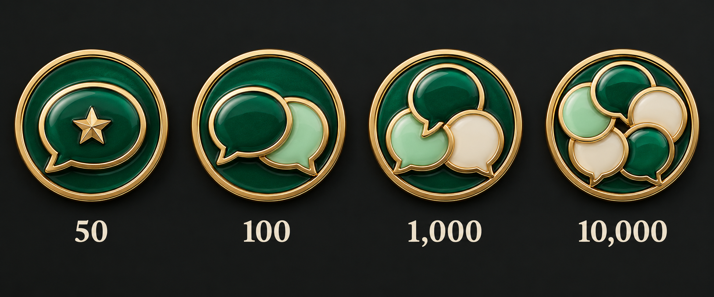
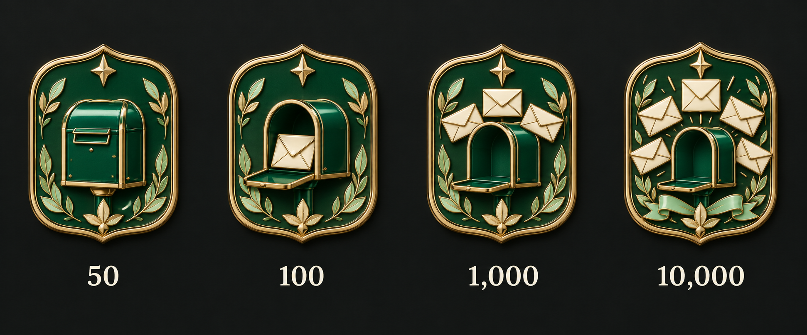
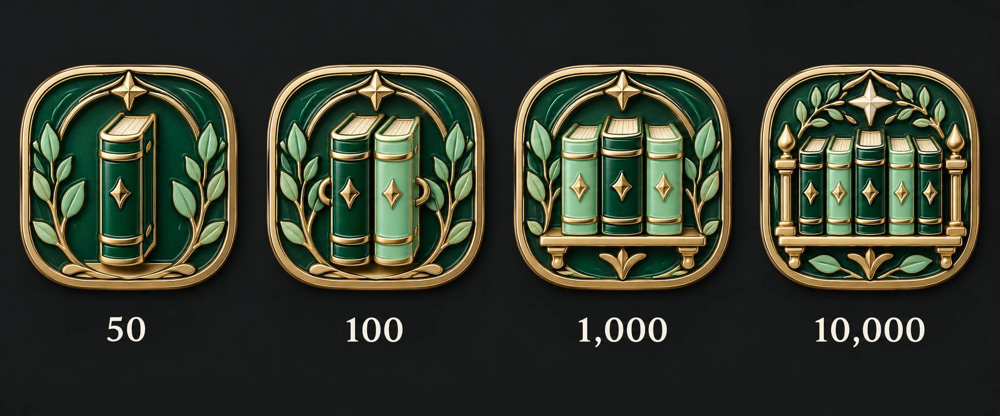
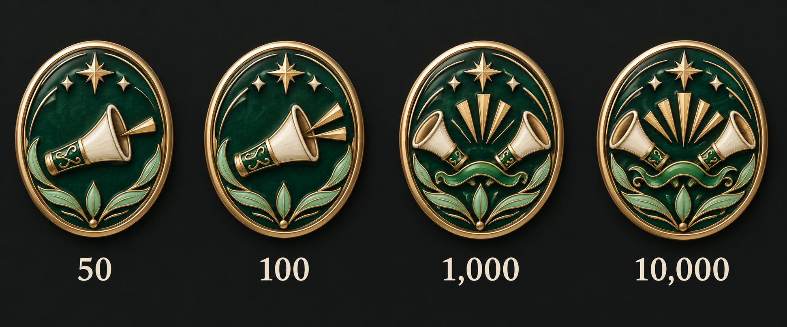

# 우리의 게시글 · 디자인 5안

단계: 50개 · 100개 · 1,000개 · 10,000개 · 상태: 선택 전 후보

기본안은 클랜 자유 게시판의 고유 글 수다. 댓글·공감·조회수·편집 횟수와 구분한다. 포함 게시판 범위와 삭제 후 누적 판정은 확인 중이다.

금빛 금속·에메랄드/민트/아이보리 에나멜을 사용한다. 같은 스타일의 외곽을 유지하고 내부 그림이 단계별로 고도화된다. 각 그림은 왼쪽부터 낮은 단계→높은 단계다.

## 01 · 우리의 문장

깃펜에 잉크와 두루마리 기록이 더해진다.

## 02 · 이어지는 이야기

말풍선이 서로 연결되는 소통의 문장이다.

## 03 · 편지의 광장

편지가 모이는 우편함과 광장이다.

## 04 · 기록의 서가

한 권의 기록이 공동체의 서가로 자란다.

## 05 · 모인 목소리

작은 목소리가 함께하는 울림으로 확장된다.

[전체 계열 비교](../README.md) · [제작 요청](prompts.json)
