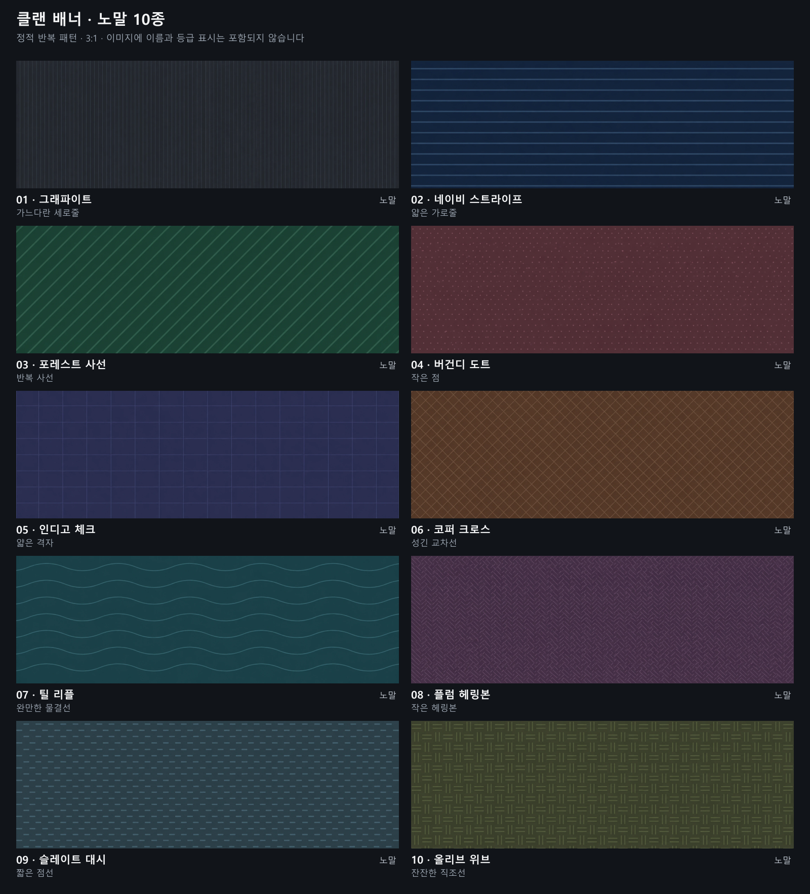
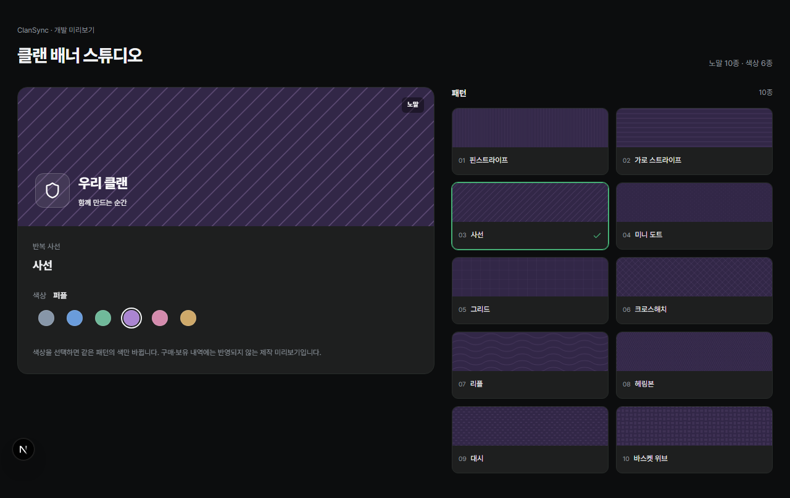

# 클랜 배너 · 노말 10종

2026-10-29 제작. 게임 캐릭터·로고 없이 작은 반복 패턴과 두 계열 색으로 구성한 정적 배너다.

## 등급 기준

| 코드 | 표시 | 디자인 기준 |
| --- | --- | --- |
| `normal` | 노말 | 정말 간단한 디자인 패턴 |
| `rare` | 레어 | 간단한 도형으로 만들어진 디자인 |
| `unique` | 유니크 | 일러스트레이터 원화 |
| `legend` | 레전드 | 애니메이팅 되어있는 배너 |

이번 10종은 모두 `normal`이다. 초기 WebP의 등급·생성 프롬프트는 [제작 목록](manifest.json), 렌더러의 등급·패턴은 [런타임 카탈로그](../../../../src/lib/clan/banner-catalog.ts)에 기록한다. QA 상점에는 패턴당 10 클랜 코인으로 등록했다. 기존 QA 보유·장착 상태를 임의 변경하지 않는다.

## 제작 목록

| 번호 | 이름 | 패턴 | 이미지 |
| --- | --- | --- | --- |
| 01 | 그래파이트 | 가느다란 세로줄 | [WebP](../../../../public/clan-banners/normal-v1/01-graphite-hairline.webp) |
| 02 | 네이비 스트라이프 | 얇은 가로줄 | [WebP](../../../../public/clan-banners/normal-v1/02-navy-horizontal.webp) |
| 03 | 포레스트 사선 | 반복 사선 | [WebP](../../../../public/clan-banners/normal-v1/03-forest-diagonal.webp) |
| 04 | 버건디 도트 | 작은 점 | [WebP](../../../../public/clan-banners/normal-v1/04-burgundy-dots.webp) |
| 05 | 인디고 체크 | 얇은 격자 | [WebP](../../../../public/clan-banners/normal-v1/05-indigo-grid.webp) |
| 06 | 코퍼 크로스 | 성긴 교차선 | [WebP](../../../../public/clan-banners/normal-v1/06-copper-crosshatch.webp) |
| 07 | 틸 리플 | 완만한 물결선 | [WebP](../../../../public/clan-banners/normal-v1/07-teal-ripple.webp) |
| 08 | 플럼 헤링본 | 작은 헤링본 | [WebP](../../../../public/clan-banners/normal-v1/08-plum-herringbone.webp) |
| 09 | 슬레이트 대시 | 짧은 점선 | [WebP](../../../../public/clan-banners/normal-v1/09-slate-dash.webp) |
| 10 | 올리브 위브 | 잔잔한 직조선 | [WebP](../../../../public/clan-banners/normal-v1/10-olive-weave.webp) |

## 규격·제작

- 2172×724px(3:1), 불투명 정적 WebP 10장. 전체 626,608 bytes(약 612KiB)이며 개별 용량은 제작 목록에 기록한다.
- 가로 전체에 반복 패턴을 배치해 현재 보유 목록의 4:1 중앙 자르기에도 무늬가 유지된다.
- 흰 클랜 이름·메타데이터를 얹도록 어두운 바탕을 사용한다. 이름·등급 표시는 이미지에 굽지 않는다.
- built-in `image_gen`으로 각 이미지별 생성 후 Sharp로 WebP 변환했다. 공통·개별 프롬프트는 제작 목록에 보관한다.
- 초기 WebP 검증: 10개 이미지의 디코딩·비율·불투명·정적 여부와 4:1 중앙 자르기. WebP 전체 픽셀을 대상으로 계산한 흰 글자 대비는 최저 4.93:1이다. 비교표의 한글·무늬를 육안 확인했다.

## 색상 프리셋 개발 환경

[배너 스튜디오](http://localhost:3011/dev/clan-banners)는 `npm run dev:qa` 실행 중 사용할 수 있다. 패턴 10종과 그래파이트·블루·그린·퍼플·로즈·앰버 6색을 조합하며 원형 색상 버튼은 키보드와 터치로도 선택한다. 주소의 `design`·`palette` 값으로 미리보기를 복원한다. 개발 모드에서만 열리고 프로덕션 빌드에서는 404다. 로그인·DB 쓰기·기존 QA 명단 시드는 필요 없다.

위 WebP는 초기 이미지 시안으로 보관한다. 개발 렌더러는 같은 10가지 패턴을 규칙적인 [SVG 마스크](../../../../public/clan-banners/normal-v1/masks)로 다시 정의했다. 상품명은 색과 독립적인 핀스트라이프·사선·리플 등의 패턴명으로 표시한다. 마스크 10개는 총 3,168 bytes이며 색상별 이미지 파일은 만들지 않는다.

- [공통 색상 프리셋](../../../../src/lib/cosmetics/color-presets.ts): `background`(바탕)·`pattern`(무늬)·`swatch`(선택 버튼). 고정 ID로 참조한다.
- [공통 색상 선택기](../../../../src/components/cosmetics/cosmetic-color-picker.tsx): `<CosmeticColorPicker value={selection.paletteId} onChange={...} />`.
- [배너 렌더러](../../../../src/components/cosmetics/clan-banner-artwork.tsx): 위치·크기가 정해진 `position: relative` 부모 안에 `<ClanBannerArtwork selection={selection} />`을 배치한다. SVG 알파 마스크와 바탕/무늬 CSS 변수만 사용한다. 최초 마스크 로드 후 색상 전환 시에는 JS 이미지 생성·필터·추가 서버 요청이 없다. 3:1 미리보기와 4:1 목록에 같은 마스크를 쓴다.
- [선택 데이터](../../../../src/lib/clan/banner-catalog.ts): `{ "designId": "forest-diagonal", "paletteId": "purple" }`. `readClanBannerSelection(unknown)`은 등록된 조합만 반환하고 잘못된 ID·배열·불완전한 쌍은 `null`이다. 개발 페이지는 기본 조합으로 복원한다. 실 장착은 `clanBannerUrl`이 만든 `/clan-banners/normal-v1/masks/forest-diagonal.svg?palette=purple`을 기존 `clans.banner_url`에 저장하고 `readClanBannerUrl`로 복원한다.
- 새 패턴은 SVG 마스크·런타임 카탈로그·상점 마이그레이션을 추가한다. 새 팔레트는 공통 프리셋과 `set_clan_banner`의 허용 목록을 함께 갱신하면 기존 패턴 보유자도 추가 구매 없이 사용한다. 상위 등급 원화·애니메이션은 색을 유지할 원본과 변경할 영역을 분리해 제작하며 실제 렌더러는 해당 등급 제작 시 확장한다.

검증: [집중 테스트](../../../../e2e/clan-banner-studio.spec.ts) 개발 모드 4개와 프로덕션 404 테스트 1개, ESLint·타입 검사·운영 모드 빌드 통과. 60개 조합의 ID 검증, 마스크 디코딩·투명도, 팔레트 흰 글자 대비 4.5:1 이상, 추가 이미지/API 요청 없는 색상 전환·DOM/영역 유지, 10개 패턴 재사용, 키보드·390px 터치·주소 복원·잘못된 입력을 확인했다. 운영 DB·배포는 변경하지 않았다.

[모바일 확인 화면](studio-mobile.png)

## QA 상점 등록

2026-10-29 노말 패턴 10종을 각 10 클랜 코인·Free 포함으로 등록했다. `store_items.rarity`는 네 등급 중 하나이며 기존 기능 상품에는 등급을 강제하지 않는다. `clan_banner_normal_` SKU는 패턴 단위이며 색상 SKU·추가 구매 행은 없다. 한 패턴을 사면 제공되는 모든 색상을 보유하며 향후 팔레트 추가에도 재구매하지 않는다.

상점·원본/실제 미리보기·관리의 보유 패턴/원형 색상 선택·대시보드가 같은 마스크 렌더러를 사용한다. 색상 선택 후 `배너 적용`을 눌러 저장한다. 소유권·운영진·클랜 지출 권한 검증과 기존 구매 원장·중복 차감 방지는 유지한다. 구매 무효화는 현재 적용한 패턴과 색상만 해제하고 다른 패턴은 유지한다. 일반 사용자 조회 권한은 기존 RLS를 유지한다.

마이그레이션: `20261029044755_normal_clan_banner_store`, QA 적용·타입 생성 완료. 관련 DB 검증은 [패턴 구매·전체 색상·권한·동시/중복 결제·잔액 부족·무효화](../../../../scripts/clan-banner-store-db.test.mjs), 브라우저 검증은 [구매·색상 장착·새로고침·멤버 표시·모바일](../../../../e2e/clan-banner-store.spec.ts)과 [기본 배너·업로드 권한](../../../../e2e/clan-appearance.spec.ts)이다. 사용자 QA 명단을 시드하지 않으며 운영 DB·배포는 보류한다.

DB 7개·운영 빌드 관련 검증 5개(개발 전용 UI 2개 제외)·lint·타입·빌드 통과. [상점 데스크톱 검증 화면](store-desktop.png) · [모바일 검증 화면](store-mobile.png).
