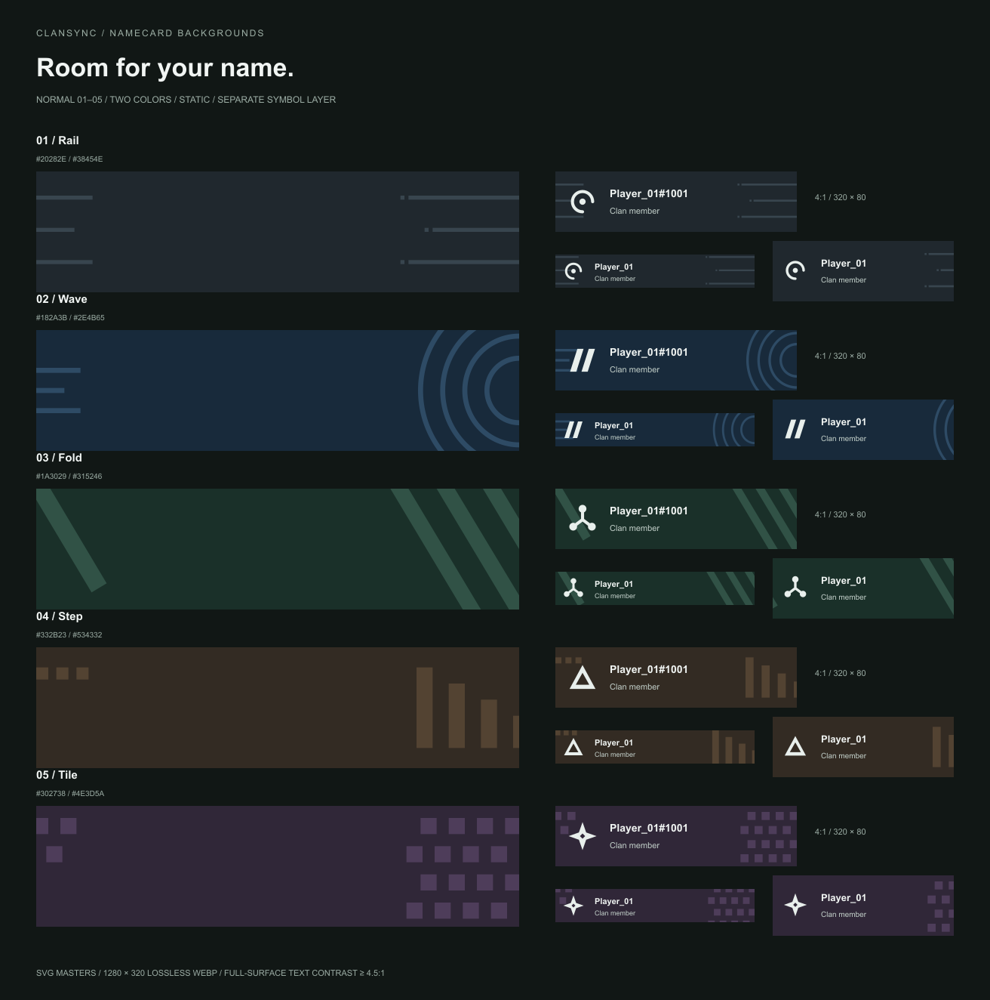

# 네임카드 배경 · 노말 5종

2026-10-29 제작. 레일·웨이브·폴드·스텝·타일의 정적 패턴이다. [제작 목록](manifest.json) · [비교표](contact-sheet.png).

| 이름 | 색 계열 | 도형 |
| --- | --- | --- |
| 레일 | 슬레이트 | 짧은 가로선과 작은 사각형 |
| 웨이브 | 네이비 | 가장자리에서 퍼지는 원호 |
| 폴드 | 포레스트 | 겹치지 않는 사선 띠 |
| 스텝 | 앰버 | 높이가 줄어드는 세로 막대 |
| 타일 | 플럼 | 어긋나게 반복되는 사각형 |

- SVG 원본은 960×240(4:1), WebP는 1280×320 무손실이다. [원본 폴더](../../../../public/namecard-backgrounds/normal-v1).
- 한 가지 바탕색과 한 가지 패턴색만 사용한다. 그라데이션·광택·질감·테마 일러스트·애니메이션은 넣지 않는다.
- 닉네임이 놓이는 왼쪽/중앙은 비우고 가장자리에 패턴을 둔다. 심벌은 배경에 구워 넣지 않는다.
- 실제 적용 시 주 글자 `#F1F5F3`, 보조 글자 `#C3D0CA`를 사용한다. 밝은/어두운 앱 테마 모두 배경 위의 글자는 이 밝은 전경색을 유지해야 한다.
- 4:1 원본과 6:1/3:1 중앙 크롭에서 글자 대비 4.5:1 이상을 검사한다. 비교표에는 별도 레이어의 기본 심벌과 닉네임을 합성한 320×80·240×80·264×44 예를 넣었다.
- 현재는 상점 등록 전 디자인 원본이다. 가격·기본 제공 여부·장착 데이터는 변경하지 않았다.

재생성·검증: `node scripts/build-normal-namecard-backgrounds.mjs`

