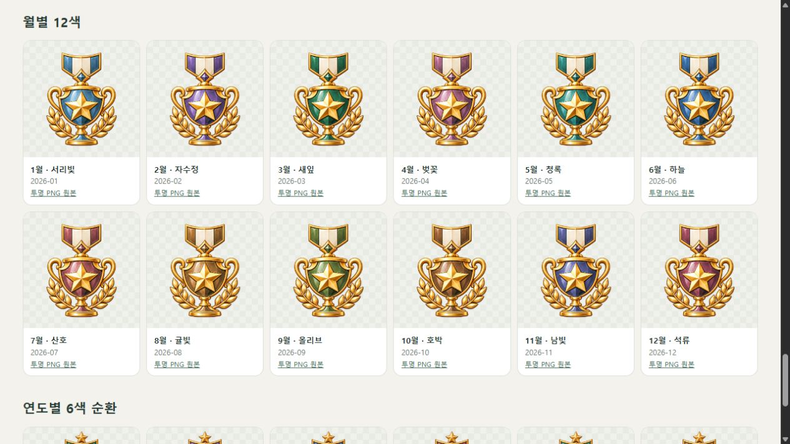
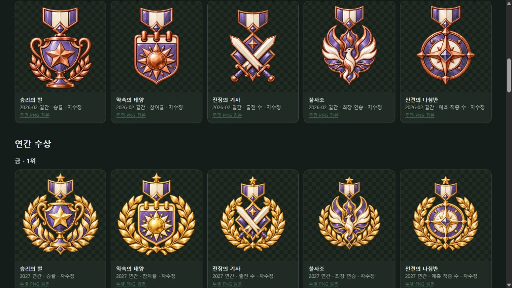
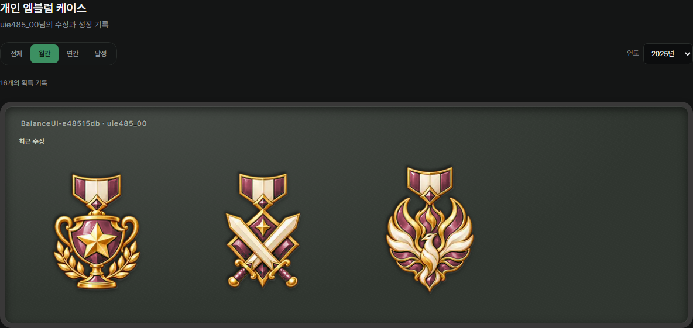
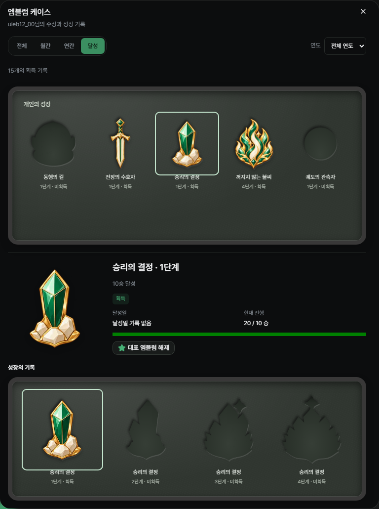

# 개인 엠블럼 · 개별 투명 이미지 V1

제작일: 2026-10-23 · 상태: 10계열·50장, 공통 케이스·대표 선택·영구 수상·최초 달성일 연결.

## 확정 범위

사용자가 [10계열 시안](../proposal-v1/README.md)을 채택했다. 수상형은 월간·연간 및 금·은·동을 구분하고, 달성형은 4단계로 그림이 성장한다. 날짜는 별도 문구로 표시하며 월별 12색·연도별 6색 순환을 함께 사용한다.

| 구분 | 계열 | 개별 이미지 |
|---|---|---|
| 수상형 | 승률·참여·출전·연승·예측 적중 | 5계열 × 월간/연간 × 금/은/동 = 30장 |
| 달성형 | 누적 참여·출전·승리·최장 연승·예측 적중 | 5계열 × 4단계 = 20장 |

전부 **1254×1254 RGBA PNG**다. 내장 image_gen에서 각각 따로 생성했고 픽셀 후처리 없이 [공용 이미지 폴더](../../../../public/personal-emblems/v1)에 복사했다. 금·은·동은 동일 계열 금 원본을 직접 참조해 금속만 바꾸었다. 연간은 짧은 리본에 별과 넓은 월계 장식을 더했다. 달성형은 돌길·방패·결정·불꽃·관측 고리가 단계별로 성장한다.

## 미리보기

`node scripts/serve-personal-emblems.mjs` 실행 후 [엠블럼 미리보기](http://127.0.0.1:3044/)를 연다. 이 서버는 엠블럼 50장과 미리보기 3개 파일만 제공하며 127.0.0.1에 바인딩한다. QA 서버·DB·기존 명단과 독립적이다.

- 월간 날짜·연간 날짜를 바꾸어 날짜와 에나멜 색을 함께 확인한다.
- 금·은·동, 월간·연간, 달성형 1~4단계를 전체 비교한다.
- 밝은/어두운 배경과 기본 녹색 원본을 전환한다.
- 각 카드의 `투명 PNG 원본` 링크는 해당 개별 원본을 내려받는다.

## 색상이 뜻하는 것

| 요소 | 의미 |
|---|---|
| 금·은·동 금속 | 1·2·3위 |
| 짧은 리본 / 추가 별·월계 | 월간 / 연간 |
| 에나멜 색상 | 수상 월·연도 |
| 외부 날짜 문구 | 정확한 수상 기간 |
| 달성형 그림의 성장 | 개인 목표 1~4단계 |

PNG에는 날짜·번호·이름을 새기지 않는다. 기본 녹색 원본 50장을 유지하고 **화면에서 녹색 에나멜만 선택해 날짜 색상으로 표시**한다. 금속·아이보리·투명 영역을 유지하므로 순위와 기간 색이 충돌하지 않는다. 날짜별 색이 적용된 별도 PNG 세트를 제작한 것은 아니다.

월간 색은 해당 월마다 고정되고 다음 해에도 같은 순서다. 연간은 2026년 비취를 기준으로 6년마다 순환한다. 같은 월 또는 6년 후에는 색이 반복되므로 날짜 문구를 항상 함께 표시한다. 실제 표시 날짜로 색을 결정하며 현재 시각·조회 순서로 색을 바꾸지 않는다.

| 월 | 색상 | 월 | 색상 |
|---|---|---|---|
| 1월 | 서리빛 `#5e9fcd` | 7월 | 산호 `#cf696d` |
| 2월 | 자수정 `#9670c2` | 8월 | 귤빛 `#cd8843` |
| 3월 | 새잎 `#368b64` | 9월 | 올리브 `#81934a` |
| 4월 | 벚꽃 `#cc779c` | 10월 | 호박 `#b87340` |
| 5월 | 청록 `#389d94` | 11월 | 남빛 `#6c70b3` |
| 6월 | 하늘 `#467fc1` | 12월 | 석류 `#ba576e` |

연도 순환: 2026 비취 → 2027 자수정 → 2028 사파이어 → 2029 루비 → 2030 터키석 → 2031 불씨 → 2032 비취. 과거 연도도 같은 기준으로 역산한다.

표시 규칙과 선택적 에나멜 필터는 [catalog.mjs](../../../../public/personal-emblems/v1/catalog.mjs)에 있다. 미리보기 날짜 변경은 카드·제목·컨트롤을 유지하고 그림과 날짜 설명만 바꾼다.

## 파일 규칙

- 수상형: `public/personal-emblems/v1/awards/{month|year}/{victory|participation|appearances|streak|prediction}-{gold|silver|bronze}.png`
- 달성형: `public/personal-emblems/v1/milestones/{sessions|matches|wins|streak|prediction}-{1|2|3|4}.png`
- 달성 단계 대응: 참여 10·50·100·300회, 출전 10·50·100·500경기, 승리 10·50·100·300승, 개인 최장 3·5·7·10연승, 예측 적중 10·50·100·300회.

## 제작 요청과 검증

- [월간 15장 전체 프롬프트·원본](month-prompts-and-assets.json)
- [연간 15장 전체 프롬프트·원본](year-prompts-and-assets.json)
- [참여·출전·승리 12장 전체 프롬프트·원본](milestone-a-prompts-and-assets.json)
- [연승·예측 8장 전체 프롬프트·원본](milestone-b-prompts-and-assets.json)
- [50장 해시·크기·투명도 검증](verification.json)

`node scripts/verify-personal-emblems.mjs`로 50장 중복 없음, 정사각 RGBA, 모서리 알파 최대 1/255, 실제 그림 존재, 생성 원본과 복사본 SHA-256 50/50 일치, 월12색·연6색/과거 연도/잘못된 날짜와 금속을 제외하는 색상 선택을 확인했다. 미리보기 서버 허용 목록 자체 검사와 변경 JavaScript ESLint를 통과했다. 내장 브라우저에서 2월·2027년 색상 전환, 월간/연간 장식, 금은동, 성장 단계와 양 배경 표시를 확인했다.

위 검증은 이미지 제작 단계다. 아래 공통 케이스와 영구 기록을 추가로 연결했다. [앞선 정책 제안](../proposal-v1/README.md)은 제작 당시의 제안 이력이다.

## 앱의 공통 케이스 · 2026-10-23

프로필에서는 활성 게임·클랜별로, 개인 기록에서는 선택 멤버의 전용 케이스 페이지를 연다. 대표3개는 클랜별로 저장해 두 화면에 공유한다. 케이스 페이지에서는 대표3칸을 제목·부제목 오른쪽의 작은 표시로 줄였다. 셀44px·전체158px이며 폭이 부족하면 제목 아래 오른쪽으로 내려간다. 지정·해제를 즉시 반영하고 대표를 누르면 상세를 다시 연다. 아래 목록은 클랜 배지와 같은 명판·펠트 표면, 진열 영역760px 미만3열/이상5열·셀 최대136px를 사용해 목록에 시선을 모은다. 분류·획득 개수를 한 행에 모으며 전체/수상/달성 분류·날짜 색상·달성형 최고 단계 진열과 관련4단계 상세를 제공한다. 미획득은 빈 홈과 미리보기로 구분한다.

고유 엠블럼 이름을 제거하고 `10승 달성`, `월간 승률 1위`처럼 설명만 표시한다. 수상 기간과 한국 시간 기준 최초 달성일을 함께 확인한다.

수상형은 종류별로 금→은→동 순의 보유 최고 등급을 먼저 고르고 같은 등급의 가장 최근1개를 진열한다. 누르면 전체 월간·연간 수상을 최신순으로 확인하며 전체/금/은/동으로 거를 수 있다. 선택한 이력의 큰 그림·기간·순위·대표 지정이 함께 바뀐다.

상세의 별 아이콘으로 대표를 지정/해제한다. 세 칸이 차 있으면 기존 대표3개를 이미지·설명·기간으로 비교하고 교체할 한 칸을 선택한다. 나머지 두 칸과 순서는 유지하며 한 번의 저장으로 교체한다. 취소·Esc는 변경하지 않고 별로 초점을 돌리며 저장 실패 시 같은 창에서 재시도한다([교체 PC](personal-emblem-replace-desktop.png)·[320px 모바일](personal-emblem-replace-mobile.png)).

[대표 진열·수상 모바일](award-case-mobile.png) · [전체 수상 이력 PC](award-history-desktop.png) · [등급 필터·모바일](award-history-mobile.png)

[1074px 제목·대표 배치](header-1074.png) · [568px](grid-568.png) · [685px](grid-685.png): 작은 대표 표시의 우측 정렬·좁은 화면 줄바꿈과 목록 크기·가로 넘침을320/390/568/640/685/768/1024/1074/1304px에서 확인했다.

[케이스 모바일](case-mobile.png) · [개별 상세 PC](case-detail-desktop.png) · [개별 상세 모바일](case-detail-mobile.png) · [통계 공개·수상 규칙](../../../01-plan/pages/10-Clan-Stats.md) · [검증 범위](../../../TODO_Phase2.md#2026-10-23-개인-엠블럼-공통-케이스)

월/연이 끝나고 해당 기간의 진행 중 정규 내전이 종료되면 수상을 한 번 확정해 보관한다. 기존 기록도 같은 기준으로 최초 수상 보관을 채우며 이후 정정·삭제·자격 설정 변경으로 바꾸지 않는다. 최초 달성일은 유효한 경기·참여·예측 기록에서 기준을 처음 넘은 시각으로 복원하고 새 기록이 반영될 때 자동 저장한다. 예측은 정산·종료 시각, 해당 시각이 없는 과거 기록은 라운드 시작 시각을 사용한다. 달성 후 기록이 정정·삭제돼도 달성과 달성일은 유지한다.

동일 계정의 탈퇴·재가입은 이력을 보존하며 계정·클랜 삭제는 연결된 이력을 정리한다. 공개 설정은 기록 보관과 별개로 응답을 제한한다. 운영 DB·배포는 보류했으며 기존 QA 명단·경기·코인은 보존했다.
