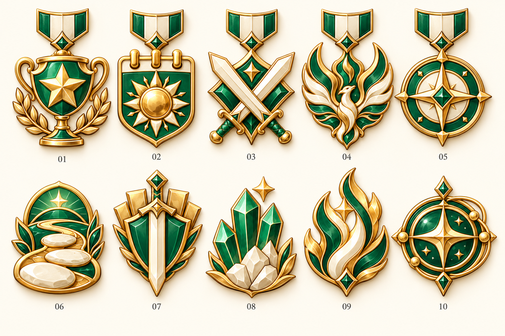

# 개인 엠블럼 개편 · 1차 제안

작성일: 2026-10-23 · 상태: 10계열 시안 채택. [개별 투명 이미지 50장·날짜 색상](../production-v1/README.md) 제작 완료, 앱·DB 미적용.

## 사용자 확정 방향

- 클랜 배지처럼 이미지로 제작한다.
- 기존 엠블럼 종류와 획득 조건도 개편한다.
- 월간·연간 경쟁의 수상형과 개인 목표의 달성형을 함께 구성한다.

사용자가 아래 10계열 구성과 월간/연간·금은동, 달성형 성장 이미지를 채택했다. 월12색·연도6색 순환도 확정했다. 이미지의 단계 수치는 아래 원안을 사용하며 실제 지급·과거 수상 보관/정정 정책은 구현 전 논의 대상으로 남아 있다.

## 이미지 시안

내장 image_gen으로 만든 최초 비교용 이미지다. 위쪽은 금메달 기준 수상형, 아래쪽은 중간 성장 단계의 달성형이다. 채택 후 개별 투명 PNG·금은동·월간/연간 차이·전체 성장 단계를 [V1](../production-v1/README.md)로 제작했다.

클랜 배지의 금빛 양각 금속과 에메랄드·민트·아이보리 에나멜을 따른다. 수상형은 짧은 리본을 단 메달, 달성형은 주제 자체가 외곽선이 되는 핀으로 구분한다. 실제 이미지에는 이름·날짜·수치를 넣지 않고 화면의 설명으로 제공한다.

## 수상형 · 제안 5계열

마감된 월간·연간마다 각 부문의 1~3위를 기념한다. 순위는 금·은·동 금속으로, 기간은 월간의 짧은 리본과 연간의 추가 월계 장식으로 구분하는 안이다. 형태와 중심 주제는 유지한다.

| 번호 | 이름 제안 | 획득 조건 제안 | 이미지 |
|---|---|---|---|
| 01 | 승리의 별 | 규정 경기 충족자 중 승률 1~3위 | 별을 품은 우승컵 |
| 02 | 약속의 태양 | 규정 회차 충족자 중 내전 참여율 1~3위 | 태양과 달력형 방패 |
| 03 | 전장의 기사 | 유효 경기 출전 수 1~3위 | 교차하는 검 |
| 04 | 불사조 | 해당 기간 최장 연승 1~3위 | 불꽃 날개의 불사조 |
| 05 | 선견의 나침반 | 확정 예측 적중 수 1~3위 | 보석과 나침반 |

승률·참여율의 규정 경기/회차는 기존 클랜 설정을 따르는 초안이다. 예측 부문은 적중률이 아니라 적중 횟수다. 공동 순위와 동률 처리, 부문 공개 설정과 발급의 관계는 구현 전에 확정한다.

## 개인 달성형 · 제안 5계열

클랜 안에서 같은 계정이 쌓은 전체 기록을 기준으로 한다. 금속 색으로 순위를 흉내 내지 않고 중심 그림의 개수·크기·구조가 성장한다. 컬렉션은 계열별 최고 단계 한 개를 진열하고 상세에서 전체 단계를 확인하는 안이다.

| 번호 | 이름 제안 | 단계 조건 초안 | 성장 방향 |
|---|---|---|---|
| 06 | 동행의 길 | 정규 내전 참여 10·50·100·300회 | 디딤돌에서 이어진 길·지평선으로 |
| 07 | 전장의 수호자 | 유효 경기 출전 10·50·100·500경기 | 검에서 방패·금속 날개로 |
| 08 | 승리의 결정 | 누적 10·50·100·300승 | 작은 결정에서 큰 결정 군집으로 |
| 09 | 꺼지지 않는 불씨 | 개인 최장 3·5·7·10연승 | 한 불씨에서 여러 겹의 큰 불꽃으로 |
| 10 | 궤도의 관측자 | 예측 누적 적중 10·50·100·300회 | 렌즈에서 별·궤도 고리로 |

09는 횟수 합산이 아닌 개인 최고 기록 달성형이다. 모든 단계 수치는 난이도 논의를 위한 초안이다.

## 집계 의미와 보관 정책

확인한 현재 구현:

- 같은 정규 내전에서 5경기 출전하면 참여 1회·출전 5경기다. 서로 다른 회차는 같은 날이어도 각각 센다.
- 승·패·무가 확정된 내전 경기만 출전에 포함한다. 무효·미정은 제외한다. 무승부는 승리에 포함하지 않고 연승을 종료하며, 출전하지 않은 경기는 개인 연승을 끊지 않는다.
- 회차 연결이 없는 수동 추가 경기는 경기 출전·승리·연승에 반영되지만 회차 참여에는 포함되지 않는다.
- 예측 적중은 환불되지 않은 확정 예측을 센다. 경기 기록 정정은 원본 예측 정산을 바꾸지 않으므로 두 결과가 다를 수 있다.
- 같은 계정의 탈퇴·재가입은 기존 경기 기록을 보존한다.
- 현재 수상형은 과거 순위를 다시 계산해 표시하며 별도의 영구 수상 기록은 없다.

정책 제안:

- 마감 수상은 수상 시점의 부문·기간·순위·기준을 기록해 보관한다. 나중의 공개 설정 변경으로 수상 이력이 조용히 사라지지 않게 한다.
- 개인 달성은 달성일을 기록한다. 정상적인 탈퇴·재가입으로 초기화하지 않는다.
- 기록 오류 정정·무효 처리로 조건 미달이 되면 사유를 남겨 정정하는 방향을 제안한다. 자동 회수 범위와 수동 정정 권한은 미확정이다.
- 기존 과거 순위의 소급 지급 범위, 달성일을 복원할 수 없는 기존 누적 기록의 날짜 표기, 비공개 항목의 노출 규칙을 확정한 뒤 구현한다.

## 확정된 이미지 제작 범위

수상형 5계열 × 2기간 × 3순위 = 30종, 달성형 5계열 × 4단계 = 20종으로 총 50종을 제작했다. 날짜 표기와 월별12색·연도별6색 순환을 함께 사용하는 미리보기를 제공한다. 수상 기록 저장과 달성 집계·컬렉션 개편은 별도 구현 범위다.

## 참조와 제작 기록

- [현재 통계·엠블럼 명세](../../../01-plan/pages/10-Clan-Stats.md)
- [현재 수상 생성](../../../../src/lib/clan/stats/hof-emblems.ts)
- [현재 과거 수상 조회](../../../../src/lib/clan/stats/load-clan-stats.ts)
- [참여 회차 집계](../../../../supabase/migrations/20261009174429_clan_stats_session_participation.sql)
- [통계 조회 모델·정정 기준](../../../02-design/clan-stats-read-model.md)
- [참가자·재가입 기록](../../../02-design/clan-participants.md)
- [클랜 배지 제작 기준](../../clan-badges/expansion-v1/production-v1/README.md)
- [전체 이미지 요청](prompts-and-assets.json)

시안의 주제·번호·배치를 육안으로 확인했다. 앱 코드는 바꾸지 않아 앱 빌드·E2E는 실행하지 않았다.
