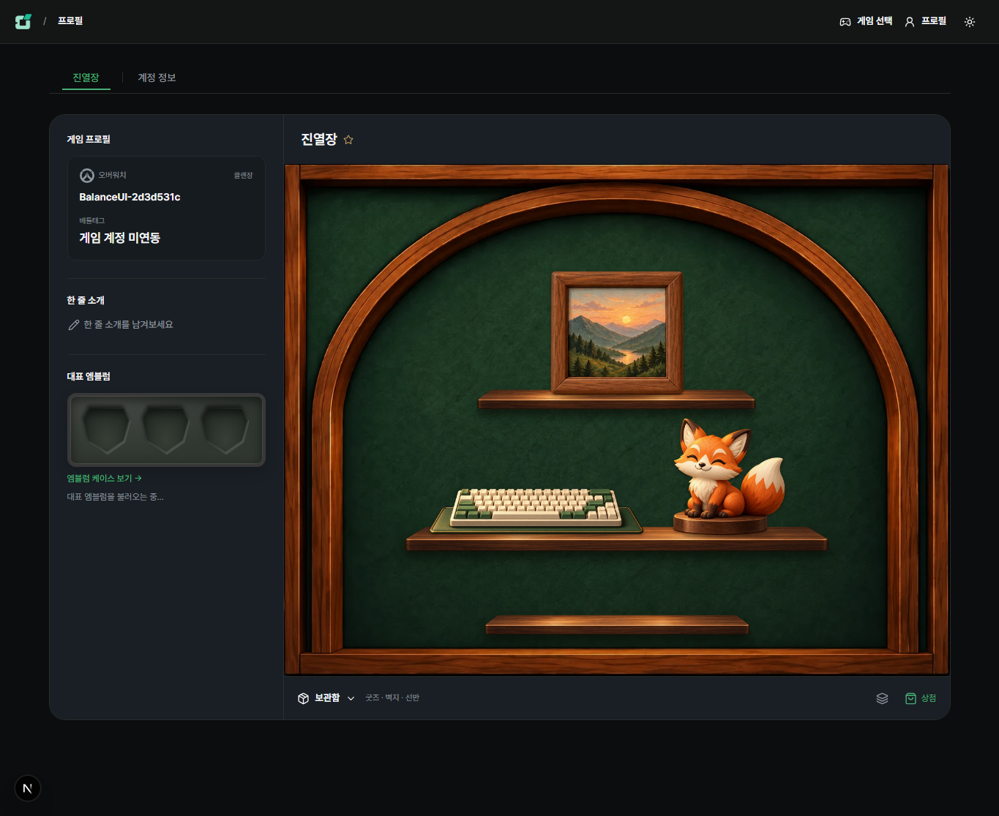
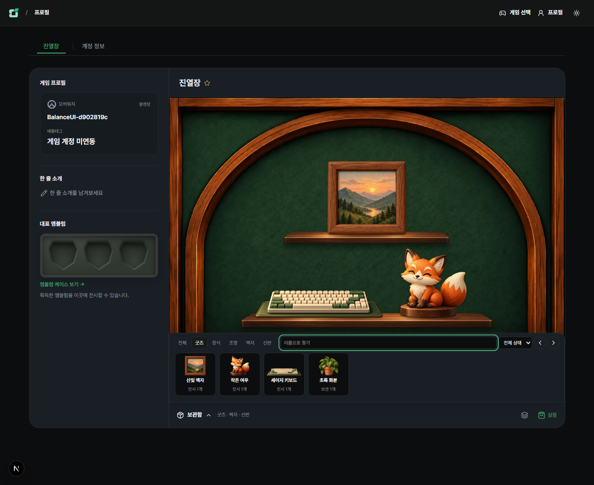
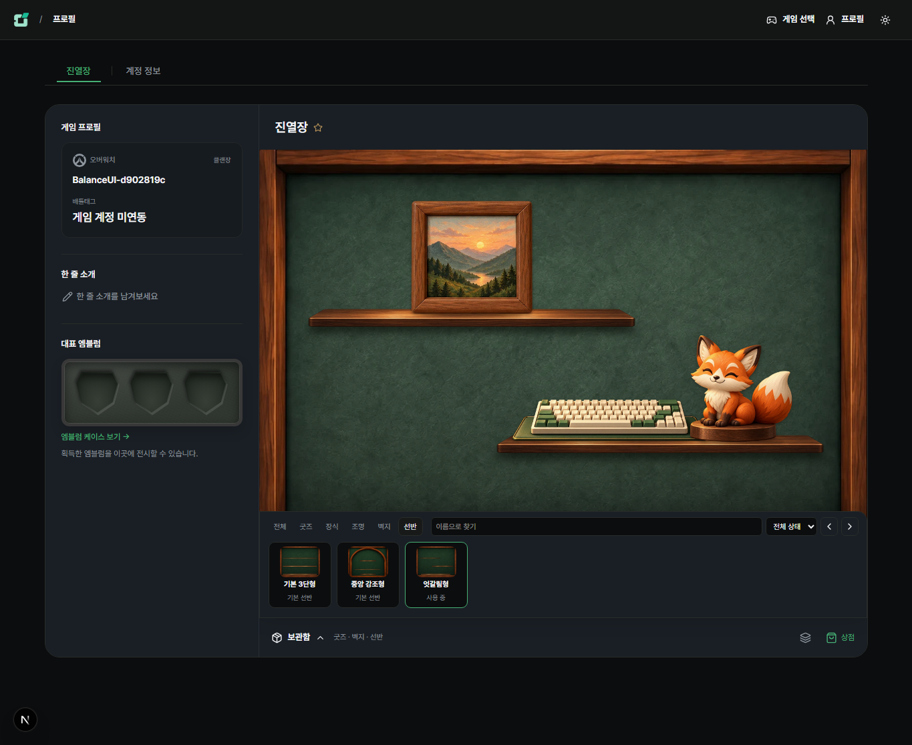
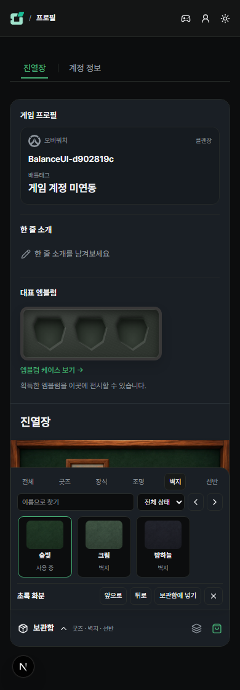
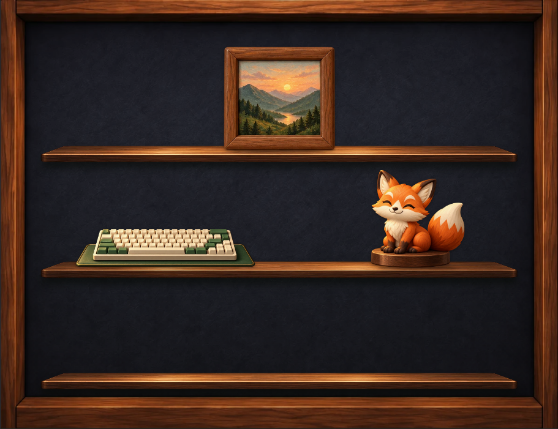
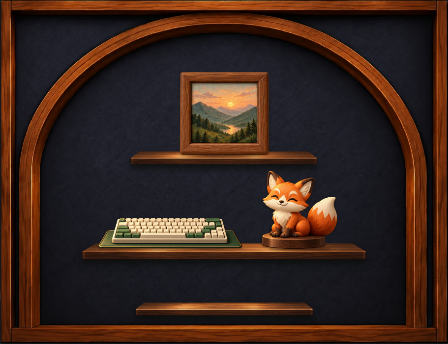

# 진열장 호버 보관함·자동 저장

2026-10-25 · 이전 [드로워 결정](drawer-and-shelves.md)의 수동 저장·설정 패널을 대체한다.

## 동작

- 진열장 제목만 표시한다. 상시 하단 설정/배치 목록/저장·취소 버튼을 제거했다.
- 손잡이는 장면 바로 아래에 있다. 보관함 본문은 장면 위로 겹쳐 열려 문서 높이를 바꾸지 않는다. 마우스를 벗어나면 즉시 닫힌다. 터치 탭과 키보드 포커스도 지원한다.
- 굿즈를 끌고 보관함에 진입하면 열리고 놓으면 회수한다. 보관함에서 꺼내는 동안 본문을 닫아 장면의 드롭 위치를 가리지 않는다. 화면 밖 드롭/Escape/포인터 취소는 저장하지 않는다.
- 전체·굿즈·장식·조명·벽지·선반, 이름 검색, 전체/보관 중/전시 중을 제공한다. 벽지 3종과 기본 선반 2종/상점에서 보유한 선반을 선택한다.
- 선택 굿즈의 앞뒤 순서·명패 문구·반환도 보관함 안에서 조절한다. 여러 구성 생성/복사/대표 지정/삭제는 관리 창에 둔다.
- 좌측 소개·제목·손잡이·열린 보관함은 공통 패널 배경을 쓴다. 내부 카드의 왼쪽 라운드와 중복 테두리를 제거하고 전체 프로필의 외곽 라운드만 유지한다.

## 저장

포인터를 놓아 배치/반환이 확정되거나 벽지/선반 선택이 바뀌면 즉시 저장 요청한다. 드래그 미리보기·선택·필터는 저장하지 않는다. 저장 요청은 직렬 처리하고 응답 후 최신 변경을 이어 저장한다. 실패 시 초안과 서버 버전을 보존하며 재시도할 때 최신 초안을 보낸다. 링크 이동은 진행 중 저장을 기다리고 미저장 상태의 페이지 이탈을 보호한다.

보유 수량·구성·대표 데이터와 기존 서버 검증은 유지한다. 1개 보유는 모든 구성 합계 1개 배치다. 상점은 QA 무료 체험 상태이며 DB 스키마·가격·운영 배포는 변경하지 않았다.

## 검증

- 자동 저장 단위: 즉시 저장·연속 변경·되돌림·실패 후 최신 초안 재시도·충돌 버전 보존.
- 집중 화면: 상단/하단 이음매 색상·라운드, 열림 전후 문서 높이, 위로 열림, 필터, 양방향 드래그, 놓기 전 미저장, 취소, 스타일 재조회, 장식/명패/조명, 네트워크 실패 복구, 여러 구성/대표/수량, 터치, 좁은 폭, 방문자, 저장 충돌/계정 변경.
- 관련 회귀: 계정 네임카드·프로필 구성·상점 왕복. 관련 E2E 3개 통과. 집중 E2E 1개, 자동 저장 단위 3개, 변경 파일 ESLint·타입 검사 통과. QA 임시 계정만 사용하고 시드를 실행하지 않았다.

## 밀도·벽지 색상 보정

- 보관함 본문은 데스크톱에서 약 258px → 159px로 줄였다. 필터·검색·배치 상태를 한 줄에 놓고 좁은 영역에서만 두 줄로 배치한다. 상품 이미지는 64px → 46px이며 선택 굿즈 조절을 포함해도 최대 260px 안에서 스크롤한다.
- 기존 벽지 필터가 목재를 포함한 합성 뒤판 전체에 적용되어 밤하늘 벽지에서 프레임까지 녹색으로 바뀌던 오류를 수정했다. 원본 목재 위에 녹색 벽면만 분리한 색상 레이어를 적용한다. 중앙 강조형의 아치 안팎 벽면도 동일하다.
- 기존 두 원본의 녹색 벽/갈색 목재 차이를 SVG 마스크로 구분한다. 원본 이미지·새 다운로드·상품/배치 데이터는 변경하지 않는다. 다른 원본 재질을 추가할 때는 해당 마스크와 목재 색 보존 검증을 함께 확인한다.
- 기본형·중앙 강조형에서 크림/밤하늘 변경 전후 목재 프레임·아치·선반의 실제 화면 픽셀이 같고 벽면 픽셀만 바뀌는지 검증한다. 보관함 높이·터치/드래그·자동 저장·필터·방문자 집중 회귀도 포함한다.

## 실제 화면

