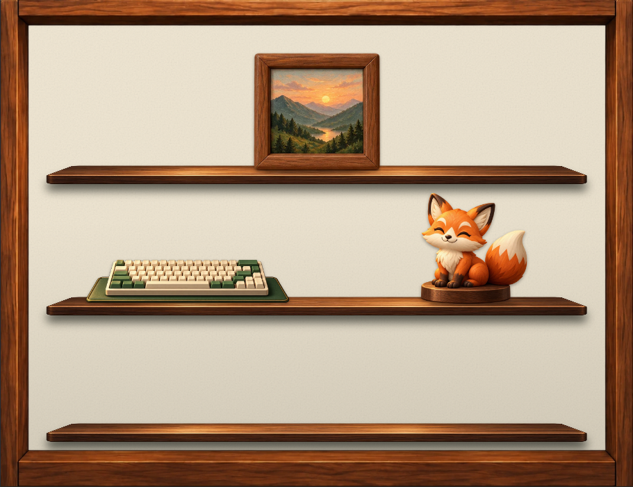
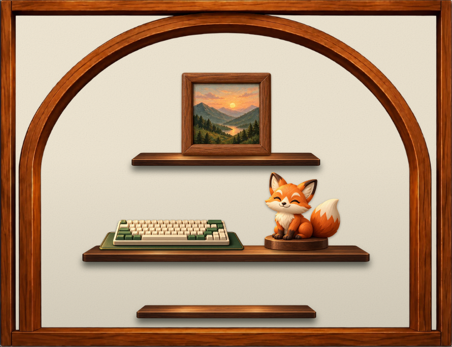

# 벽지와 투명 프레임 레이어 분리

2026-10-25. 이전 [색상 추출/경계 보정](hover-inventory.md)의 렌더링 결정을 대체한다.

## 원인과 변경

이전 화면은 벽면과 프레임이 합쳐진 이미지 위에 녹색 벽면을 추출한 마스크와 색상 필터를 덧그렸다. 원본의 어두운 벽면/접촉 그림자는 벽으로 추출되지 않거나 밝은 벽지와 섞이며 검은 테두리·얼룩을 만들었다. 밝기/흐림 보정으로는 원본에 붙은 그림자를 제거할 수 없었다.

벽지를 먼저 그리고 실제 투명 프레임을 그 위에 얹는다. 선반과 굿즈는 그 위에 기존 좌표/순서로 배치한다. 색상 추출·벽면 재착색 SVG 필터와 합성 뒤판 사용을 화면/미리보기에서 제거했다. 벽지는 공통 미세 질감과 숲빛/크림/밤하늘 색상만 공유한다. 원본 프레임 그림자가 벽지에 남지 않는다. 조명·배치·보유 수량·저장 데이터는 기존 규칙이다.

## 소재

내장 imagegen 도구의 투명 배경 편집 모드를 사용했다. 기존 두 합성 원본에서 목재만 분리했으며 생성 원본은 보존했다. 생성 alpha를 유지하며 1200×923 WebP로 인코딩했다.

- [기본형 투명 프레임](../../../public/images/showcase/cabinet-frame-classic-v1.webp) — 58,148 bytes.
- [중앙 강조형 투명 프레임](../../../public/images/showcase/cabinet-frame-focus-v1.webp) — 130,224 bytes.
- [공통 벽지 질감](../../../public/images/showcase/wallpaper-grain.svg) — 캐시되는 256px SVG 타일. 목재/검은 그림자는 포함하지 않는다.
- 렌더링: [독립 레이어](../../../src/components/profile/showcase-wallpaper.tsx). PNG 원본은 Codex generated_images에 남기며 프로젝트는 위 WebP만 사용한다.

## 제작 프롬프트

기본형은 대괄호의 첫 표현, 중앙 강조형은 두 번째 표현으로 각 1회 내장 도구를 호출했다. 두 입력은 cabinet-unlit-v3.webp와 cabinet-focus-bare-v4.webp다. transparent_background=true.

> Use case: background-extraction. Edit target: the supplied game cabinet art. Extract ONLY the [rectangular perimeter wooden frame / rectangular perimeter wooden frame AND the large wooden arch inside it] as a production transparent PNG overlay. Remove ALL green plaster/backboard wall surfaces, including the corner wall areas outside the arch if present, and remove ALL dark black cast shadows or dirty halos that were painted ON the wall. Those entire wall areas must be truly fully transparent, alpha zero, directly up to the clean wooden silhouette. Preserve the exact original warm walnut wood color, grain, beveled surfaces, front elevation, outer silhouette, arch geometry and full original composition. Keep the entire rectangular frame edge-to-edge at the original aspect ratio 1200:923, no added margins or zoom, same exact registration. Preserve darker wood side faces that belong to the timber itself, but NO black outlines or shadows spilling into empty openings. Clean antialiased cutout edges. No objects, no shelves, no wall, no floor, no background, no text. This will be layered above a separately rendered light cream wall, so any black or green halo is unacceptable.

## 검증

집중 E2E에서 필터 없는 독립 벽지/프레임의 순서, 벽지 변경 전후 목재 색, 크림 프레임 주변 벽면의 밝기, 필터/양방향 드래그/저장/실패 복구/모바일/방문 화면을 확인한다. 목재 컷아웃의 거의 불투명한 alpha와 선반 하이라이트에 따른 3/255 이내 합성 차이를 허용한다. 실제 크림 화면을 원본 검은 경계와 육안 비교한다.

최종 결과: 집중 E2E 1개·변경 소스 ESLint·타입 검사 통과. 별도 임시 QA 계정만 사용하고 기존 QA 명단/구매품/배치는 보존했다. 터치에서 pointerup 뒤 합성 click이 다시 토글하던 처리도 중복 실행되지 않게 했다.
