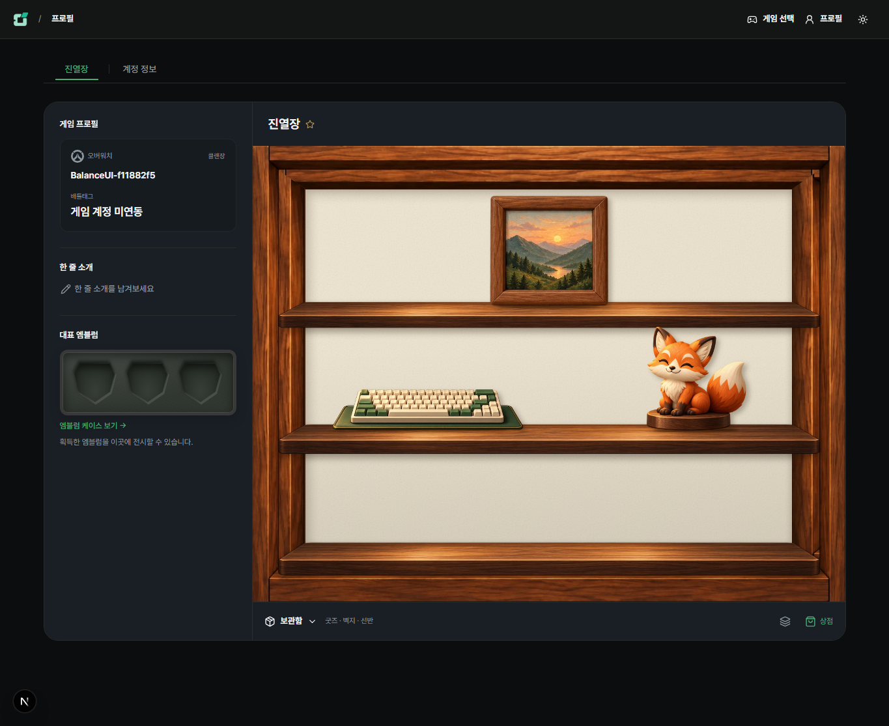
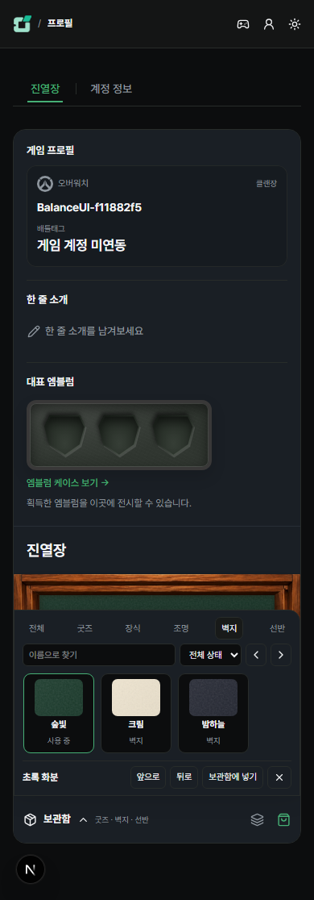

# 원목 수집장 깊이·그림자

2026-10-26. 사용자가 고른 깊이 있는 원목 수집장 시안을 QA 화면에 적용했다.

## 표현과 기존 기능

- 뒤판 앞에 좌우 목재 측판·천장·바닥을 별도로 합성한다. 기존 프레임의 목재 이미지를 재사용하며 새 비트맵이나 렌더링 라이브러리를 추가하지 않는다.
- 뒤판에는 모서리 음영을, 선반에는 깊이 있는 상판과 아래쪽 투영 그림자를 표시한다. 기본 3단형은 측판까지 이어진다. 중앙 강조형의 아치와 엇갈림형·계단형의 구도는 유지한다.
- 굿즈 밑면 접촉 그림자와 오른쪽 아래 방향의 부드러운 투영 그림자를 분리했다. 드래그 중에는 그림자를 넓히고 그림을 조금 들어 올리되 조작 좌표는 이동하지 않는다.
- 벽지·목재·선반·굿즈는 계속 독립적으로 바뀐다. 기존 배치 좌표·선반 번호·겹침 순서·보유 수량·저장 문서를 변경하지 않는다. 깊이 면은 포인터 입력을 막지 않는다.
- 보관함과 상점의 선반 견본도 같은 뒤판/선반 컴포넌트를 사용한다. 정적인 2D 합성이며 실시간 광원·물리 계산은 포함하지 않는다.

구현: [뒤판·목재](../../../src/components/profile/showcase-wallpaper.tsx), [공유 선반](../../../src/components/profile/showcase-shelf.tsx), [장면](../../../src/components/profile/showcase-scene.tsx), [스타일](../../../src/components/profile/showcase.module.css).

## 실제 QA 화면

아래는 자동 검증용 임시 계정의 실제 화면이다. 기존 QA 사용자의 구성은 변경하지 않았다.

## 검증

- `E2E_SKIP_SEED=1`, 별도 3017 서버에서 `e2e/profile-showcase.spec.ts` 1개 통과. 테스트가 만든 임시 사용자·클랜만 정리했다.
- 네 선반의 마우스 드래그·놓기·키보드 좌우 이동·실제 상판 안의 굿즈 밑면 위치와 저장 결과를 확인했다. 두 기본형의 벽지 교체 전후 목재 색을 픽셀로 비교하고 크림 뒤판의 밝기도 확인했다.
- 호버 보관함·검색/분류·드래그 취소/회수·자동 저장 실패/재시도·충돌/계정 보호·터치 배치·공개 방문과 802/390/320px 가로 넘침 검사를 함께 통과했다.
- 변경 TSX/E2E ESLint와 `npx tsc --noEmit` 통과. 스타일 중심의 변경으로 전체 빌드·DB 회귀는 실행하지 않았다. 운영 DB·수동 배포는 보류한다.
