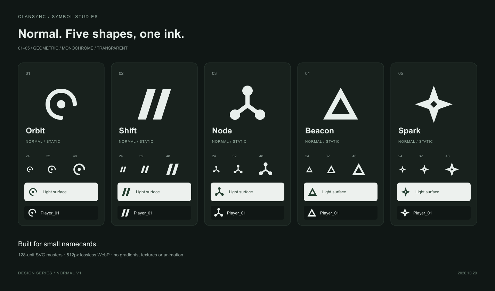

# 노말 심벌 · 1차 5종

2026-10-29. 전체 10종 제작의 첫 묶음이다. 이번 묶음은 모두 노말이며 [등급 기준과 원본 목록](manifest.json)을 함께 관리한다.

| 번호 | 이름 | 조형 |
| --- | --- | --- |
| 01 | 오비트 | 열린 링 + 중심 원 |
| 02 | 시프트 | 두 개의 평행 사변형 |
| 03 | 노드 | 세 원 + Y형 연결 |
| 04 | 비콘 | 삼각형 + 삼각형 음각 |
| 05 | 스파크 | 네 방향 마름모 + 중앙 음각 |

## 제작 규격

- 투명 배경, 128×128 viewBox, 단일 잉크 `#E8EFEC`. 광택·그라데이션·질감·입체·애니메이션 없이 실루엣으로 구분한다.
- [SVG 원본](../../../../public/symbols/normal-v1)은 확대하거나 CSS 알파 마스크로 사용한다. 색 변경은 단색 전체에 적용한다. 밝은 배경에서는 어두운 잉크를 사용한다.
- 같은 위치의 WebP는 투명 512×512 무손실 출력이다. 색상별 원본을 복제하지 않는다.
- [비교표](contact-sheet.png)는 큰 형태, 24/32/48px, 밝고 어두운 배경, 32px 네임카드 적용 예를 포함한다.
- 상점 상품·가격·구매·장착 연결은 아직 등록하지 않은 제작 원본이다. 기존 방패와 보유·장착 데이터는 유지한다.

## 등급

| 등급 | 기준 |
| --- | --- |
| 노말 | 간단한 도형을 조합한 단색 디자인 |
| 레어 | 장식과 세부 디자인을 더한 심벌 |
| 유니크 | 테마 네임카드에 들어가는 이미지 디자인 |
| 레전드 | 테마 네임카드에 들어가는 애니메이션 디자인 |

## 재생성·검증

`node scripts/build-normal-symbol-assets.mjs`

SVG의 단일 색상·외부 참조/애니메이션 부재, 512px 투명 WebP, 24/32/48px에서 도형이 캔버스를 벗어나지 않는지 검사하고 비교표를 다시 만든다.

